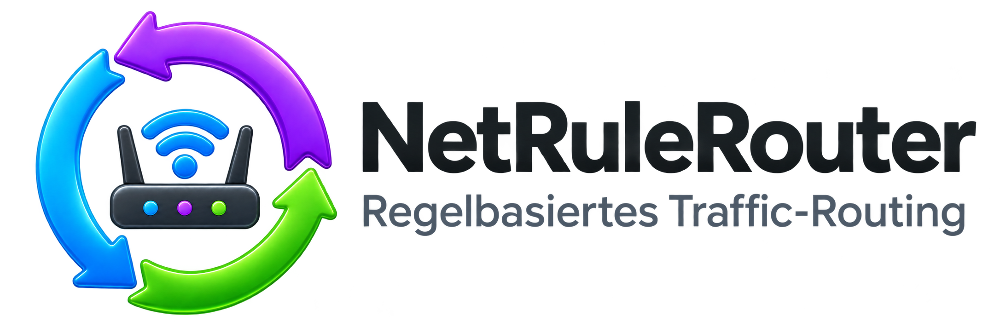
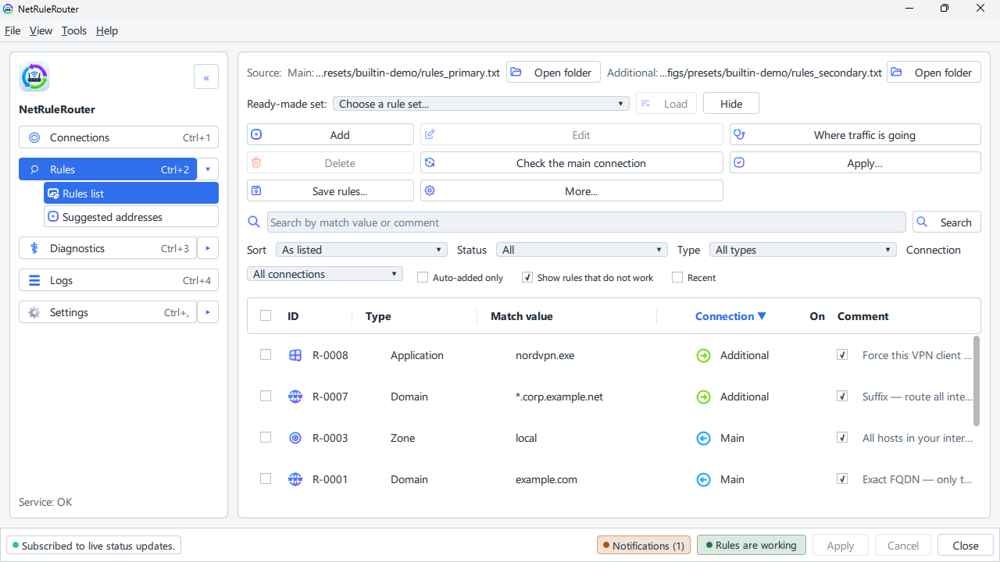

<div align="center">

<picture>
  <source media="(prefers-color-scheme: dark)" srcset="assets/brand/logo-lockup-de.png" />
  
</picture>

**Leite jede Website, Adresse, jedes Subnetz, jeden Bereich und jedes Programm über die gewünschte Verbindung, sperre unerwünschten Datenverkehr und halte ihn zurück, wenn das VPN ausfällt, statt ihn ungeschützt weiterzuleiten.**

Ein Desktop-Manager für Netzwerkregeln, der deinen Datenverkehr über bereits vorhandene Schnittstellen leitet: primärer Internetzugang, VPN, ein zweiter Anbieter, WLAN oder Ethernet. Kein eigener Tunnel, keine Cloud, kein Konto.

Windows- und Linux-Versionen sind verfügbar; macOS folgt.

[](#lizenz)
[](https://github.com/kroxiksut/net-rule-router/actions/workflows/windows-quality.yml)
[](https://github.com/kroxiksut/net-rule-router/actions/workflows/linux-quality.yml)


[](#schnellstart)
[](#terminaloberfläche)
[](#administrative-konsole)
[](https://t.me/netrulerouter)


[English](README.md) · [Русский](README_RU.md) · [简体中文](README.zh-CN.md) · [Español](README.es.md) · **Deutsch** · [Änderungsprotokoll](CHANGELOG.md)

> Diese Übersetzung wurde mit Unterstützung von KI erstellt; Ungenauigkeiten sind möglich. Rückmeldungen und Beiträge von deutschsprachigen Muttersprachlern sind willkommen. Die Übersetzung der App-Oberfläche in diese Sprachen ist vor der Veröffentlichung von Version 0.1.1 geplant; ein Termin steht noch nicht fest.



</div>

---

## Was ist NetRuleRouter?

Mit NetRuleRouter kannst du festlegen: *„Leite `*.bank.com` und diese eine App über meinen primären Internetzugang und alles andere über das VPN“* — und diese Richtlinie wird lokal, nachvollziehbar und mit einem klaren Prüfprotokoll jeder Entscheidung durchgesetzt.

Typische Konfigurationen:

- **Primärer Internetzugang + VPN** — Dienste mit hoher Latenzempfindlichkeit oder regionalen Beschränkungen direkt verbinden und den übrigen Verkehr über das VPN leiten.
- **Anbieter A + Anbieter B** — den Datenverkehr auf zwei Internetzugänge aufteilen.
- **WLAN + Ethernet / WLAN + VPN** — bestimmte Ziele an eine bestimmte Schnittstelle binden.
- **Jeder von Windows erkannte Adapter** kann als zusätzliche Route dienen — darunter USB-Netzwerkgeräte (RNDIS-/ECM-Boards, Smartphone-Tethering), Bluetooth PAN oder ein für Entwicklung und Tests reservierter Adapter einer virtuellen Maschine.

## Was NetRuleRouter *nicht* ist

NetRuleRouter ist **kein** VPN-Client, Anonymisierungstool, Werkzeug zur Umgehung von Zensur, Proxy-Manager oder Cloud-Dienst. Es verwaltet das Routing über Verbindungen, die du selbst eingerichtet hast — es erstellt oder verbirgt sie nicht.

## Schnellstart

1. **Herunterladen und starten.** Lade den Installer (`…-setup.exe` oder `.msi`) oder das portable Archiv `…-portable.zip` unter [Releases](https://github.com/kroxiksut/net-rule-router/releases) herunter. Führe den Installer aus oder entpacke das Archiv an einem beliebigen Ort — auf dem Desktop, im Stammverzeichnis eines Laufwerks oder auf einem USB-Stick — und starte `NetRuleRouter.exe`; akzeptiere die Lizenzvereinbarung. Zum Selbstkompilieren siehe [Aus dem Quellcode erstellen](#aus-dem-quellcode-erstellen).
2. **Hintergrunddienst installieren.** Im Begrüßungsfenster wird *„Dienst installieren und starten“* angeboten — bestätige die UAC-Abfrage. Ohne Dienst läuft die App im Vorschaumodus: Regeln lassen sich bearbeiten, werden aber nicht angewendet.
3. **Regelsatz auswählen.** Der Ersteinrichtungsassistent bietet einen Regelsatz für deine Region, einen Beispielsatz, zwei eigene `.txt`-Dateien oder einen leeren Start.
4. **Beide Routen zuweisen.** Lege auf dem Bildschirm *Verbindungen* fest, welcher Adapter die Hauptverbindung und welcher die zusätzliche Verbindung ist (dein VPN, ein zweiter Anbieter oder ein zweites WLAN), und über welche Verbindung Datenverkehr ohne passende Regel läuft.
5. **Den Satz als eigenen Regelsatz speichern** — unter *Einstellungen → Regel- und Einstellungsdateien → Meine Regelsätze*: Wähle einen eigenen Ordner und dann *„Aktuelle Regeln als Satz speichern“*. Regelsätze im Anwendungsordner werden beim nächsten Update ersetzt; ein Satz in deinem eigenen Ordner bleibt erhalten.
6. **Eigene Websites hinzufügen** (siehe Hinweis unten) und **Anwenden** drücken — Regeln gelten erst nach dem Anwenden.

> **Einmaliger Schritt nach der Installation.** Der Dienst leitet genau den Datenverkehr weiter, den die Regeln festlegen, und sonst nichts. Websites, die zuvor über dein VPN erreichbar waren, werden weiterhin über die Hauptverbindung geleitet, bis sie in den Regeln für die zusätzliche Route stehen — ein Preset kennt deine persönliche Liste nicht. Gehe die gewünschten Websites durch und füge sie selbst hinzu: im App-Bereich **Regeln** oder direkt in `rules_secondary.txt` im Ordner deines Regelsatzes. Drücke anschließend **Anwenden**. Das ist einmalig nötig — danach bleibt die Liste Teil deines Regelsatzes.

**Wie kann ich …?** Kurze Antworten gibt es zuerst unter [Fragen und Antworten](docs/en/questions.md).

- [Eine Website über das VPN öffnen](docs/en/adding-rules.md)
- [Eine Regel ändern, deaktivieren oder löschen](docs/en/changing-rules.md)
- [Meine Regeln speichern, einen fertigen Satz für mein Land laden oder meine Regeln auf einen anderen Computer übertragen](docs/en/rule-sets.md)
- [Haupt- und Zusatzverbindung auswählen oder tauschen oder mein VPN wechseln](docs/en/connections.md)
- [Mit „vorgeschlagenen Adressen“ umgehen](docs/en/suggested-addresses.md)
- [Herausfinden, warum eine Website nicht oder nur langsam geöffnet wird](docs/en/site-does-not-open.md)
- [Schutz ein- oder ausschalten oder Regeln vorübergehend deaktivieren](docs/en/pause-and-protection.md)
- [Neu anfangen oder das Programm entfernen](docs/en/start-over-or-remove.md)

Die vollständige Anleitung einschließlich der Wiederherstellung des Netzwerkzugangs findest du in [`docs/en/quickstart.md`](docs/en/quickstart.md). Fragen bei der Einrichtung? Siehe [Hilfe und Community](#hilfe-und-community).

## Unterstützte Systeme

| Plattform | Architektur | Bereitgestellt als | Fenster und Infobereich | Terminaloberfläche | Status in dieser Alpha-Version |
|---|---|---|---|---|---|
| Windows 10, 11 | x64 | portables ZIP, EXE-Installer, MSI | ja | ja | unter Windows 10 und Windows 11 getestet |
| Windows 11 auf ARM | ARM64 | portables ZIP, EXE-Installer, MSI | ja | ja | erstellt, noch nicht getestet |
| Linux, `.deb`: Ubuntu 22.04+, Debian 11+ und Derivate (Linux Mint, Astra Linux 1.7+) | x86_64, ARM64 | `.deb` | mit Qt 6.6+: Ubuntu 24.10+, Debian 13, Astra Linux 1.8 | ja | unter Ubuntu 26.04 LTS getestet; unter Astra Linux 1.7 und 1.8 ohne Fenster; die übrigen Systeme sollten funktionieren |
| Linux, `.rpm`: Fedora, RHEL / AlmaLinux / Rocky Linux 8+ und verwandte Systeme (z. B. RED OS 7.3+) | x86_64, ARM64 | `.rpm` | mit Qt 6.6+: Fedora, RHEL-10-Familie, RED OS 8, sofern dessen Qt-Version ausreicht | ja | auf einem RHEL-System (RED OS 8) ohne Fenster getestet; Fedora und RHEL sollten funktionieren |
| Sonstiges Linux mit systemd, nftables und glibc 2.28+ (openSUSE, ALT und weitere) | x86_64, ARM64 | `.tar.gz` | mit Qt 6.6+ | ja | sollte funktionieren, noch nicht getestet |
| 32-Bit-Windows | x86 | — | — | — | nicht unterstützt |
| macOS | — | — | — | — | noch nicht unterstützt, nach Linux geplant |

- **Getestet** bedeutet, dass die App auf diesem System installiert, mit echten Regeln verwendet und wieder entfernt wurde. **Sollte funktionieren** bedeutet, dass das System die Anforderungen erfüllt, aber noch nicht auf einem realen Gerät geprüft wurde. Die ARM64-Versionen wurden noch nicht auf echter Hardware ausgeführt.
- Unter Linux benötigen der Dienst, `nrr-cli` und `nrr-tui` systemd, nftables 0.9.6 oder neuer und glibc 2.28 oder neuer. Das Fenster benötigt das systemeigene Qt 6.6 oder neuer; mit einer älteren Qt-Version funktioniert alles andere ohne Fenster.
- Wenn das Fenster nicht läuft, bietet die Terminaloberfläche dieselben Funktionen im Terminal.
- Zusätzlich zu den genannten Prüfungen wird die automatisierte Testsuite bei jeder Änderung auf den GitHub-Runnern mit Windows Server 2025 und Ubuntu ausgeführt.

Details zu jeder Version, einschließlich Systemen, die nur anhand ihrer eigenen Dokumentation geprüft wurden: [`docs/en/supported-systems.md`](docs/en/supported-systems.md).

## Downloads überprüfen

Die Installer und Archive sind noch nicht signiert, daher zeigt Windows beim ersten Start möglicherweise eine Warnung an. GitHub speichert für jede Datei einer Veröffentlichung einen Nachweis des Builds und des zugehörigen Commits. Damit kannst du bestätigen, dass die heruntergeladene Datei genau dem Build dieses Repositorys entspricht, ohne der Downloadseite vertrauen zu müssen:

```sh
gh attestation verify <file> --repo kroxiksut/net-rule-router
```

Dafür benötigst du die GitHub CLI (`gh`) und musst mit `gh auth login` angemeldet sein. Eine nach dem Build geänderte oder anderswo erstellte Datei besteht die Prüfung nicht. Für eine schnelle Prüfsummenprüfung liegt `SHA256SUMS` bei den Dateien: `sha256sum -c SHA256SUMS` (in PowerShell mit `Get-FileHash <file>` vergleichen).

## Funktionen

- **Zwei-Routen-Modell** — eine `primary`- und eine zusätzliche Route, jeweils eine aktive Konfiguration.
- **Sieben Möglichkeiten, Datenverkehr zuzuordnen** — über eine exakte Domain, eine Domain samt allen Subdomains, eine Website in jeder Domainzone (`bank.*`), eine exakte IPv4- oder IPv6-Adresse, ein Subnetz oder einen Adressbereich, eine Domainzone (eine TLD oder ein interner Suffix wie `.ru` oder `.intra`) oder eine Anwendung (Programmname, Datei oder Installationsordner; unter Windows und Linux umfasst eine Ordnerregel auch Programme, die ein späteres Update dort ablegt, sowie darin gespeicherte Skripte).
- **Datenverkehrsstatistiken** — Datenmenge je Verbindung für heute, die aktuelle Sitzung der Zusatzverbindung und alle gespeicherten Tage (deren Anzahl du festlegst), mit CSV-Export für jeden Zeitraum.
- **Routing nach Domainnamen** *(Windows, bei einer Neuinstallation standardmäßig aktiviert: Einstellungen → Routingverhalten, unabhängig vom Leckschutz)* — Websites mit derselben Serveradresse folgen weiterhin ihrer eigenen Regel. Große Plattformen und CDNs verwenden Hunderte Namen auf wenigen Adressen; Routing nach Adresse kann sie nicht unterscheiden. Siehe [`docs/en/routing-modes.md`](docs/en/routing-modes.md).
- **Leckschutz** — eine Auswahl: **Aus**, **Weitergeleitete Websites** (Standard: Ist das VPN ausgeschaltet, fällt es aus oder startet später als der Computer, warten die dafür vorgesehenen Websites, statt direkt hinauszugehen. Datenverkehr zur Zusatzverbindung wird bei aktivierter strikter Sperrung gemeinsamer Adressen — standardmäßig aktiv — niemals über die Hauptverbindung geleitet. Alles andere funktioniert weiter, außer Websites, die eine Adresse mit einer weitergeleiteten Website teilen.) oder **Alles** (nichts verlässt den Computer außer über die Zusatzverbindung, das lokale Netzwerk und dem, was deine Regeln über die Hauptverbindung senden; fällt die Zusatzverbindung aus, wartet das Internet bis zu ihrer Wiederherstellung). Ein zusätzliches Unternehmens-VPN behält in jedem Modus Zugriff auf seine eigenen Netzwerke.
- **Sperren** — eine gesperrte Website, Adresse, ein Subnetz oder Programm wird über keine Verbindung zugelassen: Setze `!` davor in einer Regeldatei oder wähle beim Hinzufügen einer Regel im Fenster, Infobereich oder Terminal **Sperren**. Eine Sperre nach Adresse oder Subnetz hängt nicht von Namen ab; es gibt keine Sperrlisten, nur die Regeln, die du selbst schreibst.
- **Geschützte Systemprogramme** — eine Sperrregel oder Regel für die Zusatzroute darf nicht blockieren, was der Computer für den Netzwerkzugang benötigt (Systemordner, `svchost.exe`, Netzwerkdienste oder einen Ordner, den viele Programme gemeinsam nutzen). Die App lehnt eine solche Regel ab, bevor sie gespeichert wird. Wenn du sie dennoch setzen möchtest, fordert `+override` in der Regeldatei eine Bestätigung für einen von dir gewählten Zeitraum an; greift die Regel auf Programme außerhalb deines eigenen Bereichs zu, ist eine Administratorfreigabe nötig. Siehe [`docs/en/rules-file-format.md`](docs/en/rules-file-format.md#116-applying-a-rule-despite-the-protection-override).
- **Viele Regeln auf einmal und letzte Änderungen** — füge eine Liste von Websites, Adressen und Programmen als Zeilen einer Regeldatei ein; jede Zeile wird vor dem Hinzufügen geprüft. Der Filter *Zuletzt geändert* zeigt, was du in der letzten Stunde, heute oder in den letzten sieben Tagen hinzugefügt, geändert oder gelöscht hast, und stellt eine gelöschte Regel mit einem Klick wieder her. Das funktioniert im Fenster und in der Terminaloberfläche.
- **Verbindungsverlauf** — welche deiner Programme wohin und über welche Route verbunden waren. Der Verlauf bleibt standardmäßig sieben Tage lokal gespeichert, lässt sich nach Programm oder Ordner gruppieren. Nur du kannst deinen Verlauf lesen; er kommt nie in ein Diagnosearchiv. In den Einstellungen kannst du ihn löschen oder deaktivieren.
- **Website prüfen** — öffnet eine Website nicht, zeigt eine Prüfung, ob das Netzwerk oder die Website die Ursache ist: welche Route die Website, ihre Anmeldung und die dabei erkannten Namen nehmen, ob sie dort erreichbar sind und was du als Nächstes tun kannst. Starte die Prüfung unter Diagnose, über eine Zeile im Verbindungsverlauf, einen Vorschlag oder direkt über die Meldung — im Fenster und in der Terminaloberfläche.
- **Meldungen mit Hinweisen zur Ursache** — Infobereich und Terminaloberfläche informieren dich, wenn eine Website über die Hauptverbindung nicht geöffnet wird (unter Windows auch bei geschlossenem Infobereich), wenn die Haupt- oder Zusatzverbindung wiederholt ausfällt oder wenn der Dienst unerwartet stoppt (dies wird auch im Fenster angezeigt). **Dienst starten** und **Netzwerk wiederherstellen** sind direkt erreichbar. Jede Meldungsart lässt sich für einen Tag, sieben Tage, 30 Tage oder dauerhaft ausblenden; ausgeblendete Meldungen bleiben überall ausgeblendet.
- **Regeln vorübergehend ausschalten** — deaktiviere Routing und Leckschutz für 15 Minuten, eine Stunde, vier Stunden, bis zum nächsten Neustart oder bis zur erneuten Aktivierung (*Regeln ausschalten …* im Infobereich oder in den Einstellungen). Sie werden automatisch wieder aktiviert; die Regeln anderer angemeldeter Personen bleiben erhalten.
- **WSL, Container und virtuelle Maschinen** — du legst fest, ob deren Programme denselben Leckschutz wie der Computer erhalten oder ungeschützt bleiben, wenn die Zusatzroute ausfällt. Noch nicht in einer laufenden Umgebung überprüft.
- **Vorgeschlagene Adressen** — eine weitergeleitete Website verwendet oft eigene Hilfsdomains. Die App sammelt diese, zeigt, welche deiner Websites sie benötigen, und schlägt vor, sie hinzuzufügen. Ohne deine Zustimmung wird nichts hinzugefügt; ignorierst du einen Vorschlag, bleibt die Adresse auf der Hauptroute.
- **Überschneidungen** — decken Regeln beider Routen dieselben Websites ab (etwa eine Domainzone auf einer Route und eine Website darin auf der anderen), gilt die engere Regel. Die App listet alle solchen Paare samt tatsächlich verwendeter Route auf. Bestätige jedes Paar oder leite diese Websites mit einem Klick über die andere Route. Derselbe Bildschirm weist auf angewendete Regeln hin, deren tatsächliche Wirkung von ihrem Wortlaut abweicht — zum Beispiel, wenn eine Adresssperre zusätzlich eine weitergeleitete Website blockiert.
- **Erklärmodus** — frage *„Warum wurde dieser Host so weitergeleitet?“* und erhalte den genauen Regelpfad. Ein lokaler SQLite-Cache unterstützt die Zuordnung von FQDN und IP.
- **Offene, textbasierte Presets** — lesbare Regelpakete, einschließlich fertiger länderspezifischer Aufteilungen, die du vergleichen, bearbeiten und teilen kannst.
- **An den Anbieter angepasste Regeln** — setze `?` vor eine Website oder Adresse (oder markiere beim Hinzufügen **Unsicher**), damit sie zunächst über die festgelegte Route läuft. Öffnet sie sich dort nicht, aber über die andere Route, leitet die App sie über diese um und bietet an, die Regel zu verschieben. Bis du zustimmst, gilt die Umleitung bis zum Neustart des Computers. Die enthaltenen Presets verwenden dies für Dienste, die manche Anbieter blockieren und andere nicht, damit ein Regelsatz bei verschiedenen Anbietern funktioniert.
- **Native Desktop-App** — eine Qt/QML-Oberfläche mit Infobereich zur täglichen Steuerung sowie ein Hintergrunddienst, der die Richtlinie beim Start anwendet. Das Menü und die Meldungen des Infobereichs werden vor der ersten Veröffentlichung noch ausgearbeitet; Inhalt und Aussehen können sich zwischen Builds ändern.
- **Barrierefreiheit als Grundlage** — Unterstützung für Bildschirmleseprogramme, Tastaturnavigation, skalierbare Schrift und ein eigener kontrastreicher Modus. Siehe [`docs/en/accessibility.md`](docs/en/accessibility.md).
- **Englisch und Russisch direkt enthalten**, weitere Community-Sprachen lassen sich ohne erneuten Build ergänzen.
- **Lokal und privat** — keine verpflichtende Anmeldung und keine Telemetrie. Die wenigen eigenen Anfragen der App (Auflösen der in deinen Regeln genannten Websites, Prüfen der Zusatzverbindung und ihrer ausgehenden Adresse sowie Testen der `?`-Regeln für geöffnete Websites) sind in [SECURITY.md](SECURITY.md) aufgeführt, einschließlich ihres Zwecks und der Möglichkeiten, sie zu deaktivieren.

## Wie Routingentscheidungen getroffen werden

Für jedes Ziel prüft die Engine die Regeln von der spezifischsten bis zur allgemeinsten und beendet die Suche beim ersten Treffer:

| Nr. | Regeltyp | Beispiel |
|---|---|---|
| 1 | Exakte Domain (FQDN) | `api.bank.com` |
| 2 | Subdomain / Suffix | `*.bank.com` |
| 3 | Website in jeder Domainzone | `bank.*` |
| 4 | Exakte IP-Adresse (IPv4 oder IPv6) | `203.0.113.7`, `2001:db8::7` |
| 5 | Subnetz (CIDR) oder IP-Bereich | `10.0.0.0/8`, `192.0.2.10-192.0.2.40` |
| 6 | Domainzone (TLD / interner Suffix) | `.ru`, `.com`, `.intra` |
| 7 | Anwendung (Programmname, Datei oder Ordner) | `chrome.exe` |
| 8 | Standardroute | Haupt- oder Zusatzverbindung, wie in den Einstellungen festgelegt |

Hinweise:

- Die engere Regel gewinnt: Der Name einer Website steht über ihrer Adresse, eine **exakte IP-Adresse** über jedem Netzwerk, das sie enthält, und ein Netzwerk über der Domainzone, in der es liegt. Bei zwei Namen gewinnt der längere, bei zwei Netzwerken das spezifischere.
- Eine Domainzone mit mehreren Labels (`corp.example.com`) bezeichnet die Subdomains einer Website. Sie steht auf derselben Stufe wie Subdomainregeln, gilt aber nicht für den bloßen Domainnamen selbst. Damit gewinnt sie gegen `*.example.com`, eine exakte IP-Adresse und ein Netzwerk.
- Eine **Website in jeder Domainzone** (`bank.*`) umfasst mit einer Regel `bank.com`, `bank.net`, `bank.co.uk` und ihre Subdomains. Eine Regel für eine benannte Zone (`bank.by`, `*.bank.by`) hat Vorrang, unabhängig davon, über welche Route die jeweilige Website geleitet wird.
- Eine **Sperre für eine exakte IP-Adresse** blockiert diese Adresse unabhängig davon, welche andere Regel sie nennt. Jede andere Sperre wird an ihrer Stelle in die obige Reihenfolge eingeordnet.
- Sind zwei Regeln desselben Typs gleich spezifisch, gewinnt eine Sperre gegen eine Route und die Hauptroute gegen die Zusatzroute.
- Eine Regel bezeichnet ein Ziel **oder** eine Anwendung. Eine Regel, die eine Adresse auf eine einzelne Anwendung beschränkt, lässt sich derzeit nicht durchsetzen. Der Dienst lehnt sie ab, statt sie auf alle Anwendungen anzuwenden.
- **CIDR-Subnetze und IP-Bereiche** können als Ziele verwendet werden: Leite mit einer einzigen Regel ein gesamtes Unternehmensnetz oder einen Adressblock über eine der Verbindungen. Ports und Protokolle werden nicht unterstützt.
- IPv6-Adressen können in Regeln verwendet werden. Sie laufen über die Zusatzverbindung, wenn diese IPv6 unterstützt. Ist das nicht der Fall, wird eine dorthin geleitete IPv6-Adresse bei aktivem Leckschutz zurückgehalten, statt über die Hauptverbindung zu entweichen; bei deaktiviertem Leckschutz läuft sie über die Hauptverbindung. IPv6 wurde noch nicht in einem echten IPv6-Netz getestet. Nach einer Regeländerung behalten bereits bestehende IPv6-Verbindungen ihre bisherige Route, bis das Programm die Verbindung erneut herstellt (bei IPv4 aktualisiert die App sie). Ein `?` vor einer IPv6-Adresse verschiebt die Regel niemals.
- Die Entscheidungs-Engine ist rein und deterministisch: Identische Eingaben erzeugen stets identische, vollständig nachvollziehbare Ergebnisse.

> Ein Ziel ohne passende Regel verwendet die Standardroute. Soll eine Website über die Zusatzverbindung laufen, muss sie also in deren Regeln stehen; siehe den einmaligen Schritt unter [Schnellstart](#schnellstart).
> **Drücke nach dem Hinzufügen oder Entfernen von Regeln immer auf Anwenden: Regeln gelten erst danach.**

Alle weiteren möglichen Konflikte — mehrere angemeldete Personen, Schutz und Pause, deine Regeldatei und die App — werden in [`docs/en/what-takes-priority.md`](docs/en/what-takes-priority.md) erklärt.

## Presets

Im Verzeichnis `presets/` findest du offene, textbasierte Regelsätze als Ausgangspunkt, darunter länderspezifische Aufteilungen in „Inland und Ausland“ für mehrere Regionen (`ru`, `cn`, `ir`, `tr`, `in`, `id`, `vn`, `kz` und weitere). Jeder Satz besteht aus zwei Textdateien (`rules_primary.txt` und `rules_secondary.txt`) mit Metadaten in Kommentarzeilen:

```text
# NetRuleRouter preset - version 1
# name: CN Mainland Split - Primary Route
# preset_version: 1

--- Zones
cn              # .cn

--- Domains
qq.com
*.qq.com
alibaba.com
*.alibaba.com
```

Mit `?` markierte Zeilen (zum Beispiel `?accounts.google.com`) verwenden die Route ihrer Datei. Blockiert dein Anbieter sie dort, während sie über die andere Route erreichbar sind, schlägt die App vor, sie zu verschieben. Das vollständige Format ist in [`docs/en/rules-file-format.md`](docs/en/rules-file-format.md) beschrieben.

> Die enthaltenen Länder-Presets sind mit KI erstellte Entwürfe als bequemer Ausgangspunkt, keine verbindliche Routingempfehlung. Prüfe sie und passe sie an, bevor du dich darauf verlässt.

## Aus dem Quellcode erstellen

> Die folgenden Befehle gelten für Windows. Für Linux gibt es zu jedem Skript ein `*.sh`-Gegenstück, beschrieben unter [Linux-Build](docs/en/building-linux.md); macOS folgt später.

**Voraussetzungen:** eine aktuelle Rust-Toolchain, eine Qt-6-Entwicklungsinstallation und CMake. `scripts/bootstrap.ps1` prüft die Umgebung und richtet deine `.env` ein.

```powershell
# 1. Voraussetzungen und .env vorbereiten
powershell -ExecutionPolicy Bypass -File .\scripts\bootstrap.ps1

# 2. Launcher und nativen Qt-Host erstellen
cargo build -p nrr-launcher -p nrr-qt-host

# 3. Ausführen
.\target\debug\NetRuleRouter.exe          # Hauptoberfläche
.\target\debug\NetRuleRouterTray.exe      # Infobereich

# …oder über das Hilfsskript
.\scripts\run.ps1 -Component gui
.\scripts\run.ps1 -Component tray
```

Der Hintergrunddienst (wendet die Richtlinie beim Systemstart an und setzt sie durch) wird mit `scripts/install-service.ps1` installiert und mit `scripts/uninstall-service.ps1` entfernt.

Wenn alles entfernt werden soll — Dienst, Einstellungen, Caches und Protokolle — löscht `scripts/purge-data.ps1` alle Speicherorte, an die das Produkt schreibt. Ohne `-Yes` zeigt das Skript nur an, was gelöscht würde. Das Sicherheitsprüfprotokoll bleibt erhalten, außer du gibst zusätzlich `-PurgeAudit` an:

```powershell
powershell -ExecutionPolicy Bypass -File .\scripts\purge-data.ps1
```

Qualitätsprüfung (fmt + clippy + Tests + Lizenz- und Abhängigkeitsprüfung):

```powershell
powershell -ExecutionPolicy Bypass -File .\scripts\check.ps1 -RequireCargoDeny
```

### Build für die Verteilung vorbereiten

`scripts/package-windows.ps1` erstellt aus dem Checkout einen Ordner, der auf einem sauberen Windows-System ohne Qt, Rust-Toolchain, Repository oder Installer läuft:

```powershell
powershell -ExecutionPolicy Bypass -File .\scripts\package-windows.ps1 -Zip
```

Das Paket landet in `C:\temp\NetRuleRouter\dist\NetRuleRouter`; `-Zip` legt daneben `NetRuleRouter-windows-x64-<version>-portable.zip` ab. Es enthält die GUI, den Infobereich, Dienst, Konsole, Terminaloberfläche, Qt-Laufzeitumgebung und den QML-/Locale-/Preset-/Konfigurationsbaum sowie eine `build-info.json` mit Version, Revision und Build-Zeit und kurze Hinweise `README.txt` / `README.ru.txt` für die entpackende Person. Parameter und Verzeichnisstruktur: [`docs/en/packaging-windows.md`](docs/en/packaging-windows.md).

## Konfiguration und Daten

- **Oberflächeneinstellungen** (Design, Sprache, Barrierefreiheit, Routenbezeichnungen, zuletzt geöffneter Bereich …) liegen in einem verwalteten lokalen Speicher und bleiben bei Updates erhalten.
- **Aktive Konfiguration** — jeweils eine pro Windows-Benutzer: Deine täglichen Regeländerungen gehören dir (ohne Administratorabfrage) und gelten nur für dich. Ein Administrator kann eine gemeinsame **Baseline** festlegen, auf die alle Benutzer zurückfallen, bis sie eigene Anpassungen vornehmen. *Auf Baseline zurücksetzen* verwirft deine Änderungen. Regeln liegen in den beiden einfachen Preset-Textdateien.
- **Caches und Zustand** — lokale SQLite-Datenbanken (`nrr_fqdn_ip_cache.db`, `nrr_service_state.db`), Prüf- und Betriebsprotokolle im NDJSON-Format. [`docs/en/cache-and-seeding.md`](docs/en/cache-and-seeding.md) beschreibt den Aufbau des FQDN/IP-Caches einschließlich der optionalen Übernahme aus dem Browserverlauf. Diese Datenbanken sind für die Verwaltung durch die App vorgesehen — Änderungen mit Drittanbieterwerkzeugen werden nicht unterstützt und erfolgen auf eigene Verantwortung. Siehe [`docs/en/where-files-live.md`](docs/en/where-files-live.md).
- Locale-Dateien werden zur Laufzeit eingelesen. Lege eine schema-konforme `de.json` im Benutzer-Locale-Verzeichnis ab; sie erscheint ohne neue Veröffentlichung in der Sprachauswahl.

## Administrative Konsole

Die App enthält die Terminalkonsole `nrr-cli`. Sie installiert, startet, stoppt und prüft den Hintergrunddienst. `diag doctor` erstellt einen Bericht, den du an einen Fehlerbericht anhängen kannst, statt drei Screenshots zu machen. Die Routingrichtlinie bleibt in der App: Die Konsole bearbeitet oder aktiviert keine Regeln und bietet keine maschinenlesbare Ausgabe. Sie dient dazu, einen Rechner funktionsfähig zu halten, nicht als Automatisierungs-API. Siehe [`docs/en/cli.md`](docs/en/cli.md).

## Terminaloberfläche

`nrr-tui` ist die App im Terminal: Status und Meldungen, Einrichtung, Regeln, Vorschläge, Verbindungsverlauf, Websiteprüfung, Diagnose und Einstellungen — für Rechner, die per SSH erreichbar sind, Server ohne Desktop oder alle, die lieber die Tastatur verwenden. Sie funktioniert mit Bildschirmleseprogrammen (`--plain`), verlässt sich nie allein auf Farben und benötigt für deine eigenen Regeln keine Administratorrechte. Sie läuft nur interaktiv; für Skripte ist `nrr-cli` vorgesehen. Siehe [`docs/en/tui.md`](docs/en/tui.md).

## Sicherheit und Datenschutz

- Für die grundlegenden lokalen Routingfunktionen ist keine Anmeldung erforderlich.
- Es gibt keine Telemetrie. Zusätzlich zu deinem weitergeleiteten Datenverkehr löst die App die Hostnamen deiner Regeln auf und hält ihre Adressen aktuell. Solange Regelvorschläge oder Leckschutz aktiviert sind, fragt sie den DNS-Server deiner Verbindung, zu welcher Website eine Adresse gehört (nie bei Websites, die von deiner eigenen Sperrregel blockiert werden). Sie prüft, ob die Zusatzverbindung erreichbar ist, fragt bei Aktivierung bei jeder Verbindung einen öffentlichen STUN-Dienst nach der ausgehenden Adresse und testet die `?`-Regeln für geöffnete Websites. Sind Vorschläge und Leckschutz ausgeschaltet, erfolgen keine solchen Adressabfragen. Die vollständige Liste steht in [SECURITY.md](SECURITY.md).
- Öffentliche DNS-Server erhalten einige Namen aus deinen Regeln. Solange die Zusatzverbindung aktiv ist, werden die Namen deiner dafür bestimmten Regeln über diese Verbindung beim öffentlichen DNS-Server Quad9 (149.112.112.112) aufgelöst. Dadurch kann dein Anbieter sie weder sehen noch Antworten ändern; sonstige DNS-Anfragen gehen nicht an diese Adresse. Antwortet dein Anbieter für einen Namen aus deinen Regeln mit einer Adresse, die nach einer Sperre aussieht, wird der Name erneut bei Cloudflare, Google und Quad9 abgefragt. **DNS durch den Tunnel** (standardmäßig deaktiviert) sendet alle eigenen Abfragen der App über die Zusatzverbindung an diese drei Dienste. Abfragen deiner Programme für Websites außerhalb deiner Regeln der Zusatzverbindung bleiben in jedem Fall bei deinem Anbieter. Welche Namen wohin gehen: [`docs/en/dns-via-secondary.md`](docs/en/dns-via-secondary.md).
- Privilegierte Richtlinienänderungen laufen über eine lokale, durch DACL geschützte Named-Pipe-IPC-Grenze — privilegierte Änderungen verwenden keine HTTP-Steuerungsschnittstelle auf localhost.
- Die App sucht nicht nach Updates. Neue Versionen erscheinen auf der [Releases-Seite](https://github.com/kroxiksut/net-rule-router/releases) und werden im Telegram-Kanal [t.me/netrulerouter](https://t.me/netrulerouter) angekündigt. Installiere zum Aktualisieren die neue Version über der alten.

Das vollständige Vertrauensmodell steht in [`SECURITY.md`](SECURITY.md).

## Hilfe und Community

- **Fragen, Diskussionen und Ankündigungen** — im Telegram-Kanal [t.me/netrulerouter](https://t.me/netrulerouter), auf Englisch und Russisch. Frage nach der Einrichtung, berichte über deine Erfahrungen auf deinem System, schlage Ideen vor und erfahre zuerst von neuen Builds. Du bist unsicher, ob etwas ein Fehler ist? Frag dort.
- **Nachverfolgbare Fehler und Funktionswünsche** — [GitHub Issues](https://github.com/kroxiksut/net-rule-router/issues). Am schnellsten führt ein Fehlerbericht mit angehängtem Diagnosearchiv zur Behebung. Was hinein gehört, steht in [CONTRIBUTING.md](CONTRIBUTING.md#reporting-a-bug) (auf Englisch). Hänge das Archiv an das Issue an, statt es im Chat zu veröffentlichen.
- **Sicherheitslücken** — niemals im Kanal oder in einem öffentlichen Issue melden. Melde sie vertraulich, wie in [SECURITY.md](SECURITY.md) beschrieben.

## Roadmap

**Aktuell:** Zwei-Routen-Modell, eine aktive Konfiguration je Benutzer über einer gemeinsamen Administrator-Baseline, Regeln für Domains / Zonen / IP-Adressen / Netzwerke / Anwendungen (nach Name, Datei oder Ordner), Sperrregeln, Routing nach Namen, Presets, Erklärmodus, Leckschutz, vorgeschlagene Adressen, Datenverkehrsstatistiken mit CSV-Export, Verbindungsverlauf, Websiteprüfung, zeitweise Regelpause, Diagnosearchiv, administrative Konsole, Terminaloberfläche, Englisch und Russisch.

**Als Nächstes:** macOS (die plattformspezifischen Teile liegen hinter einer Schnittstelle pro Funktion; die gemeinsame Entscheidungslogik ist damit bereits betriebssystemneutral).

**In Arbeit: vollständige IPv6-Unterstützung.** Regeln können bereits IPv6-Adressen und Namen festlegen, die zu ihnen aufgelöst werden, und sie wie IPv4 routen und schützen. Bevor die Funktion als fertig gilt, muss sie noch in echten IPv6-Netzen geprüft werden.

**Direkt danach:**
- Websiteprüfung über beide Verbindungen: Sie zeigt, ob der Server selbst nicht erreichbar ist oder dein Anbieter beziehungsweise VPN die Verbindung blockiert, und schlägt vor, die Regel zu verschieben.
- Eigenes sicheres DNS für ein einzelnes Programm: Ein Programm mit eigenem verschlüsseltem DNS, etwa ein Unternehmensclient oder Spiel, funktioniert weiter, während der Schutz für alle anderen Programme aktiv bleibt.

Die vollständige Reihenfolge ohne Termine steht in [ROADMAP.md](ROADMAP.md).

## Dokumentation

| Datei | Inhalt |
|------|------------|
| [`SECURITY.md`](SECURITY.md) | Sicherheitsmodell und Vertrauensgrenzen |
| [`STRUCTURE.md`](STRUCTURE.md) | Aufbau des Repositorys |
| [`docs/en/quickstart.md`](docs/en/quickstart.md) | Schnellstart: von der Installation bis zur ersten angewendeten Regel |
| [`docs/en/supported-systems.md`](docs/en/supported-systems.md) | Unterstützte Windows- und Linux-Versionen, verfügbare Funktionen und geprüfte Systeme |
| [`docs/en/rules-file-format.md`](docs/en/rules-file-format.md) | Format von Preset- und Regeldateien |
| [`docs/en/routing-modes.md`](docs/en/routing-modes.md) | Routingoptionen, ihre Wirkung und ihr Zusammenspiel |
| [`docs/en/what-routing-changes.md`](docs/en/what-routing-changes.md) | Wer was sieht, wenn eine Website geroutet wird — und was Routing bewusst nicht verändert |
| [`docs/en/what-takes-priority.md`](docs/en/what-takes-priority.md) | Welche Regel gewinnt, wessen Regeln bei mehreren angemeldeten Personen gelten, Vorrang von Schutz und Pause sowie deiner Regeldatei und der App |
| [`docs/en/several-users.md`](docs/en/several-users.md) | Mehrere gleichzeitig angemeldete Benutzer: Alle Regeln gelten, mit einer Windows-Einschränkung |
| [`docs/en/blocked-site-browser-errors.md`](docs/en/blocked-site-browser-errors.md) | Bedeutung einer Browserfehlermeldung, wenn eine geroutete Website nicht erreichbar ist |
| [`docs/en/cache-and-seeding.md`](docs/en/cache-and-seeding.md) | Aufbau des FQDN/IP-Caches einschließlich optionaler Übernahme aus dem Browserverlauf |
| [`docs/en/where-files-live.md`](docs/en/where-files-live.md) | Speicherorte für Einstellungen, Regeln, Caches und Protokolle |
| [`docs/en/diagnostic-archive.md`](docs/en/diagnostic-archive.md) | Was in ein Diagnosearchiv aufgenommen wird und was niemals darin landet |
| [`docs/en/recovering-network-access.md`](docs/en/recovering-network-access.md) | Netzwerkzugang wiederherstellen, wenn etwas schiefgeht |
| [`docs/en/known-limitations.md`](docs/en/known-limitations.md) | Einschränkungen dieser Version und mögliche Abhilfen |
| [`docs/en/cli.md`](docs/en/cli.md) | Die `nrr-cli`-Konsole: Befehle, Exitcodes und bewusst nicht unterstützte Funktionen |
| [`docs/en/tui.md`](docs/en/tui.md) | Die Terminaloberfläche `nrr-tui`: Start, Bildschirme, Tasten, Barrierefreiheit und Rechte |
| [`docs/en/accessibility.md`](docs/en/accessibility.md) | Bedienung des Fensters mit Tastatur, Bildschirmleseprogramm, großer Schrift oder hohem Kontrast |
| [`docs/en/building-windows.md`](docs/en/building-windows.md) | Build aus dem Quellcode unter Windows: Toolchain, Qt und häufige Fehler |
| [`docs/en/unattended-install.md`](docs/en/unattended-install.md) | Skriptgesteuerte Installation mit Regeln für jeden Benutzer und Exitcodes |
| [`docs/en/packaging-windows.md`](docs/en/packaging-windows.md) | Portables Paket und Installer für die Verteilung erstellen |
| [`docs/en/building-linux.md`](docs/en/building-linux.md) | Build aus dem Quellcode unter Linux: Toolchain, Qt und häufige Fehler |
| [`docs/en/packaging-linux.md`](docs/en/packaging-linux.md) | `.deb`- und `.rpm`-Pakete für die Verteilung erstellen |
| [`docs/en/dns-via-secondary.md`](docs/en/dns-via-secondary.md) | DNS durch den Tunnel: Welche Namen wohin gehen und was Resolver sehen |
| [`docs/en/fake-ip.md`](docs/en/fake-ip.md) | Websiteweises Routing mit virtuellen Adressen: Nutzen und Voraussetzungen |
| [`docs/en/vpn-detection.md`](docs/en/vpn-detection.md) | Erkennung eines VPN-Clients auf dem Rechner und Reaktion des Produkts darauf |
| [`docs/en/first-run-answers.md`](docs/en/first-run-answers.md) | Antworten auf Fragen der Ersteinrichtung vorab festlegen |
| [`docs/en/third-party-components.md`](docs/en/third-party-components.md) | Enthaltene Drittanbieterkomponenten, ihre Lizenzen und Möglichkeiten zur Prüfung |

## Lizenz

NetRuleRouter steht unter der **MPL-2.0**. Die [Browsererweiterung](apps/browser-extension/README.md) ist wahlweise unter **MIT oder Apache-2.0** verfügbar; für ihre Symbole gelten gesonderte Bedingungen.

Das Projekt ist sowohl als eigenständige Anwendung als auch als eingebettete Routingkomponente der ersten Ebene in anderen Produkten konzipiert. Beiträge und Integrationen sind willkommen. Wenn dein Produkt NetRuleRouter verwendet, nenne es bitte und verlinke auf das Projekt. Alle Laufzeitabhängigkeiten müssen mit kommerzieller Verteilung vereinbar bleiben (MIT / Apache-2.0 / BSD / MPL-2.0 / ISC); Abhängigkeiten mit unklarer Lizenz gelten standardmäßig nicht als genehmigt.

Der vollständige Lizenztext steht in [`LICENSE`](LICENSE); die Anwendung zeigt ihn auch im Fenster *Lizenz* (Ctrl+Shift+L) an.

---

<div align="center">
<sub><code>README.md</code>, <code>README_RU.md</code>, <code>README.zh-CN.md</code>, <code>README.es.md</code> und <code>README.de.md</code> werden gemeinsam gepflegt — aktualisiere alle fünf in derselben Änderung.</sub>
</div>
