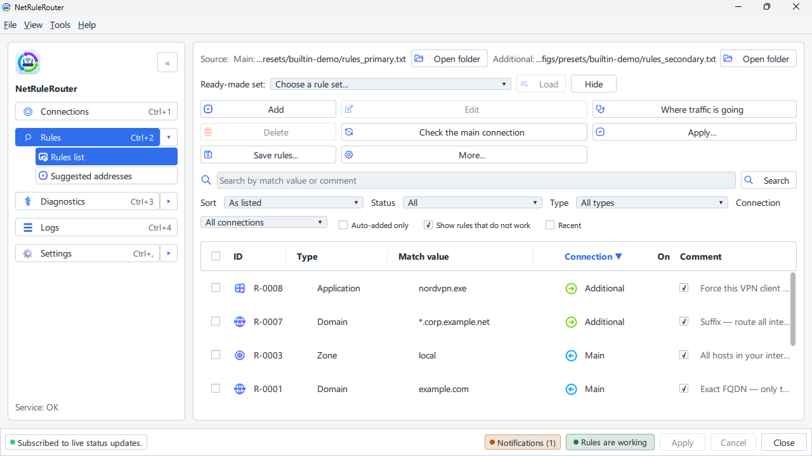

<div align="center">

<picture>
  <source media="(prefers-color-scheme: dark)" srcset="assets/brand/logo-lockup-es.png" />
  
</picture>

**Envía cada sitio, dirección, subred, rango o programa por la conexión que elijas, bloquea lo que no debe salir y detén el tráfico cuando se caiga la VPN para evitar fugas.**

Un gestor de políticas de red para escritorio que enruta tu tráfico por las interfaces que *ya tienes*: Internet principal, una VPN, un segundo proveedor, Wi-Fi o Ethernet. No incluye túnel propio, nube ni cuenta.

Versiones para Windows y Linux disponibles; macOS llegará después.

[](#licencia)
[](https://github.com/kroxiksut/net-rule-router/actions/workflows/windows-quality.yml)
[](https://github.com/kroxiksut/net-rule-router/actions/workflows/linux-quality.yml)


[](#inicio-rápido)
[](#interfaz-de-terminal)
[](#consola-administrativa)
[](https://t.me/netrulerouter)


[English](README.md) · [Русский](README_RU.md) · [简体中文](README.zh-CN.md) · **Español** · [Deutsch](README.de.md) · [Registro de cambios](CHANGELOG.md)

> **Aviso sobre la traducción:** este README se preparó con ayuda de IA y puede contener imprecisiones. Agradecemos las correcciones y contribuciones de hablantes nativos de español. La traducción de la interfaz está prevista para la versión 0.1.1; todavía no hay una fecha anunciada.



</div>

---

## Qué es

NetRuleRouter te permite indicar *«envía `*.bank.com` y esta aplicación por mi conexión principal; envía todo lo demás por la VPN»* y aplicar esa política de forma predecible y local, con un registro de auditoría claro para cada decisión.

Configuraciones habituales:

- **Internet principal + VPN** — conserva en la conexión directa los servicios sensibles a la latencia o con restricciones geográficas y envía el resto por la VPN.
- **Proveedor A + proveedor B** — divide el tráfico entre dos conexiones a Internet.
- **Wi-Fi + Ethernet / Wi-Fi + VPN** — fija destinos concretos a una interfaz específica.
- **Cualquier adaptador visible para Windows** puede ser la ruta adicional, incluidos dispositivos de red USB (placas RNDIS/ECM, conexión compartida del teléfono), Bluetooth PAN o un adaptador de máquina virtual reservado para desarrollo y pruebas.

## Qué *no* es

**No** es un cliente VPN, una herramienta de anonimato o de elusión de censura, un gestor de proxies ni un servicio en la nube. Gestiona el enrutamiento a través de las conexiones que configuras tú; no las crea ni las oculta.

## Inicio rápido

1. **Descarga y ejecuta.** Descarga el instalador (`…-setup.exe` o `.msi`) o el paquete portátil `…-portable.zip` desde [Releases](https://github.com/kroxiksut/net-rule-router/releases). Ejecuta el instalador o descomprime el archivo donde quieras —en el escritorio, la raíz de una unidad o una memoria USB—, inicia `NetRuleRouter.exe` y acepta el acuerdo de licencia. Para compilarlo tú, consulta [Compilar desde el código fuente](#compilar-desde-el-código-fuente).
2. **Instala el servicio en segundo plano.** La ventana de bienvenida ofrece *«Instalar e iniciar el servicio»*; confirma el aviso de UAC. Sin el servicio, la aplicación funciona en modo de vista previa: puedes editar reglas, pero no se aplica ninguna.
3. **Elige un conjunto inicial de reglas.** El asistente de primer inicio ofrece el conjunto de tu región, un conjunto de ejemplo, dos archivos `.txt` propios o empezar sin reglas.
4. **Asigna las dos rutas.** En la pantalla *Conexiones*, indica qué adaptador es la conexión principal y cuál es la adicional (tu VPN, un segundo proveedor o una segunda red Wi-Fi), y dónde debe ir el tráfico que no coincide con ninguna regla.
5. **Guarda el conjunto como propio** — en *Ajustes → Archivos de reglas y ajustes → Mis conjuntos de reglas*, elige una carpeta propia y luego selecciona *«Guardar las reglas actuales como conjunto»*. Los conjuntos que permanecen en la carpeta de la aplicación se reemplazan con la siguiente actualización; los que guardas en una carpeta propia se conservan.
6. **Añade tus propios sitios** (lee la nota siguiente) y pulsa **Aplicar**: las reglas solo tienen efecto después de aplicarlas.

> **Paso único después de la instalación.** El servicio enruta exactamente lo que indican las reglas y nada más. Los sitios que antes se abrían por la VPN seguirán saliendo por la conexión principal hasta que los añadas a las reglas de la ruta adicional; un conjunto predefinido no puede conocer tu lista personal. Revisa los sitios que te importan y añádelos tú en la sección **Reglas** de la aplicación o directamente en `rules_secondary.txt` dentro de la carpeta de tu conjunto de reglas. Después pulsa **Aplicar**. Solo tienes que hacerlo una vez: a partir de entonces, la lista acompaña a tu conjunto de reglas.

**¿Cómo hago...?** Primero, respuestas breves: [Preguntas y respuestas](docs/en/questions.md).

- [Abrir un sitio a través de la VPN](docs/en/adding-rules.md)
- [Cambiar, desactivar o eliminar una regla](docs/en/changing-rules.md)
- [Guardar mis reglas, cargar un conjunto preparado para mi país o trasladar mis reglas a otro ordenador](docs/en/rule-sets.md)
- [Elegir o cambiar mi conexión principal y la adicional, o cambiar de VPN](docs/en/connections.md)
- [Gestionar las «direcciones sugeridas»](docs/en/suggested-addresses.md)
- [Averiguar por qué un sitio no se abre o va lento](docs/en/site-does-not-open.md)
- [Activar o desactivar la protección, o pausar las reglas](docs/en/pause-and-protection.md)
- [Empezar de nuevo o desinstalar el programa](docs/en/start-over-or-remove.md)

La guía completa, incluido qué hacer si pierdes el acceso a la red, está en [`docs/en/quickstart.md`](docs/en/quickstart.md). Si tienes preguntas durante la configuración, consulta [Ayuda y comunidad](#ayuda-y-comunidad).

## Sistemas compatibles

| Plataforma | Arquitectura | Formato | Ventana y bandeja | Interfaz de terminal | Estado en esta versión alfa |
|---|---|---|---|---|---|
| Windows 10, 11 | x64 | ZIP portátil, instalador EXE, MSI | sí | sí | probado en Windows 10 y Windows 11 |
| Windows 11 en ARM | ARM64 | ZIP portátil, instalador EXE, MSI | sí | sí | compilado, aún no probado |
| Linux, `.deb`: Ubuntu 22.04+, Debian 11+ y derivados (Linux Mint, Astra Linux 1.7+) | x86_64, ARM64 | `.deb` | con Qt 6.6+: Ubuntu 24.10+, Debian 13, Astra Linux 1.8 | sí | probado en Ubuntu 26.04 LTS; en Astra Linux 1.7 y 1.8 sin ventana; se espera que funcione en el resto |
| Linux, `.rpm`: Fedora, RHEL / AlmaLinux / Rocky Linux 8+ y derivados (p. ej., RED OS 7.3+) | x86_64, ARM64 | `.rpm` | con Qt 6.6+: Fedora, familia RHEL 10, RED OS 8 si su Qt es suficientemente reciente | sí | probado en un sistema de la familia RHEL (RED OS 8) sin ventana; se espera que funcione en Fedora y RHEL |
| Otros Linux con systemd, nftables y glibc 2.28+ (openSUSE, ALT y otros) | x86_64, ARM64 | `.tar.gz` | con Qt 6.6+ | sí | se espera que funcione, aún no probado |
| Windows de 32 bits | x86 | — | — | — | no compatible |
| macOS | — | — | — | — | aún no compatible; previsto después de Linux |

- **Probado** significa que se instaló, se utilizó con reglas reales y se volvió a desinstalar en ese sistema. **Se espera que funcione** significa que el sistema cumple los requisitos, pero no se ha comprobado en un equipo real. Las compilaciones ARM64 aún no se han ejecutado en hardware real.
- En Linux, el servicio, `nrr-cli` y `nrr-tui` requieren systemd, nftables 0.9.6 o posterior y glibc 2.28 o posterior. La ventana necesita Qt 6.6 o posterior del propio sistema; si Qt es más antiguo, el resto funciona sin la ventana.
- Si la ventana no funciona, la interfaz de terminal ofrece las mismas funciones desde una terminal.
- Además de las comprobaciones anteriores, el conjunto automatizado de pruebas se ejecuta con cada cambio en los ejecutores Windows Server 2025 y Ubuntu de GitHub.

Detalles por versión, incluidos los sistemas comprobados solo según su documentación: [`docs/en/supported-systems.md`](docs/en/supported-systems.md).

## Verificar una descarga

Los instaladores y archivos todavía no están firmados con código, por lo que Windows puede mostrar una advertencia al iniciar uno por primera vez. GitHub conserva para cada archivo de una versión un registro de la compilación y del commit de origen. Así puedes confirmar que el archivo descargado es exactamente el que produjo la compilación de este repositorio, sin tener que confiar en la página desde la que lo descargaste:

```sh
gh attestation verify <file> --repo kroxiksut/net-rule-router
```

Necesitas GitHub CLI (`gh`) e iniciar sesión con `gh auth login`. La verificación falla si el archivo se modificó después de compilarse o se compiló en otro lugar. Para comprobar rápidamente las sumas de verificación, los archivos incluyen `SHA256SUMS`: ejecuta `sha256sum -c SHA256SUMS` (en PowerShell, compara con `Get-FileHash <file>`).

## Funciones destacadas

- **Modelo de dos rutas** — una ruta `primary` y otra adicional; solo una configuración activa a la vez.
- **Siete formas de identificar el tráfico** — dominio exacto, dominio y todos sus subdominios, sitio en cualquier zona (`bank.*`), dirección IPv4 o IPv6 exacta, subred o rango de direcciones, zona de dominio (un TLD o sufijo interno como `.ru` o `.intra`) o aplicación (por nombre de programa, archivo o carpeta donde está instalado; en Windows y Linux una regla de carpeta también cubre los programas que una actualización posterior instale allí y los scripts que contenga).
- **Estadísticas de tráfico** — cuánto pasó por cada conexión hoy, durante la sesión actual de la conexión adicional y a lo largo de todos los días conservados (tú eliges cuántos), con exportación CSV para cualquier período.
- **Enrutamiento por nombre** *(Windows, activado por defecto en instalaciones nuevas: Ajustes → Comportamiento del enrutamiento, con cualquier nivel de protección contra fugas)* — los sitios que comparten la dirección de un servidor siguen la ruta de su propia regla. Las grandes plataformas y CDN alojan cientos de nombres en unas pocas direcciones, y el enrutamiento por dirección no puede distinguirlos; consulta [`docs/en/routing-modes.md`](docs/en/routing-modes.md).
- **Protección contra fugas** — elige **Desactivada**, **Sitios enrutados** (por defecto: si la VPN está apagada, se cae o se inicia después que el ordenador, los sitios que envías por ella esperan en vez de salir directamente; lo que tus reglas envían por la conexión adicional nunca sale por la principal mientras está activo el bloqueo estricto de direcciones compartidas, como ocurre por defecto; todo lo demás sigue funcionando, excepto los sitios que comparten dirección con uno enrutado) o **Todo** (nada sale salvo por la conexión adicional, tu red local y lo que tus reglas envían por la principal; si se cae la conexión adicional, Internet espera hasta que vuelva). Una VPN corporativa junto a la tuya conserva sus propias redes en todos los modos.
- **Bloqueo** — un sitio, una dirección, una subred o un programa que bloquees no puede pasar por ninguna conexión: antepón `!` en un archivo de reglas o elige «Bloquear» al añadir una regla en la ventana, la bandeja o la interfaz de terminal. El bloqueo por dirección o subred no depende de nombres; no hay listas de bloqueo, solo las reglas que escribes.
- **Programas del sistema protegidos** — una regla de bloqueo o de ruta adicional no puede quitarle al ordenador lo que necesita para seguir en la red (la carpeta del sistema, `svchost.exe`, los servicios de red o una carpeta compartida por muchos programas): la aplicación la rechaza antes de guardarla. Si realmente lo necesitas, `+override` en el archivo de reglas solicita tu confirmación durante el tiempo que elijas, con aprobación de administrador si afecta a programas ajenos; consulta [`docs/en/rules-file-format.md`](docs/en/rules-file-format.md#116-applying-a-rule-despite-the-protection-override).
- **Añadir muchas reglas y revisar cambios recientes** — pega una lista de sitios, direcciones y programas como líneas de un archivo de reglas; cada línea se valida antes de añadirse. El filtro *Recientes* muestra lo que añadiste, cambiaste o eliminaste durante la última hora, hoy o en los últimos 7 días, y permite restaurar una regla eliminada con un clic. Funciona tanto en la ventana como en la interfaz de terminal.
- **Historial de conexiones** — qué programas se conectaron, adónde y por qué ruta; se conserva en este ordenador durante 7 días salvo que elijas otra duración, agrupado por programa o carpeta. Solo tú puedes leer tu historial; nunca se incluye en un archivo de diagnóstico y puedes borrarlo o desactivarlo en Ajustes.
- **Comprobar sitio** — si un sitio no se abre, una comprobación indica si el problema está en la red o en el propio sitio: qué ruta usan el sitio, su inicio de sesión y los nombres asociados, si responde cada uno y qué hacer después. Ejecútala desde Diagnóstico, una línea del registro de conexiones, una sugerencia o el propio aviso, tanto en la ventana como en la interfaz de terminal.
- **Avisos que señalan la causa** — la bandeja y la interfaz de terminal te avisan si un sitio que visitas no se abre por la conexión principal (en Windows, incluso con la bandeja cerrada), si la conexión principal o la adicional se cae repetidamente y si el servicio se detiene por sí solo (esto último también aparece en la ventana). Tendrás a mano **Iniciar servicio** y **Restaurar red**. Puedes ocultar cualquier aviso durante un día, 7 días, 30 días o para siempre; lo oculto desaparece en todas partes.
- **Pausar las reglas** — desactiva temporalmente el enrutamiento y la protección contra fugas durante 15 minutos, una hora, 4 horas, hasta el siguiente reinicio o hasta volver a activarlos (*Desactivar reglas…* en la bandeja o en Ajustes). Se reactivan automáticamente y los demás usuarios con sesión iniciada conservan sus reglas.
- **WSL, contenedores y máquinas virtuales** — eliges si sus programas reciben la misma protección contra fugas que este ordenador o quedan sin protección cuando se cae la ruta adicional. Aún no se ha verificado en una configuración real.
- **Direcciones sugeridas** — un sitio enrutado suele necesitar sus propios dominios auxiliares. La aplicación los recopila, muestra qué sitios tuyos necesitan cada uno y propone añadirlos. No se añade nada sin tu intervención; si ignoras una sugerencia, esa dirección simplemente permanece en la ruta principal.
- **Solapamientos** — cuando reglas de ambas rutas cubren los mismos sitios (por ejemplo, una zona en una ruta y un sitio dentro de ella en la otra), prevalece la regla más específica y la aplicación enumera cada pareja junto con la ruta que realmente usarán sus sitios. Confirma cada caso o envía esos sitios por la otra ruta con un clic. La misma pantalla señala reglas aplicadas cuyo efecto difiere de lo que parece indicar su texto, por ejemplo un bloqueo por dirección que también detiene un sitio que estás enrutando.
- **Modo de explicación** — pregunta *«¿por qué fue este host por esa ruta?»* y obtén la traza exacta de reglas. Una caché SQLite local respalda la correspondencia FQDN/IP.
- **Conjuntos predefinidos abiertos y en texto plano** — paquetes de reglas legibles (incluidas divisiones por país listas para usar) que puedes comparar, editar y compartir.
- **Reglas que se adaptan a tu proveedor** — antepón `?` a un sitio o dirección (o marca «No estoy seguro» al añadirlo) para que funcione por la ruta elegida. Si no se abre por esa ruta, pero sí por la otra, la aplicación lo envía por la otra y ofrece mover la regla; hasta que aceptes, el cambio dura hasta que se reinicie el ordenador. Los conjuntos incluidos usan esta función para servicios que algunos proveedores bloquean y otros no, de modo que un mismo conjunto sirve con cualquier proveedor.
- **Aplicación de escritorio nativa** — interfaz Qt/QML y bandeja para el uso diario, además de un servicio en segundo plano que aplica la política al iniciar. El menú y los avisos de la bandeja siguen en preparación para la primera versión; su contenido y aspecto pueden cambiar entre compilaciones.
- **Accesibilidad desde el principio** — compatibilidad con lectores de pantalla, navegación con teclado, fuentes escalables y un tema específico de alto contraste; consulta [`docs/en/accessibility.md`](docs/en/accessibility.md).
- **Inglés y ruso incluidos**, con idiomas comunitarios que se pueden instalar sin recompilar.
- **Enfoque local y privado** — no requiere iniciar sesión y no tiene telemetría. Las pocas solicitudes propias que realiza la aplicación (resolver los sitios de tus reglas, comprobar la conexión adicional y la dirección desde la que sale, probar las reglas `?` de los sitios que visitas) están enumeradas en [SECURITY.md](SECURITY.md), junto con lo que aporta cada una y cómo desactivarla cuando es posible.

## Cómo se toman las decisiones de enrutamiento

Para cada destino, el motor recorre las reglas desde la más específica hasta la más general y se detiene en la primera coincidencia:

| N.º | Tipo de regla | Ejemplo |
|---|---|---|
| 1 | Dominio exacto (FQDN) | `api.bank.com` |
| 2 | Subdominio / sufijo | `*.bank.com` |
| 3 | Sitio en cualquier zona | `bank.*` |
| 4 | Dirección IP exacta (IPv4 o IPv6) | `203.0.113.7`, `2001:db8::7` |
| 5 | Subred (CIDR) o rango de IP | `10.0.0.0/8`, `192.0.2.10-192.0.2.40` |
| 6 | Zona (TLD / sufijo interno, zonas de dominio) | `.ru`, `.com`, `.intra` |
| 7 | Aplicación (nombre de programa, archivo o carpeta) | `chrome.exe` |
| 8 | Ruta predeterminada | la conexión principal o la adicional, según los ajustes |

Notas:

- Prevalece la regla más específica: el nombre propio de un sitio vence a su dirección; una **IP exacta** vence a cualquier red que la contenga y una red vence a la zona donde se encuentra. Entre dos nombres, gana el más largo; entre dos redes, la más específica.
- Una zona de varias etiquetas (`corp.example.com`) designa los subdominios de un sitio: ocupa el nivel de las reglas de subdominio, sin incluir el nombre base, por lo que vence a `*.example.com`, una IP exacta y una red.
- Un **sitio en cualquier zona** (`bank.*`) cubre `bank.com`, `bank.net`, `bank.co.uk` y sus subdominios con una sola regla. Una regla que nombre la zona (`bank.by`, `*.bank.by`) prevalece, independientemente de la ruta asignada.
- El **bloqueo** de una IP exacta detiene esa dirección independientemente de las demás reglas que la nombren. Cualquier otro bloqueo ocupa su lugar en el orden anterior.
- Si dos reglas del mismo tipo tienen la misma especificidad, prevalece el bloqueo sobre la ruta y la ruta principal sobre la adicional.
- Una regla nombra un destino **o** una aplicación. Por ahora, no se puede limitar una dirección a una sola aplicación; el servicio rechaza esa regla en vez de aplicarla a todas las aplicaciones.
- Las **subredes CIDR y los rangos IP** funcionan como destinos: enruta una red corporativa completa o un bloque de direcciones por cualquiera de las conexiones con una sola regla. No se admiten puertos ni protocolos.
- Las reglas admiten direcciones IPv6. Usan la conexión adicional cuando esta ofrece IPv6. Si no lo ofrece, las direcciones IPv6 que tus reglas envían allí quedan bloqueadas mientras la protección contra fugas esté activada, en vez de salir por la conexión principal; con la protección desactivada, salen por la conexión principal. IPv6 todavía no se ha probado en una red IPv6 real. Después de cambiar una regla, las conexiones IPv6 ya abiertas conservan su ruta anterior hasta que el programa se vuelva a conectar (en IPv4, la aplicación las actualiza); además, `?` nunca mueve una regla de dirección IPv6.
- El motor de decisiones es puro y determinista: entradas idénticas siempre producen resultados idénticos y completamente trazables.

> Un destino que no coincide con ninguna regla usa la ruta predeterminada. Por eso debes incluir un sitio en las reglas de la ruta adicional si quieres enviarlo por allí; consulta el paso único de [Inicio rápido](#inicio-rápido).
> **Después de añadir o quitar reglas, pulsa siempre Aplicar: las reglas solo tienen efecto después de aplicarlas.**

Todo lo demás que pueda entrar en conflicto —varias personas con sesión iniciada, la protección y una pausa, tu archivo de reglas y la aplicación— se resuelve en [`docs/en/what-takes-priority.md`](docs/en/what-takes-priority.md).

## Conjuntos predefinidos

`presets/` incluye paquetes de reglas abiertos y en texto plano que puedes importar como punto de partida, incluidas divisiones por país entre «nacional y extranjero» para varias regiones (`ru`, `cn`, `ir`, `tr`, `in`, `id`, `vn`, `kz` y otras). Cada conjunto consta de dos archivos sencillos, `rules_primary.txt` / `rules_secondary.txt`, con metadatos en comentarios de cabecera:

```text
# NetRuleRouter preset - version 1
# name: CN Mainland Split - Primary Route
# preset_version: 1

--- Zones
cn              # .cn

--- Domains
qq.com
*.qq.com
alibaba.com
*.alibaba.com
```

Las líneas marcadas con `?` (por ejemplo, `?accounts.google.com`) usan la ruta de su archivo. Si tu proveedor las bloquea por esa ruta y se abren por la otra, la aplicación ofrece moverlas. El formato completo está documentado en [`docs/en/rules-file-format.md`](docs/en/rules-file-format.md).

> Los conjuntos por país incluidos son borradores preparados con IA para servir como punto de partida cómodo, no como recomendaciones de enrutamiento autoritativas. Revísalos y adáptalos antes de depender de ellos.

## Compilar desde el código fuente

> Los comandos siguientes son para Windows. Cada script tiene un equivalente `*.sh` para Linux, descrito en [Compilar en Linux](docs/en/building-linux.md); macOS llegará más adelante.

**Requisitos previos:** una versión reciente de Rust, una instalación de desarrollo de Qt 6 y CMake. `scripts/bootstrap.ps1` comprueba el entorno y prepara tu `.env`.

```powershell
# 1. Preparar los requisitos previos y .env
powershell -ExecutionPolicy Bypass -File .\scripts\bootstrap.ps1

# 2. Compilar el lanzador y el host nativo de Qt
cargo build -p nrr-launcher -p nrr-qt-host

# 3. Ejecutar
.\target\debug\NetRuleRouter.exe          # interfaz gráfica principal
.\target\debug\NetRuleRouterTray.exe      # bandeja

# …o mediante el script auxiliar
.\scripts\run.ps1 -Component gui
.\scripts\run.ps1 -Component tray
```

El servicio en segundo plano (aplica y hace cumplir la política al iniciar) se instala con `scripts/install-service.ps1` y se elimina con `scripts/uninstall-service.ps1`.

Para no dejar nada atrás —servicio, ajustes, cachés y registros de una vez—, `scripts/purge-data.ps1` elimina todas las ubicaciones donde escribe el producto. Solo muestra lo que eliminaría hasta que pases `-Yes`, y conserva el registro de auditoría de seguridad salvo que también pases `-PurgeAudit`:

```powershell
powershell -ExecutionPolicy Bypass -File .\scripts\purge-data.ps1
```

Control de calidad (fmt + clippy + pruebas + auditoría de licencias y dependencias):

```powershell
powershell -ExecutionPolicy Bypass -File .\scripts\check.ps1 -RequireCargoDeny
```

### Preparar una compilación para distribuir

`scripts/package-windows.ps1` convierte el checkout en una carpeta que funciona en un Windows limpio, sin Qt, toolchain de Rust, repositorio ni instalador:

```powershell
powershell -ExecutionPolicy Bypass -File .\scripts\package-windows.ps1 -Zip
```

El paquete se guarda en `C:\temp\NetRuleRouter\dist\NetRuleRouter`; `-Zip` coloca junto a él `NetRuleRouter-windows-x64-<version>-portable.zip`. Incluye la interfaz gráfica, la bandeja, el servicio, la consola, la interfaz de terminal, el entorno de ejecución Qt y el árbol QML / de idiomas / conjuntos / configuración, además de un sello `build-info.json` (versión, revisión y hora de compilación) y notas breves `README.txt` / `README.ru.txt` para quien lo descomprima. Consulta los parámetros y la estructura en [`docs/en/packaging-windows.md`](docs/en/packaging-windows.md).

## Configuración y datos

- **Preferencias de la interfaz** (tema, idioma, accesibilidad, nombres de rutas, última sección…) se guardan en almacenamiento local gestionado y se conservan al actualizar.
- **Configuración activa** — una a la vez, **por usuario de Windows**: tus cambios diarios en las reglas son tuyos (no requieren aviso de administrador) y solo se aplican a tu cuenta. Un administrador puede definir una **base compartida** a la que vuelven todos los usuarios hasta personalizarla. «Restablecer la base» descarta tus cambios. Las reglas están en los dos archivos de texto plano del conjunto.
- **Cachés y estado** — SQLite local (`nrr_fqdn_ip_cache.db`, `nrr_service_state.db`); auditoría y registros operativos en NDJSON. Consulta [`docs/en/cache-and-seeding.md`](docs/en/cache-and-seeding.md) para saber cómo se llena la caché FQDN/IP, incluida la importación opcional del historial del navegador. La aplicación debe gestionar estas bases de datos; editarlas con herramientas de terceros no está admitido y queda bajo tu responsabilidad. Consulta [`docs/en/where-files-live.md`](docs/en/where-files-live.md).
- Los archivos de idioma se leen durante la ejecución: coloca un `de.json` válido según el esquema en el directorio de idiomas del usuario y aparecerá en el selector de idioma, sin esperar a una versión nueva.

## Consola administrativa

La aplicación incluye la consola de terminal `nrr-cli`. Instala, inicia, detiene e inspecciona el servicio en segundo plano; además, `diag doctor` genera un único informe que puedes adjuntar a un error en lugar de tres capturas de pantalla. La política de enrutamiento se configura en la aplicación: la consola no edita ni aplica reglas y no ofrece salida legible por máquinas. Sirve para mantener un equipo en buen estado, no como API de automatización. Consulta [`docs/en/cli.md`](docs/en/cli.md).

## Interfaz de terminal

`nrr-tui` permite usar la aplicación desde una terminal: estado y avisos, configuración, reglas, sugerencias, historial de conexiones, comprobación de sitios, diagnóstico y ajustes. Está pensada para equipos a los que accedes por SSH, servidores sin escritorio y quienes prefieren el teclado. Funciona con lectores de pantalla (`--plain`), nunca depende solo del color y no requiere permisos de administrador para tus propias reglas. Solo funciona de forma interactiva; los scripts usan `nrr-cli`. Consulta [`docs/en/tui.md`](docs/en/tui.md).

## Seguridad y privacidad

- Las funciones locales básicas de enrutamiento no requieren iniciar sesión.
- No hay telemetría. Además del tráfico enrutado, la aplicación resuelve los nombres de host de tus reglas y mantiene actualizadas sus direcciones; mientras estén activadas las sugerencias de reglas o la protección contra fugas, pregunta al DNS de tu conexión a qué sitio pertenece una dirección (nunca lo hace para un sitio bloqueado por una regla tuya); comprueba que la conexión adicional está activa y, si lo habilitas, consulta a un servicio STUN público qué dirección de salida tiene cada vez que se conecta; también prueba las reglas `?` de los sitios que visitas. Si desactivas las sugerencias y la protección contra fugas, no se hacen estas consultas de direcciones. La lista completa está en [SECURITY.md](SECURITY.md).
- Algunos nombres de tus reglas llegan a servidores DNS públicos. Mientras la conexión adicional está activa, los nombres de host de tus reglas para esa conexión se consultan a través de ella en el DNS público Quad9 (149.112.112.112), así que tu proveedor no ve esas consultas ni puede modificar las respuestas; el resto de tu DNS no se envía a esa dirección. Si tu proveedor responde a un nombre de tus reglas con una dirección que parece bloqueada, se vuelve a consultar a Cloudflare, Google y Quad9. **DNS a través del túnel** (desactivado por defecto) envía todas las consultas propias de la aplicación por la conexión adicional a esos tres servicios. Las consultas de tus programas para sitios fuera de tus reglas de la conexión adicional siguen yendo a tu proveedor en cualquier caso. Consulta qué nombres van a dónde en [`docs/en/dns-via-secondary.md`](docs/en/dns-via-secondary.md).
- Los cambios de política privilegiados pasan por el límite IPC local de tubería con nombre protegido por DACL; no hay un plano de control HTTP en localhost para cambios privilegiados.
- La aplicación no busca actualizaciones. Las versiones nuevas aparecen en la [página de lanzamientos](https://github.com/kroxiksut/net-rule-router/releases) y se anuncian en el canal de Telegram [t.me/netrulerouter](https://t.me/netrulerouter). Para actualizar, instala la nueva versión sobre la anterior.

Consulta el modelo de confianza completo en [`SECURITY.md`](SECURITY.md).

## Ayuda y comunidad

- **Preguntas, debate y novedades** — canal de Telegram [t.me/netrulerouter](https://t.me/netrulerouter), en inglés y ruso. Pregunta cómo configurar algo, cuéntanos cómo funciona en tu sistema, propón ideas y entérate antes que nadie de las nuevas compilaciones. Si no sabes si algo es un error, pregunta allí.
- **Errores y solicitudes de funciones que requieren seguimiento** — [GitHub Issues](https://github.com/kroxiksut/net-rule-router/issues). La forma más rápida de llegar a una solución es informar del error y adjuntar el archivo de diagnóstico; [CONTRIBUTING.md](CONTRIBUTING.md#reporting-a-bug) (en inglés) explica qué incluir. Adjunta el archivo al issue, no lo publiques en el chat.
- **Vulnerabilidades** — nunca las publiques en el canal ni en un issue público. Repórtalas de forma privada según las instrucciones de [SECURITY.md](SECURITY.md).

## Hoja de ruta

**Actual:** modelo de dos rutas, una configuración activa por usuario sobre una base compartida de administrador, reglas de dominio / zona / IP / red / aplicación (por nombre, archivo o carpeta), reglas de bloqueo, enrutamiento por nombre, conjuntos predefinidos, modo de explicación, protección contra fugas, direcciones sugeridas, estadísticas de tráfico con exportación CSV, historial de conexiones, comprobación de sitios, pausa temporal de las reglas, archivo de diagnóstico, consola administrativa, interfaz de terminal e inglés/ruso.

**Siguiente:** macOS (las partes específicas de cada plataforma están detrás de una interfaz por capacidad, por lo que la lógica de decisiones compartida ya es independiente del sistema operativo).

**En curso: IPv6 completo.** Las reglas ya admiten direcciones IPv6 y nombres que se resuelven a ellas, y las enrutan y protegen como IPv4. Falta verificarlo en redes IPv6 reales antes de darlo por terminado.

**Justo después:**

- comprobar un sitio a través de ambas conexiones: la comprobación indica si el servidor está caído o si tu proveedor o VPN lo bloquea, y ofrece mover la regla;
- DNS seguro propio para un programa: un programa con su propio DNS cifrado, como un cliente corporativo o un juego, sigue funcionando mientras la protección permanece activa para los demás programas.

El orden completo del trabajo, sin fechas: [ROADMAP.md](ROADMAP.md).

## Documentación

| Archivo | Contenido |
|------|------------|
| [`SECURITY.md`](SECURITY.md) | Modelo de seguridad y límites de confianza |
| [`STRUCTURE.md`](STRUCTURE.md) | Estructura del repositorio |
| [`docs/en/quickstart.md`](docs/en/quickstart.md) | Inicio rápido: de la instalación a la primera regla aplicada |
| [`docs/en/supported-systems.md`](docs/en/supported-systems.md) | Versiones compatibles de Windows y Linux, funciones disponibles y comprobaciones realizadas |
| [`docs/en/rules-file-format.md`](docs/en/rules-file-format.md) | Formato de archivos de conjuntos y reglas |
| [`docs/en/routing-modes.md`](docs/en/routing-modes.md) | Opciones de enrutamiento: qué ofrece cada una y cómo se combinan |
| [`docs/en/what-routing-changes.md`](docs/en/what-routing-changes.md) | Quién ve qué cuando se enruta un sitio y qué aspectos deja intactos el enrutamiento |
| [`docs/en/what-takes-priority.md`](docs/en/what-takes-priority.md) | Prioridades: qué regla gana, qué reglas se aplican con varios usuarios conectados, protección y pausa, archivo de reglas y aplicación |
| [`docs/en/several-users.md`](docs/en/several-users.md) | Varios usuarios conectados a la vez: se aplican las reglas de todos y se explica la única limitación de Windows |
| [`docs/en/blocked-site-browser-errors.md`](docs/en/blocked-site-browser-errors.md) | Qué significa un error del navegador cuando no se abre un sitio enrutado |
| [`docs/en/cache-and-seeding.md`](docs/en/cache-and-seeding.md) | Cómo se llena la caché FQDN/IP, incluida la importación opcional del historial del navegador |
| [`docs/en/where-files-live.md`](docs/en/where-files-live.md) | Dónde se guardan los ajustes, reglas, cachés y registros |
| [`docs/en/diagnostic-archive.md`](docs/en/diagnostic-archive.md) | Qué incluye un archivo de diagnóstico y qué nunca incluye |
| [`docs/en/recovering-network-access.md`](docs/en/recovering-network-access.md) | Cómo recuperar la red si algo sale mal |
| [`docs/en/known-limitations.md`](docs/en/known-limitations.md) | Qué carencias tiene esta versión y qué hacer en cada caso |
| [`docs/en/cli.md`](docs/en/cli.md) | Consola `nrr-cli`: comandos, códigos de salida y funciones que deliberadamente no ofrece |
| [`docs/en/tui.md`](docs/en/tui.md) | Interfaz de terminal `nrr-tui`: inicio, pantallas, teclas, accesibilidad y permisos |
| [`docs/en/accessibility.md`](docs/en/accessibility.md) | Uso de la ventana con teclado, lector de pantalla, texto grande o alto contraste |
| [`docs/en/building-windows.md`](docs/en/building-windows.md) | Compilar desde el código fuente en Windows: toolchain, Qt y errores frecuentes |
| [`docs/en/unattended-install.md`](docs/en/unattended-install.md) | Instalación mediante script con reglas preparadas para cada usuario y códigos de salida |
| [`docs/en/packaging-windows.md`](docs/en/packaging-windows.md) | Crear el paquete portátil y los instaladores para distribuir |
| [`docs/en/building-linux.md`](docs/en/building-linux.md) | Compilar desde el código fuente en Linux: toolchain, Qt y errores frecuentes |
| [`docs/en/packaging-linux.md`](docs/en/packaging-linux.md) | Crear paquetes `.deb` y `.rpm` para distribuir |
| [`docs/en/dns-via-secondary.md`](docs/en/dns-via-secondary.md) | DNS a través del túnel: a dónde van los nombres y qué ven los resolutores |
| [`docs/en/fake-ip.md`](docs/en/fake-ip.md) | Enrutamiento por sitio con direcciones virtuales: ventajas y requisitos |
| [`docs/en/vpn-detection.md`](docs/en/vpn-detection.md) | Cómo se detecta un cliente VPN en el equipo y qué hace el producto al respecto |
| [`docs/en/first-run-answers.md`](docs/en/first-run-answers.md) | Respuestas anticipadas a las preguntas de configuración |
| [`docs/en/third-party-components.md`](docs/en/third-party-components.md) | Componentes de terceros incluidos, sus licencias y cómo verificarlos |

## Licencia

NetRuleRouter está publicado bajo **MPL-2.0**. La [extensión del navegador](apps/browser-extension/README.md) está disponible bajo **MIT o Apache-2.0**, con condiciones aparte para sus iconos.

Está diseñado para funcionar tanto como aplicación independiente como componente de enrutamiento de primera capa integrable en otros productos. Agradecemos las contribuciones y las integraciones. Si tu producto utiliza NetRuleRouter, menciónalo e incluye un enlace al proyecto. Todas las dependencias de ejecución deben seguir siendo compatibles con la distribución comercial (MIT / Apache-2.0 / BSD / MPL-2.0 / ISC); por defecto no se aprueban dependencias con licencias poco claras.

El texto completo de la licencia está en [`LICENSE`](LICENSE); la aplicación también lo muestra en la ventana Licencia (Ctrl+Shift+L).

---

<div align="center">
<sub><code>README.md</code>, <code>README_RU.md</code>, <code>README.zh-CN.md</code>, <code>README.es.md</code> y <code>README.de.md</code> se mantienen sincronizados; actualízalos en el mismo cambio.</sub>
</div>
