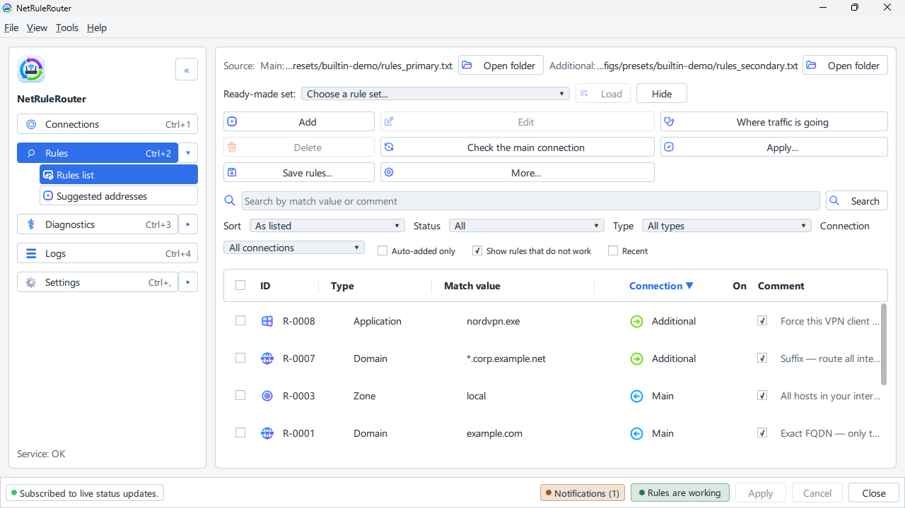

<div align="center">

<picture>
  <source media="(prefers-color-scheme: dark)" srcset="assets/brand/logo-lockup-zh-CN.png" />
  
</picture>

**让每个网站、地址、子网、地址范围或程序通过你选择的连接；阻止不该发出的流量；VPN 断开时暂停相关流量，避免泄漏。**

NetRuleRouter 是一款桌面网络策略管理工具，可通过你*已经拥有*的网络接口路由流量：主互联网连接、VPN、第二家运营商、Wi-Fi、以太网。它不创建自己的隧道，不使用云服务，也不需要账户。

目前提供 Windows 和 Linux 版本；macOS 后续推出。

[](#许可证)
[](https://github.com/kroxiksut/net-rule-router/actions/workflows/windows-quality.yml)
[](https://github.com/kroxiksut/net-rule-router/actions/workflows/linux-quality.yml)


[](#快速开始)
[](#终端界面)
[](#管理控制台)
[](https://t.me/netrulerouter)


[English](README.md) · [Русский](README_RU.md) · **简体中文** · [Español](README.es.md) · [Deutsch](README.de.md) · [更新日志](CHANGELOG.md)

> 本 README 在 AI 协助下翻译，可能仍有不准确之处。欢迎中文母语者提出反馈或贡献改进。应用界面的语言文件计划在 0.1.1 版本发布前翻译；发布日期尚未公布。



</div>

---

## 产品简介

你可以告诉 NetRuleRouter：“让 `*.bank.com` 和这个应用走主线路，其他流量走 VPN”，然后由它在本机稳定地执行这项策略，并清楚记录每次决策。

常见用法：

- **主互联网连接 + VPN** — 将对延迟敏感或受地域限制的服务留在直连线路，其余流量通过 VPN。
- **运营商 A + 运营商 B** — 将流量分配到两个上行连接。
- **Wi-Fi + 以太网 / Wi-Fi + VPN** — 将特定目标固定到指定接口。
- **Windows 能识别的任何适配器**都可以作为附加路由，包括 USB 网络设备（RNDIS/ECM 网卡、手机网络共享）、蓝牙 PAN，或专用于开发和测试的虚拟机适配器。

## 本产品不是什么

它**不是** VPN 客户端、匿名工具、绕过审查工具、代理管理器或云服务。它只管理你自行建立的连接之间的路由，不会创建或隐藏这些连接。

## 快速开始

1. **下载并运行。** 从[发布页](https://github.com/kroxiksut/net-rule-router/releases)下载安装程序（`…-setup.exe` 或 `.msi`）或便携包 `…-portable.zip`。运行安装程序，或将压缩包解压到任意位置（桌面、磁盘根目录或 U 盘），启动 `NetRuleRouter.exe` 并接受许可协议。自行构建请参阅[从源代码构建](#从源代码构建)。
2. **安装后台服务。** 欢迎窗口会显示“安装并启动服务”，确认 UAC 提示即可。没有服务时，应用以预览模式运行：可以编辑规则，但不会应用规则。
3. **选择初始规则集。** 首次运行向导提供适用于你所在地区的规则集、示例规则集、你自己的两份 `.txt` 文件，或空白配置。
4. **指定两条路由。** 在“连接”页面中，指定哪个适配器是主连接、哪个是附加连接（例如 VPN、第二家运营商或第二个 Wi-Fi），并选择没有匹配规则的流量走哪条路由。
5. **将规则集保存到自己的位置** — 打开“设置 → 规则和设置文件 → 我的规则集”，选择自己的文件夹，然后点击“将当前规则保存为规则集”。保存在应用目录中的规则集会在下次更新时被替换；保存在自有文件夹中的规则集不会受影响。
6. **添加你自己的站点**（见下方说明），然后按**应用**。只有应用后规则才会生效。

> **安装后需要完成一次的步骤。** 服务严格按照规则路由，不会额外猜测。过去通过 VPN 打开的站点，在加入附加路由规则之前仍会通过主连接访问；预设规则集无法知道你的个人站点清单。请在应用的**规则**部分添加常用站点，或直接编辑规则集目录中的 `rules_secondary.txt`，然后按**应用**。这只需做一次，此后站点列表会随你的规则集保存。

**如何……？** 先看简明问答：[常见问题](docs/en/questions.md)。

- [让站点通过 VPN 访问](docs/en/adding-rules.md)
- [更改、关闭或删除规则](docs/en/changing-rules.md)
- [保存规则、载入所在国家/地区的现成规则集，或将规则迁移到另一台电脑](docs/en/rule-sets.md)
- [选择或切换主连接和附加连接，或更换 VPN](docs/en/connections.md)
- [处理“建议地址”](docs/en/suggested-addresses.md)
- [排查站点无法打开或速度缓慢](docs/en/site-does-not-open.md)
- [开启或关闭保护，或暂时关闭规则](docs/en/pause-and-protection.md)
- [重新开始或卸载程序](docs/en/start-over-or-remove.md)

完整操作指南（包括网络访问中断时的处理方法）见 [`docs/en/quickstart.md`](docs/en/quickstart.md)。设置过程中有疑问，请查看[帮助与社区](#帮助与社区)。

## 支持的系统

| 平台 | 架构 | 发布形式 | 窗口和托盘 | 终端界面 | 当前 alpha 版本状态 |
|---|---|---|---|---|---|
| Windows 10、11 | x64 | 便携 ZIP、EXE 安装程序、MSI | 支持 | 支持 | 已在 Windows 10 和 Windows 11 上测试 |
| Windows 11 on ARM | ARM64 | 便携 ZIP、EXE 安装程序、MSI | 支持 | 支持 | 已构建，尚未测试 |
| Linux，`.deb`：Ubuntu 22.04+、Debian 11+ 及其衍生版（Linux Mint、Astra Linux 1.7+） | x86_64、ARM64 | `.deb` | Qt 6.6+：Ubuntu 24.10+、Debian 13、Astra Linux 1.8 | 支持 | 已在 Ubuntu 26.04 LTS 上测试；在 Astra Linux 1.7 和 1.8 上无窗口测试；其余预计可用 |
| Linux，`.rpm`：Fedora、RHEL / AlmaLinux / Rocky Linux 8+ 及相关发行版（如 RED OS 7.3+） | x86_64、ARM64 | `.rpm` | Qt 6.6+：Fedora、RHEL 10 系列、Qt 版本足够新的 RED OS 8 | 支持 | 已在 RHEL 系统（RED OS 8）上无窗口测试；预计 Fedora 和 RHEL 可用 |
| 其他使用 systemd、nftables 和 glibc 2.28+ 的 Linux（openSUSE、ALT 等） | x86_64、ARM64 | `.tar.gz` | Qt 6.6+ | 支持 | 预计可用，尚未测试 |
| 32 位 Windows | x86 | — | — | — | 不支持 |
| macOS | — | — | — | — | 暂不支持，计划在 Linux 之后推出 |

- **已测试**表示已在该系统上安装、使用真实规则并卸载；**预计可用**表示系统满足要求，但尚未在真实机器上验证。ARM64 构建尚未在真实硬件上运行。
- Linux 上的服务、`nrr-cli` 和 `nrr-tui` 需要 systemd、nftables 0.9.6 或更高版本，以及 glibc 2.28 或更高版本。图形窗口需要系统自带的 Qt 6.6 或更高版本；Qt 较旧时，其余功能仍可在没有窗口的情况下工作。
- 如果图形窗口无法运行，可以通过终端界面使用相同功能。
- 除上述验证外，每次更改都会在 GitHub 的 Windows Server 2025 和 Ubuntu runner 上运行自动化测试套件。

各版本详情（包括仅依据发行版自身文档核对的系统）见 [`docs/en/supported-systems.md`](docs/en/supported-systems.md)。

## 验证下载文件

安装程序和压缩包目前尚未进行代码签名，因此 Windows 首次启动时可能会显示警告。GitHub 会为每个发布文件保存其构建记录和源代码提交信息。你可以验证下载的文件确实由本仓库的发布构建生成，而无需信任下载页面：

```sh
gh attestation verify <file> --repo kroxiksut/net-rule-router
```

这需要 GitHub CLI（`gh`），并通过 `gh auth login` 登录。构建后被修改的文件或在其他位置构建的文件无法通过验证。快速检查校验和可使用随文件附带的 `SHA256SUMS`：运行 `sha256sum -c SHA256SUMS`（在 PowerShell 中可用 `Get-FileHash <file>` 对照）。

## 主要功能

- **两路由模型** — 一条 `primary` 主路由和一条附加路由；同一时间启用一份配置。
- **七种流量匹配方式** — 精确域名、域名及其所有子域名、每个域中的站点（`bank.*`）、精确 IPv4 或 IPv6 地址、子网或地址范围、域名区域（顶级域或 `.ru`、`.intra` 这类内部后缀），以及按应用匹配（程序名称或其安装文件/文件夹；在 Windows 和 Linux 上，文件夹规则也会覆盖后续更新放入该目录的程序和其中的脚本）。
- **流量统计** — 查看今天、附加连接当前会话期间以及所保留的每一天（保留天数由你选择）的连接流量，并可将任意时间段导出为 CSV。
- **按名称路由**（*Windows，新安装默认开启：设置 → 路由行为；与泄漏保护选项无关*）— 即使多个站点共用一个服务器地址，也仍按各自规则路由。大型平台和 CDN 会将数百个名称放在少数几个地址上，单纯按地址路由无法区分它们；参见 [`docs/en/routing-modes.md`](docs/en/routing-modes.md)。
- **泄漏保护** — 可选 **关闭**、**已路由站点**（默认：VPN 关闭、断开或晚于电脑启动时，通过 VPN 访问的站点会等待，而不会直接泄漏；规则指定走附加连接的流量不会经过主连接，前提是启用了默认开启的共享地址严格阻止；其他流量继续工作，但与已路由站点共用地址的站点除外）或 **全部流量**（除附加连接、本地网络和规则指定走主连接的流量外，其他流量都不会发出；附加连接断开后，互联网访问会等待连接恢复）。无论使用哪种模式，企业 VPN 自己的网络都会保留。
- **拒绝访问** — 被拒绝的站点、地址、子网或程序不会通过任何连接。可在规则文件条目之前加 `!`，也可在窗口、托盘或终端界面添加规则时选择“拒绝”。按地址或子网拒绝不依赖域名；没有内置封锁列表，只有你编写的规则。
- **受保护的系统程序** — 拒绝规则或附加路由规则不能破坏电脑保持联网所需的对象（系统目录、`svchost.exe`、网络服务、多个程序共用的目录）；应用会在保存前拒绝此类规则。若确实需要这样做，可在规则文件中使用 `+override`，并确认所选时长；涉及其他程序时还需要管理员批准。参见 [`docs/en/rules-file-format.md`](docs/en/rules-file-format.md#116-applying-a-rule-despite-the-protection-override)。
- **批量规则和近期更改** — 将站点、地址和程序列表作为规则文件中的多行粘贴，每一行都会在添加前验证；“最近”筛选器显示最近一小时、今天或过去 7 天内添加、更改或删除的规则，并可一键恢复已删除规则。窗口和终端界面均支持。
- **连接历史** — 在本机保留 7 天（除非你另行设置）程序连接目标和所用路由的信息，可按程序或文件夹分组。只有你能读取自己的历史；它不会进入诊断归档，你可以在设置中清除或关闭它。
- **站点检查** — 站点无法打开时，一次检查即可判断问题来自网络还是站点：查看站点、其登录页面以及相关名称所使用的路由，确认它们能否通过该路由访问，并获得后续建议。可在窗口和终端界面的诊断页、连接追踪记录、建议项或通知中启动。
- **指出原因的通知** — 托盘和终端界面会在主连接无法打开你访问的站点时提醒你（Windows 上即使托盘关闭也会提醒），也会提示主连接或附加连接持续断开，以及服务自行停止（窗口也会显示此项），并提供**启动服务**和**恢复网络**入口。任何通知都可以隐藏一天、7 天、30 天或永久隐藏，隐藏状态会同步到所有界面。
- **暂时关闭规则** — 可通过托盘中的“关闭规则……”或设置，关闭路由和泄漏保护 15 分钟、1 小时、4 小时、直到下次重启或直到手动重新开启。规则会自动恢复，其他已登录用户的规则不受影响。
- **WSL、容器和虚拟机** — 可选择它们中的程序是否与本机程序一样受到泄漏保护，或在附加路由断开时不受保护。目前尚未在真实环境中验证。
- **建议地址** — 已路由站点通常还会连接其辅助域名。应用会收集这些地址，显示每个地址由哪些站点需要，并建议将其加入规则。不会擅自添加；忽略建议后，该地址仍走主路由。
- **规则重叠** — 两条路由的规则覆盖相同站点时（例如一条路由定义了域区域，另一条路由定义了其中的站点），更具体的规则优先。应用会列出每一对规则及站点实际采用的路由。你可以逐项确认，或一键将这些站点切换到另一条路由。同一页面还会指出规则实际效果与字面含义不同的情况，例如按地址拒绝同时阻止了你希望路由的站点。
- **解释模式** — 询问“这个主机为什么走了这条路由？”，即可查看精确的规则匹配过程。FQDN/IP 映射由本地 SQLite 缓存支持。
- **开放的文本预设** — 规则包采用易读文本格式（包括现成的国家/地区分流规则），可以比较、编辑和分享。
- **适应不同运营商的规则** — 在站点或地址前加 `?`（或添加规则时勾选“不确定”），即可让它先按指定路由工作。如果该路由打不开、另一条路由可以，应用会通过另一条路由访问并建议迁移规则；在你同意前，迁移只持续到电脑重启。内置预设使用此功能处理某些运营商会阻止、而其他运营商不会阻止的服务，因此同一规则包可适用于不同运营商。
- **原生桌面应用** — Qt/QML 图形界面和日常控制托盘，以及开机时应用策略的后台服务。首个发行版之前，托盘菜单和通知仍在调整；不同构建之间，内容和外观可能会改变。
- **以无障碍为基础** — 支持屏幕阅读器、键盘导航、可缩放字体和专用高对比度主题；参见 [`docs/en/accessibility.md`](docs/en/accessibility.md)。
- **开箱提供俄语和英语**，也支持直接添加社区语言文件，无需重新构建。
- **本地优先并保护隐私** — 不强制登录，也没有遥测。应用自行发出的少量请求（查询规则中的站点、检查附加连接及其出口地址、尝试检查你访问的 `?` 规则）列在 [SECURITY.md](SECURITY.md) 中，并说明每项请求的用途以及可关闭的方式。

## 路由决策方式

对于每个目标，路由引擎从最具体到最宽泛遍历规则，并在首次匹配时停止：

| # | 规则类型 | 示例 |
|---|---|---|
| 1 | 精确域名（FQDN） | `api.bank.com` |
| 2 | 子域名 / 后缀 | `*.bank.com` |
| 3 | 每个区域中的站点 | `bank.*` |
| 4 | 精确 IP 地址（IPv4 或 IPv6） | `203.0.113.7`、`2001:db8::7` |
| 5 | 子网（CIDR）或 IP 地址范围 | `10.0.0.0/8`、`192.0.2.10-192.0.2.40` |
| 6 | 区域（顶级域 / 内部后缀、域名区域） | `.ru`、`.com`、`.intra` |
| 7 | 应用（程序名称、文件或文件夹） | `chrome.exe` |
| 8 | 默认路由 | 在设置中选择的主连接或附加连接 |

注意事项：

- 更具体的规则优先：站点自身名称优先于其地址，**精确 IP** 优先于包含它的网络，网络优先于其所属区域。两个名称相比，较长的名称优先；两个网络相比，前缀更具体的网络优先。
- 多标签区域（`corp.example.com`）匹配该站点的子域名：它与子域名规则处于同一优先级，但不匹配裸域名，因此优先于 `*.example.com`、精确 IP 和网络。
- **每个区域中的站点**（`bank.*`）可用一条规则匹配 `bank.com`、`bank.net`、`bank.co.uk` 及其子域名。无论站点被路由到哪里，直接指定区域的规则（`bank.by`、`*.bank.by`）都优先。
- 对精确 IP 地址的**拒绝规则**会阻止该地址，不受其他规则影响。其他拒绝规则按上述顺序参与匹配。
- 两条同类规则的具体程度相同，则拒绝规则优先于路由规则，主路由优先于附加路由。
- 一条规则指定一个目标**或**一个应用。当前无法执行“将某地址限制为仅某个应用使用”的规则，因此服务会拒绝该规则，而不会将其应用到所有应用。
- **CIDR 子网和 IP 地址范围**可作为目标：只需一条规则，即可让整个企业网络或一段地址通过任一连接。暂不支持端口和协议。
- 规则支持 IPv6 地址。附加连接支持 IPv6 时，这些地址会通过附加连接；不支持时，在开启泄漏保护的情况下，规则指定走附加连接的 IPv6 流量会被阻止，不会从主连接泄漏；关闭泄漏保护时则通过主连接。尚未在真实 IPv6 网络上测试 IPv6。更改规则后，已通过 IPv6 建立的连接会保留旧路由，直到程序重新连接（应用会刷新 IPv4 连接）；IPv6 地址前的 `?` 不会迁移规则。
- 决策引擎是纯函数且具有确定性：相同输入总会产生相同、可完整追踪的输出。

> 没有匹配规则的目标会采用默认路由。因此，如果希望某站点走附加路由，就需要把它加入附加路由规则；参见[快速开始](#快速开始)中的一次性步骤。**添加或移除规则后务必按“应用”：规则只有应用后才会生效。**

其他可能产生冲突的因素（多位用户同时登录、保护状态和暂停状态、规则文件与应用之间的优先关系）由 [`docs/en/what-takes-priority.md`](docs/en/what-takes-priority.md) 说明。

## 预设规则

`presets/` 提供开放的文本规则包，可作为导入后的起点，其中包括多个地区的“国内与境外”分流预设（`ru`、`cn`、`ir`、`tr`、`in`、`id`、`vn`、`kz` 等）。每个规则包包含两个普通文件 `rules_primary.txt` / `rules_secondary.txt`，并通过头部注释记录元数据：

```text
# NetRuleRouter preset - version 1
# name: CN Mainland Split - Primary Route
# preset_version: 1

--- Zones
cn              # .cn

--- Domains
qq.com
*.qq.com
alibaba.com
*.alibaba.com
```

以 `?` 标记的行（例如 `?accounts.google.com`）会先通过所在文件对应的路由访问；如果运营商在该路由上阻止了它，而另一条路由可以访问，应用会建议迁移规则。完整格式见 [`docs/en/rules-file-format.md`](docs/en/rules-file-format.md)。

> 内置国家/地区预设由 AI 起草，只是便于开始使用的参考，并非权威路由建议。依赖这些规则之前，请先检查并按需调整。

## 从源代码构建

> 以下命令适用于 Windows。每个脚本在 Linux 上都有对应的 `*.sh` 版本，说明见[在 Linux 上构建](docs/en/building-linux.md)；macOS 之后推出。

**前置条件：**较新的 Rust 工具链、Qt 6 开发环境和 CMake。`scripts/bootstrap.ps1` 会检查环境并准备 `.env`。

```powershell
# 1. 检查前置条件并准备 .env
powershell -ExecutionPolicy Bypass -File .\scripts\bootstrap.ps1

# 2. 构建 launcher 和原生 Qt host
cargo build -p nrr-launcher -p nrr-qt-host

# 3. 运行
.\target\debug\NetRuleRouter.exe          # 主图形界面
.\target\debug\NetRuleRouterTray.exe      # 托盘

# …也可以使用辅助脚本
.\scripts\run.ps1 -Component gui
.\scripts\run.ps1 -Component tray
```

后台服务（开机时应用并执行策略）通过 `scripts/install-service.ps1` 安装，通过 `scripts/uninstall-service.ps1` 卸载。

若要一次性清理产品留下的所有数据（服务、设置、缓存和日志），`scripts/purge-data.ps1` 会删除产品写入的每个位置。默认只列出待删除项；添加 `-Yes` 才会执行删除。除非同时传入 `-PurgeAudit`，否则会保留安全审计记录：

```powershell
powershell -ExecutionPolicy Bypass -File .\scripts\purge-data.ps1
```

质量检查（fmt + clippy + 测试 + 许可证/依赖审计）：

```powershell
powershell -ExecutionPolicy Bypass -File .\scripts\check.ps1 -RequireCargoDeny
```

### 准备分发构建

`scripts/package-windows.ps1` 会将当前检出内容打包成可在干净 Windows 电脑上运行的目录，无需 Qt、Rust 工具链、仓库或安装程序：

```powershell
powershell -ExecutionPolicy Bypass -File .\scripts\package-windows.ps1 -Zip
```

包会输出到 `C:\temp\NetRuleRouter\dist\NetRuleRouter`；`-Zip` 会在旁边生成 `NetRuleRouter-windows-x64-<version>-portable.zip`。包中包括 GUI、托盘、服务、控制台、终端界面、Qt runtime、QML / 语言文件 / 预设 / 配置目录，以及记录版本、修订号和构建时间的 `build-info.json`，还有供解压使用者阅读的简短 `README.txt` / `README.ru.txt` 说明。参数和目录布局见 [`docs/en/packaging-windows.md`](docs/en/packaging-windows.md)。

## 配置与数据

- **界面偏好设置**（主题、语言、无障碍、路由名称、上次打开的页面等）保存在受管理的本地存储中，并会在更新后保留。
- **活动配置** — 同一时间启用一份；Windows 上按**每位用户**分别管理：你可以日常编辑自己的规则，无需管理员提示，且规则只对你生效。管理员可以设置所有用户在自定义之前使用的共享**基线**；“重置为基线”会丢弃你的更改。规则保存在两个纯文本预设文件中。
- **缓存与状态** — 使用本地 SQLite（`nrr_fqdn_ip_cache.db`、`nrr_service_state.db`）；审计和运行日志为 NDJSON 格式。FQDN/IP 缓存的填充方式（包括可选的浏览器历史记录导入）见 [`docs/en/cache-and-seeding.md`](docs/en/cache-and-seeding.md)。这些数据库由应用自行管理；使用第三方工具编辑不受支持，风险由你承担。存储位置说明见 [`docs/en/where-files-live.md`](docs/en/where-files-live.md)。
- 语言文件在运行时读取；将符合 schema 的 `de.json` 放入用户语言目录后，它就会出现在语言选择器中，无需发布新版本。

## 管理控制台

应用随附终端控制台 `nrr-cli`，用于安装、启动、停止和检查后台服务。`diag doctor` 会生成一份报告，可直接附在错误反馈中，代替三张截图。路由策略仍由应用管理：控制台不会编辑或应用规则，也不提供机器可读输出；它用于维护单台电脑，而不是自动化 API。参见 [`docs/en/cli.md`](docs/en/cli.md)。

## 终端界面

`nrr-tui` 是终端中的应用界面：状态和通知、设置、规则、建议、连接历史、站点检查、诊断和设置。它适用于通过 SSH 访问的机器、没有桌面环境的服务器，以及偏好键盘操作的用户。它支持屏幕阅读器（`--plain`），不会只依赖颜色传递信息，而且管理自己的规则无需管理员权限。它只支持交互式运行；脚本应使用 `nrr-cli`。参见 [`docs/en/tui.md`](docs/en/tui.md)。

## 安全与隐私

- 核心本地路由功能不需要强制登录。
- 没有遥测。除转发你的流量外，应用还会查询规则中的主机名并更新其地址；开启规则建议或泄漏保护时，会向当前连接的 DNS 服务器查询某个地址属于哪个站点（你自己的拒绝规则阻止的站点除外）；会检查附加连接是否可用；如果你启用相关功能，每次连接时会询问公共 STUN 服务该连接的出口地址；还会尝试检查你访问站点的 `?` 规则。关闭规则建议和泄漏保护后，不会进行这些地址查询。完整清单见 [SECURITY.md](SECURITY.md)。
- 公共 DNS 服务器会收到你规则中的部分名称。附加连接开启时，为该连接配置的规则主机名会经由它发送到 Quad9 公共 DNS（149.112.112.112）查询，因此运营商既看不到这些名称，也无法篡改其答案；你的其他 DNS 查询不会发往该地址。如果运营商将规则中的名称解析到疑似封锁地址，应用会再向 Cloudflare、Google 和 Quad9 查询一次。**通过隧道使用 DNS**（默认关闭）会将应用自身的所有查询经附加连接发送到这三家服务。无论如何，你的程序查询不属于附加连接规则的站点时仍使用运营商 DNS。各名称的路由方式见 [`docs/en/dns-via-secondary.md`](docs/en/dns-via-secondary.md)。
- 特权策略更改通过受本地 DACL 保护的命名管道 IPC 边界进行；没有用于特权操作的 localhost HTTP 控制平面。
- 应用不会检查更新。新版本会发布在[发布页](https://github.com/kroxiksut/net-rule-router/releases)，并在 Telegram 频道 [t.me/netrulerouter](https://t.me/netrulerouter) 公告；更新时直接安装新版本覆盖旧版本即可。

完整信任模型见 [`SECURITY.md`](SECURITY.md)。

## 帮助与社区

- **问题、讨论和公告** — Telegram 频道 [t.me/netrulerouter](https://t.me/netrulerouter)，交流语言为英语和俄语。可以询问设置方法、分享程序在你的系统上的运行情况、提出想法，并第一时间了解新构建。不确定是否遇到 bug？可以先在那里询问。
- **需要跟踪处理的错误和功能建议** — [GitHub Issues](https://github.com/kroxiksut/net-rule-router/issues)。附上诊断归档的错误报告最有助于快速修复；报告内容见 [CONTRIBUTING.md](CONTRIBUTING.md#reporting-a-bug)（英语）。请将归档附在 issue 中，不要发到聊天频道。
- **安全漏洞** — 请勿发到频道或公开 issue；按 [SECURITY.md](SECURITY.md) 中的说明私下报告。

## 路线图

**当前：**两路由模型、每位用户一份活动配置并支持管理员共享基线、域名 / 区域 / IP / 网络 / 应用规则（应用可按名称、文件或文件夹匹配）、拒绝规则、按名称路由、预设、解释模式、泄漏保护、建议地址、支持 CSV 导出的流量统计、连接历史、站点检查、定时暂停规则、诊断归档、管理控制台、终端界面、俄语和英语。

**下一步：**macOS（各项平台专属能力都通过各自的接口隔离，因此共享决策逻辑已经与操作系统无关）。

**正在进行：完整 IPv6 支持。**规则已经可以指定 IPv6 地址及解析到 IPv6 的名称，并像 IPv4 一样进行路由和保护；在宣布完成前，还需要在真实 IPv6 网络上验证。

**紧接着：**
- 通过两条连接检查站点：判断服务器本身是否故障，还是被运营商或 VPN 阻止，并建议迁移规则；
- 为单个程序使用自有安全 DNS：使用自带加密 DNS 的程序（例如企业客户端或游戏）可以继续工作，同时其他程序仍受保护。

不含日期的完整工作顺序见英文 [ROADMAP.md](ROADMAP.md)。

## 文档

| 文件 | 内容 |
|------|------|
| [`SECURITY.md`](SECURITY.md) | 安全模型与信任边界 |
| [`STRUCTURE.md`](STRUCTURE.md) | 仓库结构 |
| [`docs/en/quickstart.md`](docs/en/quickstart.md) | 快速开始：从安装到应用第一条规则 |
| [`docs/en/supported-systems.md`](docs/en/supported-systems.md) | 支持的 Windows 和 Linux 版本、各版本功能及验证情况 |
| [`docs/en/rules-file-format.md`](docs/en/rules-file-format.md) | 预设和规则文件格式 |
| [`docs/en/routing-modes.md`](docs/en/routing-modes.md) | 路由选项的作用及其组合方式 |
| [`docs/en/what-routing-changes.md`](docs/en/what-routing-changes.md) | 站点经过路由后的可见情况，以及路由有意不影响的部分 |
| [`docs/en/what-takes-priority.md`](docs/en/what-takes-priority.md) | 优先级规则：哪条规则生效、多位用户登录时使用谁的规则、保护与暂停的关系、规则文件与应用的优先级 |
| [`docs/en/several-users.md`](docs/en/several-users.md) | 多位用户同时登录：每个人的规则都会生效，以及 Windows 上唯一的限制 |
| [`docs/en/blocked-site-browser-errors.md`](docs/en/blocked-site-browser-errors.md) | 路由站点无法打开时浏览器错误的含义 |
| [`docs/en/cache-and-seeding.md`](docs/en/cache-and-seeding.md) | FQDN/IP 缓存的填充方式，包括可选的浏览器历史记录导入 |
| [`docs/en/where-files-live.md`](docs/en/where-files-live.md) | 设置、规则、缓存和日志的存放位置 |
| [`docs/en/diagnostic-archive.md`](docs/en/diagnostic-archive.md) | 诊断归档会包含和绝不会包含的内容 |
| [`docs/en/recovering-network-access.md`](docs/en/recovering-network-access.md) | 出现问题时恢复网络 |
| [`docs/en/known-limitations.md`](docs/en/known-limitations.md) | 当前版本的不足及对应处理方式 |
| [`docs/en/cli.md`](docs/en/cli.md) | `nrr-cli` 控制台：命令、退出码及明确不支持的功能 |
| [`docs/en/tui.md`](docs/en/tui.md) | `nrr-tui` 终端界面：启动、页面、按键、无障碍和权限 |
| [`docs/en/accessibility.md`](docs/en/accessibility.md) | 使用键盘、屏幕阅读器、大字号或高对比度主题操作窗口 |
| [`docs/en/building-windows.md`](docs/en/building-windows.md) | 在 Windows 上从源代码构建：工具链、Qt 和常见故障 |
| [`docs/en/unattended-install.md`](docs/en/unattended-install.md) | 使用脚本安装并为每位用户准备规则，以及退出码 |
| [`docs/en/packaging-windows.md`](docs/en/packaging-windows.md) | 生成便携包和分发用安装程序 |
| [`docs/en/building-linux.md`](docs/en/building-linux.md) | 在 Linux 上从源代码构建：工具链、Qt 和常见故障 |
| [`docs/en/packaging-linux.md`](docs/en/packaging-linux.md) | 生成用于分发的 `.deb` 和 `.rpm` 软件包 |
| [`docs/en/dns-via-secondary.md`](docs/en/dns-via-secondary.md) | 通过隧道使用 DNS：名称的路由方式及解析器可见内容 |
| [`docs/en/fake-ip.md`](docs/en/fake-ip.md) | 使用虚拟地址按站点路由：作用和前置条件 |
| [`docs/en/vpn-detection.md`](docs/en/vpn-detection.md) | 如何识别本机上的 VPN 客户端，以及产品如何处理 |
| [`docs/en/first-run-answers.md`](docs/en/first-run-answers.md) | 预先回答初始设置问题 |
| [`docs/en/third-party-components.md`](docs/en/third-party-components.md) | 随产品分发的第三方组件、所用许可证及验证方式 |

## 许可证

NetRuleRouter 使用 **MPL-2.0** 许可证。[浏览器扩展](apps/browser-extension/README.md)可选择使用 **MIT 或 Apache-2.0** 许可证；扩展图标适用单独条款。

本项目既可作为独立应用使用，也可作为其他产品中可嵌入的第一层路由组件；欢迎贡献和集成。如果你的产品使用 NetRuleRouter，请注明出处并链接回本项目。所有运行时依赖都必须与商业分发兼容（MIT / Apache-2.0 / BSD / MPL-2.0 / ISC）；默认不批准许可证不明确的依赖。

完整许可证文本见 [`LICENSE`](LICENSE)；应用也可通过“许可证”窗口（Ctrl+Shift+L）查看。

---

<div align="center">
<sub><code>README.md</code>、<code>README_RU.md</code>、<code>README.zh-CN.md</code>、<code>README.es.md</code> 和 <code>README.de.md</code> 应保持同步；修改时请一并更新。</sub>
</div>
