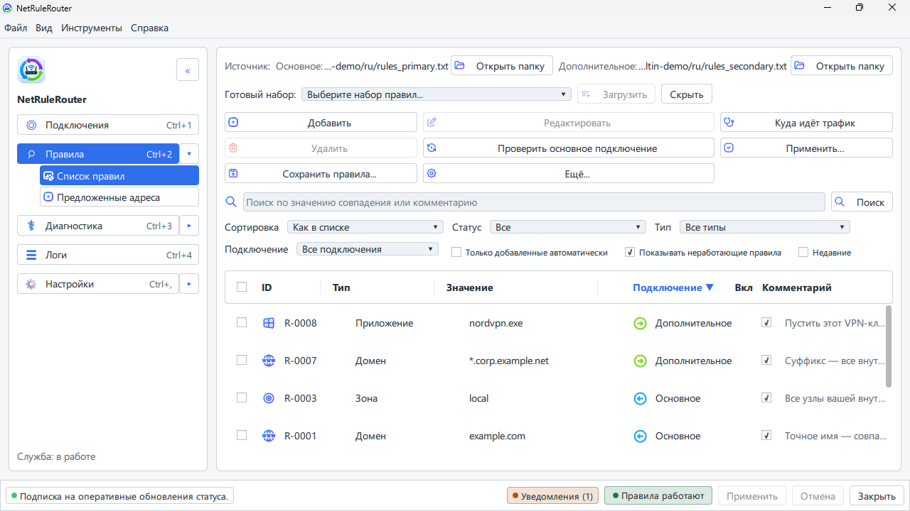

<div align="center">


# NetRuleRouter

**Направляйте каждый сайт, адрес, подсеть, диапазон или программу через выбранное подключение, запрещайте то, чему нельзя уходить, а если VPN упал — трафик ждёт, а не утекает в открытую сеть.**

Десктопный менеджер сетевой политики, который маршрутизирует трафик между
интерфейсами, которые у вас *уже есть*: основной интернет, VPN, второй провайдер,
Wi-Fi, Ethernet. Без собственного туннеля, без облака, без аккаунта.

Сегодня — сборки под Windows; Linux в работе, macOS следом.

[](#лицензия)
[](https://github.com/kroxiksut/net-rule-router/actions/workflows/windows-quality.yml)
[](https://github.com/kroxiksut/net-rule-router/actions/workflows/linux-quality.yml)

-0078D6.svg)

[](#быстрый-старт)
[](#терминальный-интерфейс)
[](#административная-консоль)


[English](README.md) · **Русский**



</div>

---

## Что это

NetRuleRouter позволяет сказать: *«пусти `*.bank.com` и вот это приложение через
основную линию, а всё остальное — через VPN»* — и эта политика применяется
предсказуемо, локально и с понятным журналом каждого решения.

Типичные сценарии:

- **Основной интернет + VPN** — оставить чувствительные к задержкам или геозависимые сервисы на прямой линии, остальное направить через VPN.
- **Провайдер A + Провайдер B** — распределить трафик между двумя аплинками.
- **Wi-Fi + Ethernet / Wi-Fi + VPN** — закрепить конкретные адреса за конкретным интерфейсом.
- **Любой адаптер, который видит Windows,** годится в роли дополнительного маршрута — включая USB-сетевые устройства (платы RNDIS/ECM, телефон в режиме модема), Bluetooth PAN или адаптер виртуальной машины, выделенный под разработку и тесты.

## Чем это *не* является

Это **не** VPN-клиент, не инструмент анонимизации, не инструмент обхода блокировок,
не proxy manager и не облачный сервис. Он управляет маршрутизацией между
подключениями, которые вы настроили сами, — он их не создаёт и не скрывает.

## Быстрый старт

1. **Распакуйте и запустите.** Распакуйте архив куда угодно — на рабочий стол,
   в корень диска, на флешку, — запустите `NetRuleRouter.exe` и примите
   лицензионное соглашение. Готовых архивов пока нет; собрать такой —
   `scripts/package-windows.ps1`, он запускается на машине без Qt и Rust
   (см. [Сборка из исходников](#сборка-из-исходников)).
2. **Установите фоновую службу.** Окно приветствия предлагает
   *«Установить и запустить службу»* — подтвердите запрос UAC. Без службы
   приложение работает в режиме предпросмотра: правила можно править, но
   ничего не применяется.
3. **Выберите стартовый набор правил.** Мастер первого запуска предлагает
   страновой пресет, встроенный демо-набор, ваши собственные два `.txt`-файла
   или пустой старт.
4. **Назначьте два маршрута.** На экране *«Интерфейсы и маршруты»* укажите,
   какой адаптер — основной маршрут, а какой — дополнительный (ваш VPN, второй
   провайдер, второй Wi-Fi), и куда идёт трафик, не попавший ни под одно
   правило.
5. **Сохраните набор как свой** — *Настройки → «Пресеты и настройки» → «Мои
   наборы правил»*: укажите свою папку и нажмите *«Сохранить текущие правила
   как набор»*. Наборы, оставшиеся в папке приложения, заменяются при
   следующем обновлении; набор в вашей папке его переживёт.
6. **Добавьте свои сайты** (врезка ниже) и нажмите **«Применить»** — правила
   вступают в силу только после применения.

> **Один раз после установки.** Служба маршрутизирует ровно то, что написано в
> правилах, и ничего сверх того. Сайты, которые раньше открывались у вас через
> VPN, продолжат ходить по основному каналу, пока их нет в правилах
> дополнительного маршрута, — пресет не знает вашего личного
> списка. Пройдитесь по нужным вам сайтам и добавьте их сами: в разделе
> **«Правила»** или прямо в файле `rules_secondary.txt` в вашей папке наборов.
> После этого нажмите **«Применить»**. Это делается один раз — дальше список
> живёт вместе с вашим набором правил.

Подробный разбор, включая что делать, если пропал интернет, — в
[`docs/ru/quickstart.md`](docs/ru/quickstart.md). На каких версиях Windows и
Linux программа работает и где это уже проверено — в
[`docs/ru/supported-systems.md`](docs/ru/supported-systems.md).

## Проверка загрузки

Установщики и архивы пока не подписаны сертификатом разработчика, поэтому
Windows может предупредить при первом запуске. Для каждого файла выпуска
GitHub хранит запись о сборке и коммите, из которого он собран, — так можно
убедиться, что скачанный файл ровно тот, что собрала сборка выпуска этого
репозитория, не доверяя странице, с которой он скачан:

```sh
gh attestation verify <файл> --repo kroxiksut/net-rule-router
```

Нужен GitHub CLI (`gh`) со входом через `gh auth login`. Файл, изменённый
после сборки или собранный где-то ещё, проверку не пройдёт. Для быстрой
сверки контрольных сумм рядом с файлами лежит `SHA256SUMS`:
`sha256sum -c SHA256SUMS` (в PowerShell — сравнить с `Get-FileHash <файл>`).

## Возможности

- **Модель из двух маршрутов** — `primary` и дополнительный, одна активная конфигурация одновременно.
- **Семь способов сопоставления трафика** — по точному домену, по домену со всеми поддоменами, по сайту во всех зонах (`bank.*`), по точному IPv4- или IPv6-адресу, по подсети или диапазону адресов, по доменной зоне (TLD или внутренний суффикс, например `.ru` или `.intra`) или по приложению (имя программы либо файл или папка, где она установлена; на Windows и Linux правило папки покрывает и программы, которые туда положит следующее обновление, и скрипты из неё).
- **Статистика трафика** — сколько прошло через каждое подключение сегодня, за текущий сеанс дополнительного подключения и за все хранимые дни (сколько хранить — выбираете вы), с выгрузкой в CSV за любой период.
- **Маршрутизация по именам** *(Windows, на новой установке включена: Настройки → Поведение маршрутизации, при включённой защите от утечки)* — сайты, живущие на одном адресе сервера, всё равно идут туда, куда велит их собственное правило. Крупные платформы и CDN размещают сотни имён на считанных адресах, и маршрутизация по адресам их не различает; см. [`docs/ru/routing-modes.md`](docs/ru/routing-modes.md).
- **Защита от утечки** — один выбор: **«Выключена»** (по умолчанию), **«Только сайты из правил»** (то, что правила отправляют через дополнительное подключение, никогда не уйдёт через основное; всё остальное работает как обычно) или **«Всё»** (ничего не уходит, кроме как через дополнительное подключение, локальную сеть и то, что правила отправляют через основное; если дополнительное подключение пропадёт, интернет подождёт, пока оно вернётся). Корпоративный VPN рядом с вашим при любом варианте сохраняет свои сети.
- **Запрет** — сайт, адрес, подсеть или программу, которые вы запретили, не пускают ни через одно подключение: поставьте `!` перед ними в файле правил или выберите «Запретить» при добавлении правила в окне, в трее или в терминальном интерфейсе. Запрет адреса или подсети не зависит от имён; списков блокировки нет — только правила, которые пишете вы.
- **Защита системных программ** — запрет или правило для дополнительного маршрута не может задеть то, без чего компьютер теряет сеть (системную папку, `svchost.exe`, сетевые службы, общую папку многих программ): приложение отвергает такое правило до сохранения. Если вы действительно этого хотите, `+override` в файле правил просит вашего подтверждения на выбранный срок, а там, где правило задевает не только ваши программы, — ещё и прав администратора; см. [`docs/ru/rules-file-format.md`](docs/ru/rules-file-format.md#116-применить-правило-вопреки-защите-override).
- **Много правил сразу и недавние изменения** — вставьте список сайтов, адресов и программ строками файла правил, и каждая строка проверяется до добавления; фильтр «Недавние» показывает, что вы добавили, изменили или удалили за последний час, сегодня или за 7 дней, и одним нажатием возвращает удалённое правило. И в окне, и в терминальном интерфейсе.
- **История соединений** — какие из ваших программ куда соединялись и по какому маршруту, хранится на этом компьютере 7 дней, если вы не выберете иначе, с группировкой по программе или по папке. Читать свою можете только вы; в диагностический архив она не попадает, а очистить или выключить её можно в настройках.
- **WSL, контейнеры и виртуальные машины** — вы выбираете, получают ли их программы ту же защиту от утечки, что и этот компьютер, или остаются без защиты, пока дополнительный маршрут недоступен. На живой системе пока не проверено.
- **Предлагаемые адреса** — маршрутизируемый сайт часто подтягивает собственные вспомогательные домены. Приложение собирает их, показывает, какому из ваших сайтов нужен каждый, и предлагает добавить. Ничего не добавляется без вашего ведома, а если оставить предложение без ответа, адрес просто продолжит идти по основному маршруту.
- **Перекрытия** — если правила двух маршрутов покрывают одни и те же сайты (зона на одном маршруте, сайт внутри неё — на другом), побеждает более узкое правило, а приложение показывает каждую такую пару и маршрут, по которому на самом деле идут её сайты. Каждую можно подтвердить или одним нажатием направить эти сайты через другой маршрут. Тот же экран показывает применённые правила, которые работают не так, как записаны, — например, запрет адреса, который заодно останавливает маршрутизируемый вами сайт.
- **Explain mode** — спросите *«почему этот хост ушёл именно туда?»* и получите точную трассировку правил. Под сопоставление FQDN/IP работает локальный SQLite-кэш.
- **Открытые текстовые пресеты** — читаемые наборы правил (включая готовые страновые сплиты), которые можно сравнивать, редактировать и делиться ими.
- **Правила, которые подстраиваются под провайдера** — поставьте `?` перед сайтом или адресом (или отметьте «Не уверен» при добавлении), и он пойдёт через тот маршрут, для которого записан. Если там он не открывается, а через другой маршрут открывается, приложение пустит его через другой маршрут и предложит перенести правило; пока вы не согласились, перенос действует до перезагрузки компьютера. Встроенные пресеты используют это для сервисов, которые один провайдер блокирует, а другой нет, — один набор подходит для любого провайдера.
- **Нативное десктоп-приложение** — Qt/QML GUI плюс tray для ежедневного управления и фоновая служба, применяющая политику при старте. Меню трея и его уведомления ещё дорабатываются до первого релиза: их состав и вид могут меняться от сборки к сборке.
- **Доступность как базовое требование** — поддержка экранных чтецов, навигация с клавиатуры, масштабируемые шрифты, отдельная тема высокой контрастности; см. [`docs/ru/accessibility.md`](docs/ru/accessibility.md).
- **RU / EN из коробки**, с подключаемыми community-локалями (без пересборки).
- **Local-first и приватность** — без обязательного логина и без телеметрии. Немногие собственные обращения приложения (поиск адресов сайтов из ваших правил, проверка дополнительного подключения и адреса, с которого оно выходит, проверка правил с `?` для открытых вами сайтов, необязательная проверка обновлений) перечислены в [SECURITY.md](SECURITY.md) — с тем, что каждое из них даёт и как его выключить, где это можно.

## Как принимаются решения о маршруте

Для каждого назначения движок идёт по правилам от более специфичных к менее
специфичным и останавливается на первом совпадении:

| # | Тип правила | Пример |
|---|-------------|--------|
| 1 | Точный домен (FQDN) | `api.bank.com` |
| 2 | Поддомен / суффикс | `*.bank.com` |
| 3 | Сайт в любой зоне | `bank.*` |
| 4 | Точный IP-адрес (IPv4 или IPv6) | `203.0.113.7`, `2001:db8::7` |
| 5 | Подсеть (CIDR) или диапазон IP | `10.0.0.0/8`, `192.0.2.10-192.0.2.40` |
| 6 | Зона (TLD / внутренний суффикс, доменные зоны) | `.ru`, `.com`, `.intra` |
| 7 | Приложение (имя программы, файл или папка) | `chrome.exe` |
| 8 | Маршрут по умолчанию | основное подключение или дополнительное, как выбрано в настройках |

Примечания:

- Побеждает более узкое правило: собственное имя сайта сильнее его адреса,
  **точный IP** сильнее любой сети, в которую входит, сеть сильнее зоны, в
  которой лежит. Из двух имён побеждает более длинное, из двух сетей — более
  конкретная.
- **Сайт в любой зоне** (`bank.*`) одним правилом покрывает `bank.com`,
  `bank.net`, `bank.co.uk` и их поддомены. Правило с явной зоной (`bank.by`,
  `*.bank.by`) сильнее его, в какой бы маршрут ни вело каждое из них.
- **Запрет** точного IP-адреса останавливает этот адрес, какое бы правило
  его ни называло. Любой другой запрет стоит на своём месте в порядке выше.
- Если два правила одного вида одинаково конкретны, запрет сильнее
  маршрута, а основной маршрут — дополнительного.
- Правило задаёт адрес назначения **или** приложение. Правило, которое
  ограничивает адрес одним приложением, пока не может быть исполнено, поэтому
  служба его отклоняет, а не применяет ко всем приложениям.
- **CIDR-подсети и диапазоны IP** работают как адреса назначения: целую
  корпоративную сеть или блок адресов можно направить через любое из подключений
  одним правилом. Порты и протоколы не поддерживаются.
- IPv6-адреса работают в правилах. Они идут через дополнительное подключение,
  если оно несёт IPv6; если нет — задерживаются, а не уходят через основное.
  На настоящей IPv6-сети это ещё не проверялось. После смены правила уже
  открытые по IPv6 соединения сохраняют прежний маршрут, пока программа не
  переподключится (по IPv4 приложение обновляет их само), а `?` на IPv6-адресе
  никогда не переносит правило.
- Движок решений чистый и детерминированный: одинаковый вход всегда даёт одинаковый, полностью трассируемый результат.

> Назначение, не совпавшее ни с одним правилом, идёт по маршруту по умолчанию,
> поэтому сайт должен быть в правилах дополнительного маршрута,
> если вы хотите отправить его туда; см. разовый шаг в
> [Быстром старте](#быстрый-старт). **После добавления или удаления правил
> всегда нажимайте «Применить»: правила вступают в силу только после
> применения.**

## Пресеты

В `presets/` лежат открытые текстовые наборы правил, которые можно импортировать
как отправную точку, — включая страновые сплиты «своё против зарубежного» для ряда
регионов (`ru`, `cn`, `ir`, `tr`, `in`, `id`, `vn`, `kz` и др.). Каждый набор — это
два простых файла, `rules_primary.txt` / `rules_secondary.txt`, с метаданными в
комментариях-заголовках:

```text
# NetRuleRouter preset - version 1
# name: CN Mainland Split - Primary Route
# preset_version: 1

--- Zones
cn              # .cn

--- Domains
qq.com
*.qq.com
alibaba.com
*.alibaba.com
```

Строки с `?` (например, `?accounts.google.com`) идут через маршрут своего
файла; если ваш провайдер блокирует их там, а другой маршрут их открывает,
приложение предложит их перенести. Полный формат описан в
[`docs/ru/rules-file-format.md`](docs/ru/rules-file-format.md).

> Встроенные страновые пресеты — это черновики, подготовленные с помощью ИИ, как
> удобная отправная точка, а не авторитетная рекомендация по маршрутизации.
> Проверяйте и адаптируйте их перед тем, как на них полагаться.

## Сборка из исходников

> Команды ниже — для Windows. У каждого скрипта есть парный `*.sh` для Linux,
> где порт ещё в работе и не проверен на релизном уровне; macOS идёт следом.

**Требования:** свежий Rust toolchain, установленный Qt 6 для разработки и CMake.
`scripts/bootstrap.ps1` проверяет окружение и готовит ваш `.env`.

```powershell
# 1. Подготовить окружение и .env
powershell -ExecutionPolicy Bypass -File .\scripts\bootstrap.ps1

# 2. Собрать launcher + native Qt host
cargo build -p nrr-launcher -p nrr-qt-host

# 3. Запустить
.\target\debug\NetRuleRouter.exe          # главный GUI
.\target\debug\NetRuleRouterTray.exe      # tray

# …или через helper-скрипт
.\scripts\run.ps1 -Component gui
.\scripts\run.ps1 -Component tray
```

Фоновая служба (применяет и поддерживает политику при старте) ставится через
`scripts/install-service.ps1` и удаляется через `scripts/uninstall-service.ps1`.

Чтобы не осталось ничего — служба, настройки, кэши и логи за один раз —
`scripts/purge-data.ps1` убирает все места, куда продукт пишет. Без `-Yes` он
только показывает, что удалит, и оставляет журнал аудита, если не добавить
`-PurgeAudit`:

```powershell
powershell -ExecutionPolicy Bypass -File .\scripts\purge-data.ps1
```

Проверка качества (fmt + clippy + тесты + аудит зависимостей/лицензий):

```powershell
powershell -ExecutionPolicy Bypass -File .\scripts\check.ps1 -RequireCargoDeny
```

### Подготовка сборки к распространению

`scripts/package-windows.ps1` превращает рабочую копию в папку, которая
запускается на чистой машине с Windows — без Qt, без Rust, без репозитория и
без установщика:

```powershell
powershell -ExecutionPolicy Bypass -File .\scripts\package-windows.ps1 -Zip
```

Пакет складывается в `C:\temp\NetRuleRouter\dist\NetRuleRouter`, а `-Zip`
кладёт рядом `NetRuleRouter-windows-x64-<версия>+<коммит>.zip`. Внутри — GUI,
трей, служба, консоль, терминальный интерфейс, runtime Qt и дерево QML / локалей / пресетов /
конфигураций, плюс отметка сборки `build-info.json` (версия, ревизия, время
сборки) и короткие `README.txt` / `README.ru.txt` для того, кто распакует
архив. Параметры и состав пакета — в
[`docs/ru/packaging-windows.md`](docs/ru/packaging-windows.md).

## Конфигурация и данные

- **UI-настройки** (тема, язык, доступность, названия маршрутов, последний раздел…) хранятся в managed local storage и переживают обновления.
- **Активная конфигурация** — одна за раз, **на пользователя Windows**: ваши ежедневные правки правил — ваши собственные (без запроса администратора) и действуют только для вас, а администратор может задать общий **baseline**, к которому откатывается каждый пользователь, пока не настроит своё. «Сбросить к baseline» отбрасывает ваши изменения. Правила лежат в двух текстовых файлах пресета.
- **Кэши и состояние** — локальный SQLite (`nrr_fqdn_ip_cache.db`, `nrr_service_state.db`); аудит и операционные логи в формате NDJSON. Как заполняется кэш FQDN/IP, включая опциональный засев из истории браузера — в [`docs/ru/cache-and-seeding.md`](docs/ru/cache-and-seeding.md). Этими базами управляет само приложение — правка сторонними инструментами не поддерживается и делается на свой риск; подробности — в [`docs/ru/where-files-live.md`](docs/ru/where-files-live.md).
- Locale-файлы читаются во время выполнения; положите валидный по схеме `de.json` в каталог пользовательских локалей — и он появится в выборе языка без нового релиза.

## Административная консоль

Вместе с приложением поставляется консоль `nrr-cli`. Она устанавливает,
запускает, останавливает и проверяет фоновую службу, а `diag doctor` печатает
один отчёт, который можно приложить к обращению вместо трёх скриншотов.
Правила остаются в приложении: консоль их не редактирует и не применяет,
машиночитаемого вывода у неё нет — это способ поддерживать одну машину в
порядке, а не API для автоматизации. Подробности —
[`docs/ru/cli.md`](docs/ru/cli.md).

## Терминальный интерфейс

`nrr-tui` — это программа в терминале: состояние, настройка, правила,
предложения, диагностика и настройки для машины, куда заходят по SSH, для
сервера без рабочего стола или для тех, кому удобнее клавиатура. Он работает с
экранными чтецами (`--plain`), никогда не полагается только на цвет и не
требует прав администратора для ваших собственных правил. Запускается только
интерактивно — сценарии пользуются `nrr-cli`. Подробности —
[`docs/ru/tui.md`](docs/ru/tui.md).

## Безопасность и приватность

- Для основных локальных функций маршрутизации логин не требуется.
- Телеметрии нет. Кроме вашего маршрутизируемого трафика, приложение разрешает имена сайтов из ваших правил и поддерживает их адреса свежими, спрашивает у DNS-сервера вашего подключения, какому сайту принадлежит адрес, пока включены предложения правил или защита от утечки (никогда — для сайта, который закрыло ваше правило запрета), проверяет, что дополнительное подключение живо, а если вы это включите, при каждом его подключении спрашивает у публичного сервиса STUN, с какого адреса оно выходит, проверяет правила с `?` для открытых вами сайтов и (после первого выпуска) может проверять, не вышла ли новая версия. Без предложений правил и без защиты от утечки таких вопросов об адресах нет; проверку обновлений можно выключить в настройках. Полный перечень — в [SECURITY.md](SECURITY.md).
- Привилегированные изменения политики идут через локальную, защищённую DACL границу named-pipe IPC — никакого localhost HTTP control plane для привилегированных операций.
- До выхода первого выпуска приложение вообще не проверяет обновления. После этого раз в N дней (по умолчанию 14, настраивается в настройках) оно спрашивает у официальной страницы выпусков проекта, не вышла ли новая версия, и если вышла — показывает уведомление. Оно ничего не скачивает, не устанавливает и не меняет маршрутизацию, а саму проверку можно выключить в настройках. Справка → «Проверить обновления» задаёт тот же вопрос по запросу, даже при выключенной автоматической проверке.

Полная модель доверия — в [`SECURITY.md`](SECURITY.md).

## Дорожная карта

**Сейчас:** модель из двух маршрутов, одна активная конфигурация на
пользователя Windows поверх общего администраторского baseline, правила по
домену / зоне / IP / сети / приложению (по имени, файлу или папке программы),
запреты, маршрутизация по именам, пресеты,
explain mode, защита от утечки, предлагаемые адреса, статистика трафика с
выгрузкой в CSV, история соединений, диагностический архив, административная консоль, RU/EN.

**В работе:** поддержка Linux (платформенные части вынесены за отдельный
интерфейс на каждую возможность, поэтому общая логика решений уже не зависит
от ОС), затем macOS.

**В работе: полноценный IPv6.** Правила уже называют IPv6-адреса и имена,
которые в них разрешаются, и маршрутизируют и защищают их так же, как IPv4;
осталось проверить это в настоящих IPv6-сетях, прежде чем считать готовым.

**Сразу за этим:** проверка, которая скажет, лежит ли неотвечающий сервер сам
или его не пропускает один из ваших каналов, и предупреждение, когда
дополнительный канал подходит к лимиту тарифа.

Весь порядок работы, без дат: [ROADMAP_RU.md](ROADMAP_RU.md).

## Документация

| Файл | Содержание |
|------|------------|
| [`SECURITY.md`](SECURITY.md) | Модель безопасности и границы доверия |
| [`STRUCTURE.md`](STRUCTURE.md) | Структура репозитория |
| [`docs/ru/rules-file-format.md`](docs/ru/rules-file-format.md) | Формат файлов пресетов и правил |
| [`docs/ru/quickstart.md`](docs/ru/quickstart.md) | Быстрый старт: от установки до первого применённого правила |
| [`docs/ru/supported-systems.md`](docs/ru/supported-systems.md) | Поддерживаемые версии Windows и Linux, что где доступно и что уже проверено |
| [`docs/ru/routing-modes.md`](docs/ru/routing-modes.md) | Переключатели маршрутизации: что даёт каждый и как их сочетать |
| [`docs/ru/what-routing-changes.md`](docs/ru/what-routing-changes.md) | Кто что видит, когда сайт идёт по правилу, и чего маршрутизация сознательно не трогает |
| [`docs/ru/several-users.md`](docs/ru/several-users.md) | Несколько вошедших одновременно: правила действуют у всех, и единственное ограничение на Windows |
| [`docs/ru/blocked-site-browser-errors.md`](docs/ru/blocked-site-browser-errors.md) | Что означает ошибка браузера, когда маршрутизируемый сайт не открывается |
| [`docs/ru/cache-and-seeding.md`](docs/ru/cache-and-seeding.md) | Как заполняется кэш FQDN/IP, включая засев из истории браузера |
| [`docs/ru/where-files-live.md`](docs/ru/where-files-live.md) | Где хранятся настройки, правила, кэши и логи |
| [`docs/ru/diagnostic-archive.md`](docs/ru/diagnostic-archive.md) | Что попадает в диагностический архив, а что не попадает никогда |
| [`docs/ru/recovering-network-access.md`](docs/ru/recovering-network-access.md) | Как вернуть сеть, если что-то пошло не так |
| [`docs/ru/known-limitations.md`](docs/ru/known-limitations.md) | Пробелы этой версии и что делать с каждым |
| [`docs/ru/cli.md`](docs/ru/cli.md) | Консоль `nrr-cli`: команды, коды возврата и что она сознательно не умеет |
| [`docs/ru/tui.md`](docs/ru/tui.md) | Терминальный интерфейс `nrr-tui`: запуск, экраны, клавиши, доступность, права |
| [`docs/ru/accessibility.md`](docs/ru/accessibility.md) | Работа с окном с клавиатуры, с экранным чтецом, крупным текстом или высокой контрастностью |
| [`docs/ru/building-windows.md`](docs/ru/building-windows.md) | Сборка из исходников на Windows: toolchain, Qt, типовые ошибки |
| [`docs/ru/unattended-install.md`](docs/ru/unattended-install.md) | Установка сценарием сразу с правилами для каждого пользователя и коды выхода |
| [`docs/ru/packaging-windows.md`](docs/ru/packaging-windows.md) | Как собрать переносимый пакет и установщики для распространения |
| [`docs/ru/building-linux.md`](docs/ru/building-linux.md) | Сборка из исходников на Linux: toolchain, Qt, типовые ошибки |
| [`docs/ru/packaging-linux.md`](docs/ru/packaging-linux.md) | Как собрать пакеты `.deb` и `.rpm` для распространения |
| [`docs/ru/dns-via-secondary.md`](docs/ru/dns-via-secondary.md) | DNS через туннель: какие имена куда идут и что видят резолверы |
| [`docs/ru/fake-ip.md`](docs/ru/fake-ip.md) | Посайтовая маршрутизация через виртуальные адреса: что она даёт и что нужно |
| [`docs/ru/vpn-detection.md`](docs/ru/vpn-detection.md) | Как распознаётся VPN-клиент на машине и что с этим делает программа |
| [`docs/ru/first-run-answers.md`](docs/ru/first-run-answers.md) | Ответы на вопросы настройки, заданные заранее |
| [`docs/ru/third-party-components.md`](docs/ru/third-party-components.md) | Какие сторонние компоненты поставляются, под какими лицензиями и как их проверить |

## Лицензия

NetRuleRouter распространяется под **MPL-2.0**.

Он спроектирован так, чтобы быть пригодным и как самостоятельное приложение, и как
встраиваемый компонент маршрутизации первого слоя внутри других продуктов — вклад и
интеграции приветствуются. Если ваш продукт использует NetRuleRouter, пожалуйста,
укажите его и дайте ссылку на проект. Все runtime-зависимости должны оставаться
совместимыми с коммерческим распространением (MIT / Apache-2.0 / BSD / MPL-2.0 /
ISC); зависимости с неясной лицензией не считаются одобренными по умолчанию.

Полный текст лицензии — в файле [`LICENSE`](LICENSE); приложение также
показывает его в окне «Лицензия» (Ctrl+Shift+L).

---

<div align="center">
<sub><code>README.md</code> и <code>README_RU.md</code> поддерживаются синхронно — обновляйте оба в одном изменении.</sub>
</div>
