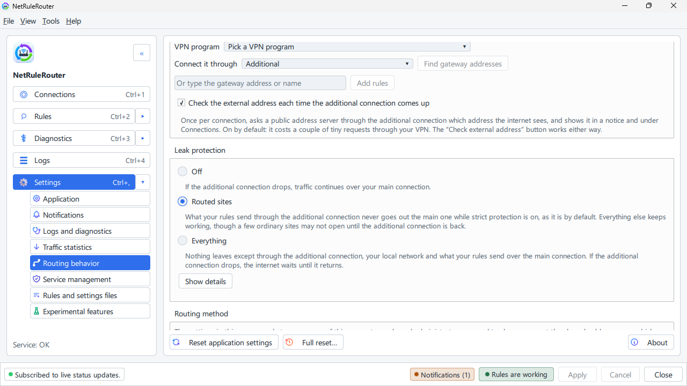

# Pause everything, and leak protection

**English** · [Русский](../ru/pause-and-protection.md)

This page shows how to switch the program's rules off for a while, and how to
choose what happens to your internet when the VPN is not connected.

## Pause everything quickly

Use this to find out whether the program is the reason something does not work.

1. Right-click the NetRuleRouter icon near the clock.
2. Click **Turn off rules…**.
3. Choose for how long: **In 15 minutes**, **In 1 hour**, **In 4 hours**, after
   a restart, or **When I turn them back on**.
4. Type a short reason (it is saved in the log) and click **Turn off now**.

While the rules are off, both your rules and leak protection are off. Every
site goes the ordinary way. The window says **Rules are off**. To turn them
back on early, click **Turn rules on** in the tray menu. When the time is up
they come back by themselves.

The same is in the window: **Settings** → **Routing behavior** → **Turning rules on and off** → **Turn off rules**.

## Leak protection (on by default)

A VPN can be off, drop, or start later than Windows. **Leak protection**
decides what your internet does then. It is on from the start with **Routed
sites**: the sites you send through the VPN wait instead of going out
directly, so a service with regional restrictions does not see your real
region. Everything else keeps working. You can turn it off in Settings.

There are three choices:

- **Off.** Nothing stops. Sites that should use the VPN still open, but over
  your ordinary internet, so your provider and the site see your real address.
- **Routed sites** (the default). Only the sites and programs from your rules
  stop opening while the VPN is down. Everything else works.
- **Everything.** The whole internet waits until the VPN is back. Nothing
  leaves except through the VPN and your local network.

If you have not chosen an additional connection yet, the sites your rules send
there wait too, and the window says so. Choose the connection
([Choose your main and additional connection](connections.md)), or set leak
protection to **Off**. Without rules for the additional connection nothing
waits.

> **This is an alpha.** **Everything** has not been fully tested and may cut
> off your internet until you set it back to **Off**. If that happens, see
> [Recovering network access](recovering-network-access.md).

### Turn protection on or off

In the window:

1. Open NetRuleRouter and click **Settings**.
2. Click **Routing behavior**.
3. Under **Leak protection**, click **Off**, **Routed sites** or
   **Everything**. The choice works at once; there is nothing to apply.

To turn protection back on, click **Routed sites** (or **Everything**) in the
same place. If you pick **Everything** while the VPN is not connected, the
window asks first, because the internet stops at once.

In the tray menu there is no protection switch. **Turn off rules…** there
switches off your rules and leak protection together for a while: see
[Pause everything quickly](#pause-everything-quickly).

In the terminal interface:

1. Press `0` to open **Settings**.
2. Choose **Routing behavior** with the arrow keys and press `Enter`.
3. Move to **Leak protection** and press `Enter`.
4. Choose **Off**, **Routed sites** or **Everything** with the arrow keys and
   press `Enter`.

### When a site waits for the VPN

With **Routed sites** on and the VPN off:

- a notification says **The additional connection is not up**: everything your
  rules send there is held until it comes back, and that is the protection
  doing its job, not a fault;
- the browser shows an error page for the sites from your rules. Everything
  else opens as usual.

Start the VPN. When it is back, the sites open again by themselves; a page that
showed an error needs a reload (F5). More on the error pages:
[Browser error pages](blocked-site-browser-errors.md). In the terminal
interface the same notice is in the feed on the Status screen.

## If you need more

- With **Routed sites**, some ordinary sites that share a server with a routed
  site may stop too. To allow them, untick **Strict: also block addresses shared with regular sites (may break them)**
  just under the setting. A little traffic of routed sites may then go out in
  the open.
- Keep your VPN program working: set it up under **Your VPN client**, see
  [Choose your main and additional connection](connections.md).
- In the terminal interface: **Settings** → **Routing behavior** has the same
  choices: [the terminal interface](tui.md).

## See also

- [Routing modes: what each switch does](routing-modes.md)
- [Recovering network access](recovering-network-access.md)
- [What takes priority](what-takes-priority.md)
- [A site does not open](site-does-not-open.md)
