# Quick start (pre-alpha)

**English** · [Русский](../ru/quickstart.md)

NetRuleRouter controls **which traffic uses which connection** — by domain,
IP address, or application. It works with connections you already have
(main internet + VPN, two providers, Wi-Fi + Ethernet), and is not a VPN
client, proxy, or anonymity tool.

> **This is pre-alpha.** Leak protection, its **Everything** setting above
> all, has not yet passed full testing and may work
> incorrectly — up to a complete loss of network access until it is set
> back to **Off**. It is available in settings, but turning it on is at your
> own risk.

## Requirements

- Windows 10 or 11, 64-bit
- Administrator rights — once, to install the background service
- Two network connections to route traffic between (for example, main
  internet and VPN). You can also work with one —
  see [«If you have no additional connection»](#if-you-have-no-additional-connection)

## Installation

1. Get the archive. Ready-made archives are not published yet:
   `scripts/package-windows.ps1` builds one that runs on a machine without Qt
   or Rust (see [Packaging a portable build](packaging-windows.md)).
2. Unpack it into any folder — for example, on your Desktop or at the root
   of drive `C:` or `D:`.
3. Run `NetRuleRouter.exe`. At first launch the app will show the
   [end-user license agreement](../legal/eula.en.md) — read and accept
   it to continue.

   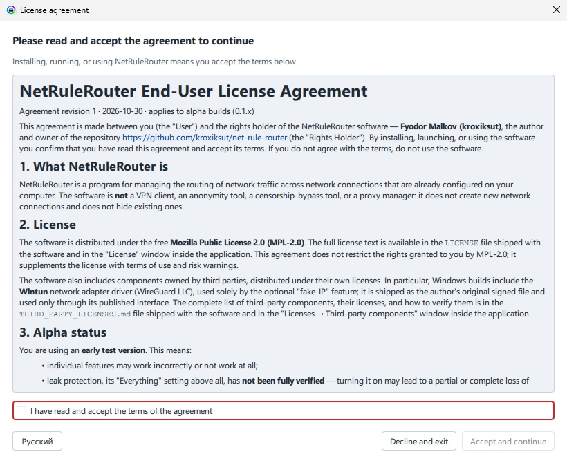

4. Install the background service. The welcome window offers it right
   away — **"Install and start the service"**; confirm the UAC prompt for
   administrator rights. The same actions live in **Settings → Service
   management**, where the service can also be started, stopped, and
   removed.

Without the service, the app runs in limited mode: you can edit rules, but
routing does not apply.

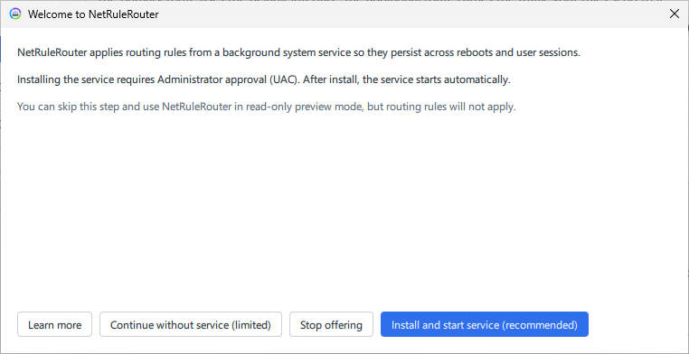

## First setup

1. **Pick a starting rule set.** Right after the service dialog, the
   first-run wizard offers four options: a country preset, a built-in
   demo set, two `.txt` files of your own, or an empty start. Whatever
   you pick lands in the rules for review before anything is applied.
   It also offers to start the tray icon at sign-in (on by default), so
   after a restart the state is in sight without opening the window.

   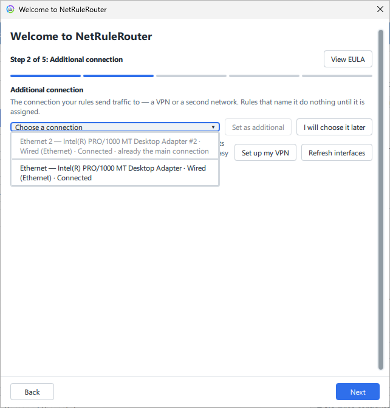

   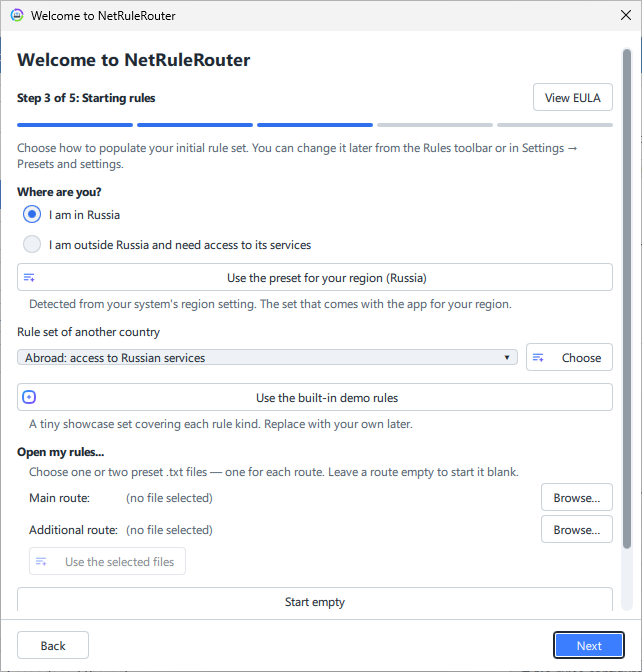

2. **Choose two routes.** On the *Interfaces & routes* screen, specify
   which network adapter is the *main* (primary) one and which is the
   *additional* one (for example, a VPN). Both can be given custom
   names — they will be visible in the rules.

   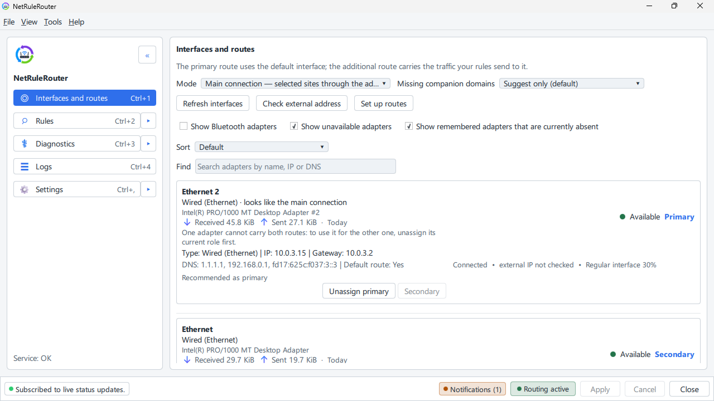

3. **Choose the default route and leak protection.** The *default route*
   decides where traffic that no rule covers goes:

   - **Main connection — selected sites through the additional one**;
   - **Additional connection — exceptions through the main one**.

   *Leak protection* decides what may still leave over the main connection
   instead of the additional one:

   - **Off** (the default) — if the additional connection drops, traffic
     continues over your main connection.
   - **Routed sites** — what your rules send through the additional
     connection never goes out the main one while strict blocking of shared
     addresses is on, as it is by default. Everything else keeps working,
     except sites that share an address with a routed one.
     Offered with the main-connection default route.
   - **Everything** — nothing leaves except through the additional
     connection, your local network and what your rules send over the main
     connection. If the additional connection drops, the internet waits
     until it returns.

   A corporate VPN beside yours keeps its own networks in every mode.

   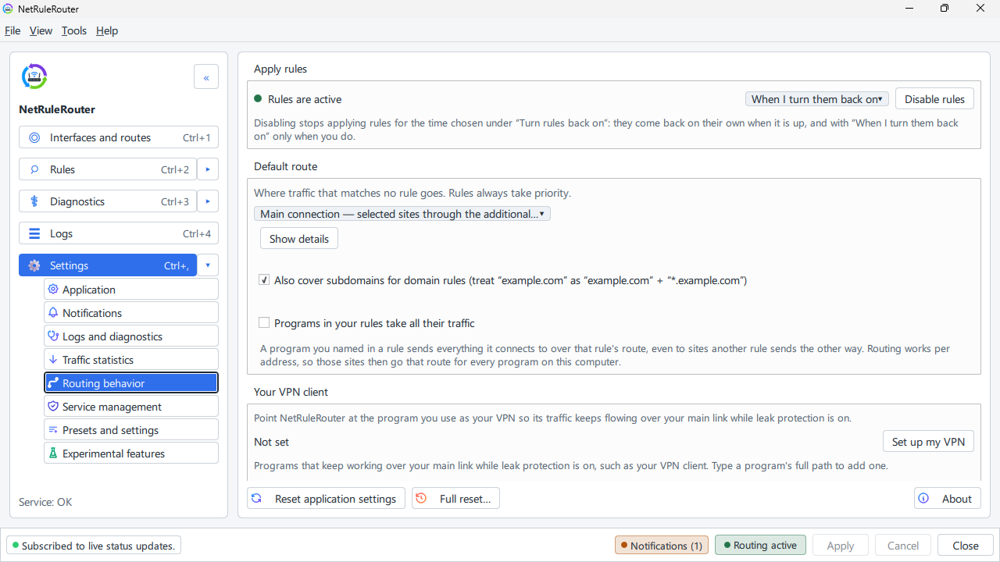

4. **Save the set as your own.** Settings → *Presets & settings* → *My rule
   sets*: point it at a folder of your own, then *"Save current rules as a
   set"* and give it a name. Rule sets left in the application folder are
   replaced by the next update; a set in your own folder survives it, and
   you can keep several — "home", "work" — and switch between them.

   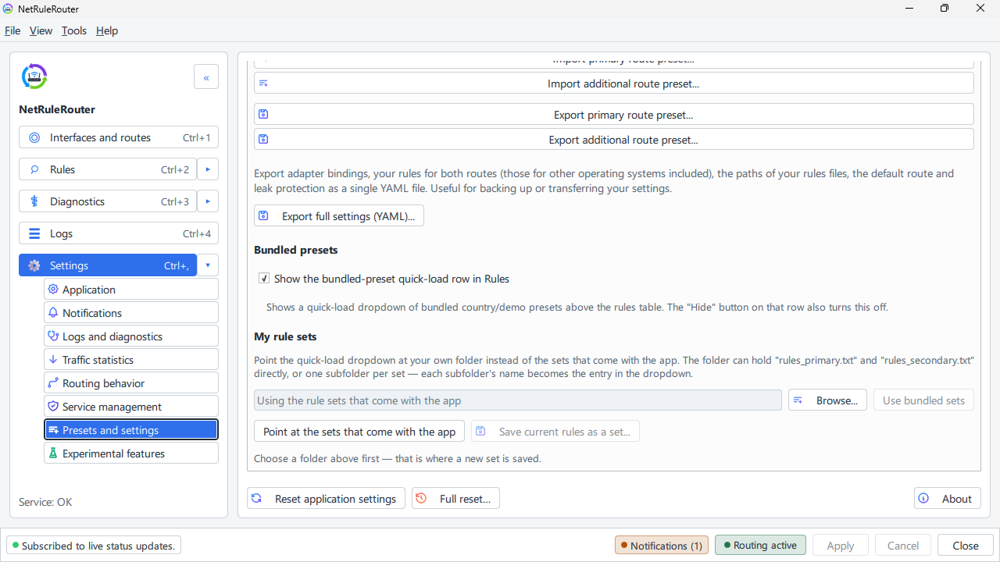

5. **Add your own sites and apply** — see the next section.

## Rules: how it works

A rule says: "this traffic → through that route". Traffic can be described
seven ways, listed here from the strongest rule to the weakest:

| Type | Example | Matches |
|-----|--------|---------|
| Exact domain | `api.example.com` | only this host |
| Domain with subdomains | `*.example.com` | the domain and all subdomains |
| Site in every zone | `example.*` | `example.com`, `example.net`, `example.co.uk`… with subdomains |
| Exact IP | `203.0.113.7`, `2001:db8::7` | only that address |
| Network or range | `10.0.0.0/8`, `192.0.2.10-192.0.2.40` | every address in it |
| Domain zone | `.ru` | all domains in the zone |
| Application | `chrome.exe`, `C:\Apps\Tool\*` | that program wherever it is installed, or every program in that folder |

The narrower rule wins: a site's own name beats its address, an address beats
the network around it, a network beats the zone. A zone of several labels
(`corp.example.com`) counts as its subdomains and beats `*.example.com`. A rule
that names the zone (`*.example.by`) beats `example.*` for that zone. A rule names either an address or an
application: a rule that limits an address to one application cannot be
carried out yet, so the service refuses it.

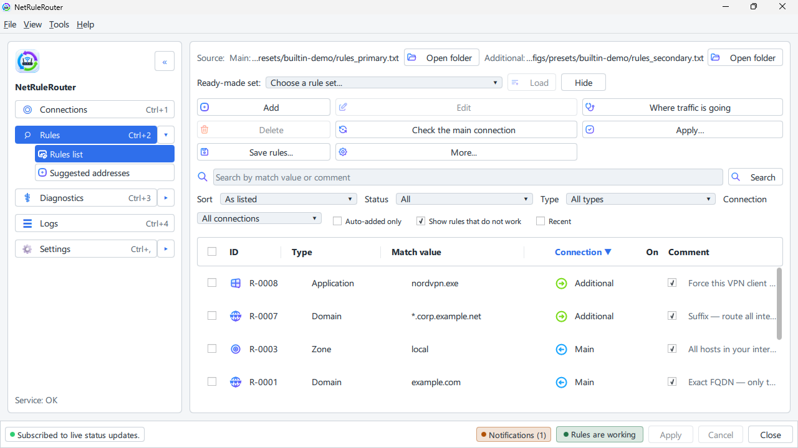

### Add your own sites — a one-time step

The service routes exactly what the rules say and nothing else. Sites that
used to open for you over the VPN keep going out over the main connection
until they appear in the rules of the additional route — a
preset ships someone else's list, not yours.

So right after the first setup, go through the sites you actually use over
the VPN and add them yourself, either way round:

- in the **Rules** section of the app — pick the additional route, add the
  domain (`example.com` and `*.example.com` for its subdomains);
- or straight in `rules_secondary.txt` inside your rule-set folder, one
  entry per line, then reload the set in the app.

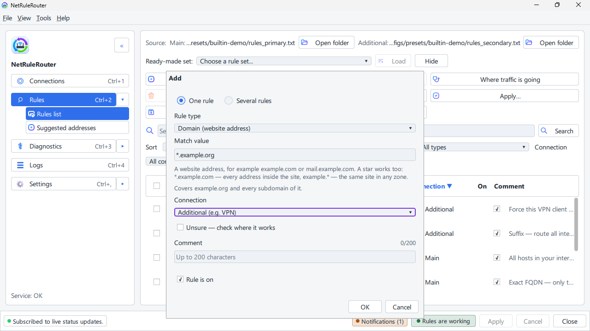

Then press **Apply**: rules only take effect after applying. You do this
once — from then on the list travels with your rule set, including across
reinstalls.

Apply never surprises you: the app first shows what the service is about to
receive — every rule added, changed or removed — and waits for your
confirmation.

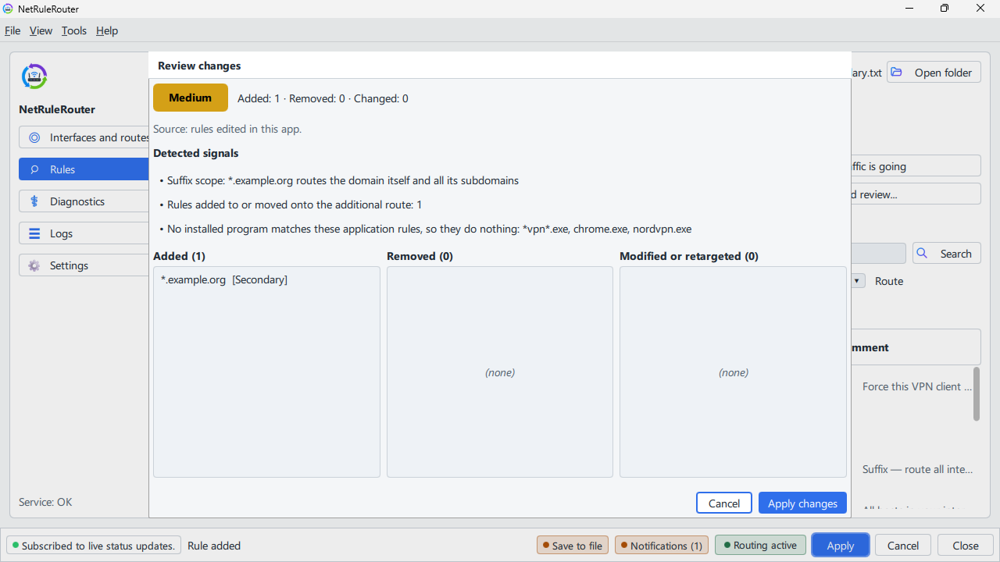

### Deny, many rules at once, and recent changes

- **Deny.** Choose *Deny* as the route when you add a rule, or put `!` before
  the value in a rules file (`!telemetry.example.net`): that site, address,
  network or program is not let through any connection. The *Denied* filter
  of the rules list shows them all.
- **Several rules at once.** Switch the add window to *Several rules* and
  type or paste one rule per line, as in a rules file. Each line is checked
  and shown with its type before anything is added; the lines that are not
  taken stay in the box for you to fix.
- **Recent.** The *Recent* filter of the rules list shows what you added or
  changed in the last hour, today or the last 7 days, newest first, with the
  time and what it was before. Rules you deleted are listed below them, and
  *Restore* puts one back as it was; apply to bring it into
  force again.

The terminal interface has all three too; see [its Rules
screen](tui.md#more-on-the-rules-screen).

### Programs by name, file or folder

An application rule names a program by its name (`chrome.exe`), by its file
(`C:\Apps\Tool\tool.exe`) or by the folder it lives in: *Choose folder...* in
the add window, with *Include subfolders* for a program that keeps helpers
and new versions in subfolders; under the field the window says how many
programs the rule takes. A folder rule also covers a program that
appears there after an update, and the scripts kept in the folder when they
are started by Python, PowerShell, Java and the like. Rules by file and
folder work on Windows and Linux. The full list of forms is in the [rules
format](rules-file-format.md#windows--linux--macos-application-sections).

To find the folder, open **Connection trace** and group it by folder: a
folder group offers a rule for the whole folder.

### Programs the system needs are protected

A deny, or a rule for the additional route, cannot take a program or a folder
the computer needs to stay on the network: the system folder, `svchost.exe`,
the network services, a folder many programs share such as `Program Files`.
The add window says so before the rule is saved, and such a rule already in a
rules file is shown as not applied, with the reason. When you do mean it,
write `+override` after the value in the rules file: the rule is applied once
you confirm it in the rules list (*Confirm…*), for a time you choose, and
confirming a rule that reaches past your own programs asks for administrator
rights. See [Applying a rule despite the
protection](rules-file-format.md#116-applying-a-rule-despite-the-protection-override).

### Application rules need a restart of the program

An application rule names a program to watch: the addresses it contacts are
learned as it connects, and the route follows from the next connection onward.
A program that is **already running** when you add its rule will therefore see
its first attempts fail — installers and updaters in particular often give up
at that point and report that there is no connection.

So: add the rule, press **Apply**, then restart the program. If you also know
the site the program uses, an ordinary domain rule (`*.example.com`) is the
better tool — it takes effect as soon as the name is looked up, with nothing to
learn first.

### Suggestions you are not interrupted about

While you work, the app notices further hosts the sites you route actually
need, and offers to add them. A host that already answers over your main
connection is **not** raised in the tray: it works without the additional
route, and interrupting you about it would be noise.


It is still in the suggestions list, marked as reachable on the main
connection. Answering is not the same as serving — some sites answer a
main-connection address with a refusal — so the decision stays yours: open the
list and add it if the site is not actually working for you.

When you accept a suggestion, the app refreshes your own open connections to
that site so the page picks up the new route; other programs and other people
on the PC are left alone. If the page could not be refreshed, the app asks you
to reload it (F5).


### Overlapping rules

When rules of the two routes cover the same sites — the zone `ru` on one
route and `mail.example.ru` on the other, or `*.example.com` and
`*.api.example.com` — the narrower rule wins: an exact name beats a
wildcard, a wildcard beats a zone, a longer name beats a shorter one.

**Rules → Overlaps** lists every such pair and says which route its sites
take. Press **Correct** to confirm a pair, or send those sites over the other
route. A confirmed pair leaves the list; **Show resolved** brings it back.
The number next to the entry counts the pairs you have not confirmed yet; the
entry is hidden while there is nothing to show. A change here is an ordinary
edit of your rules list and takes effect after **Apply**.

Above the pairs, **Conflicts in the applied rules** lists rules the service
carries out differently from how they read: a blocked address that also stops
a site you route, a block that cannot close a site because it shares an
address with one a narrower rule routes, or a rule that is not enforced at
all. The list reflects the rules currently applied and updates after
**Apply**.

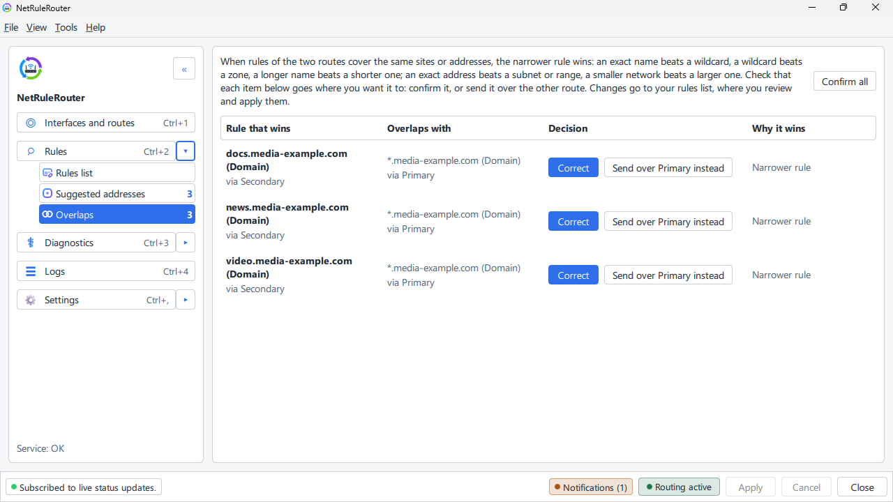

### Work computers by a short name

Machines at work are often opened by a short name such as `wiki` or
`timesheet`. With a work VPN connected these names keep working: a VPN that
announces its network domain is picked up on its own. If yours does not, name
the domain in Settings → *Routing* → **Short names**.

Suggestions never offer a bare short name: a rule for `wiki` alone would reach
far beyond the one machine. When the app knows the full name, such as
`wiki.corp.example`, that is what it offers.

### If you have no additional connection

You may not have a VPN or a second line — then simply **do not assign** an
additional route during setup. Rules that direct traffic to the
additional route will be ignored, and all traffic will go the usual way,
through the main channel. This is expected behavior, not an error: the
rules stay in place and will work as soon as you assign an additional
route (for example, install a VPN).

If you want traffic from such rules to be **blocked instead of using the
main channel**, set leak protection to **Routed sites** — but read the
warning at the beginning of this document: in pre-alpha leak protection is
turned on at your own risk.

If you do use a VPN, tell the app which program it is — its client keeps
working over your main link while leak protection is on, instead of being cut
off with everything else.

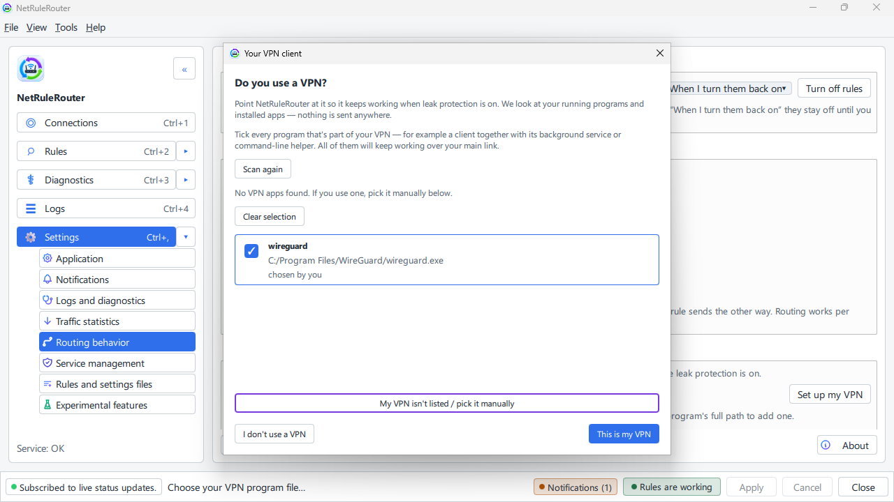

A second VPN that may connect only from one network — a work VPN allowed only
from abroad, say — is set up just below, under **Other VPNs (corporate)**: it
finds that VPN's gateway and adds a rule so the VPN always connects through the
route you choose. See [A VPN that must connect through the other
channel](vpn-detection.md#a-vpn-that-must-connect-through-the-other-channel-vpn-over-vpn).

### Ready-made presets

The `presets/` folder contains ready-made rule sets — including
splits like "home traffic / foreign traffic" for several countries. Two
ways to load one: the quick-load row above the rules table (Settings →
*Presets & settings* → *Bundled presets* turns it on and off), or
Settings → *Presets & settings* → *Import preset for the main / additional
route*. Either way the app shows what changes before anything is applied.

Import a set and adapt it to yourself: presets are a starting point, not
the final truth.

## Settings and appearance

Settings → *Application* holds how the app behaves (the tray icon at sign-in,
minimizing to the tray), the theme, accessibility options and the interface
language — Russian or English. Settings → *Notifications* decides what the tray
may tell you and which kinds of notifications stay hidden, and for how long.

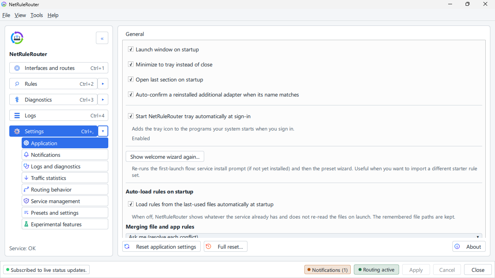

The theme follows the system or can be set to light or dark; for low vision
there is a dedicated high-contrast theme. Text size, the font and working
from the keyboard alone are covered in [Accessibility](accessibility.md).

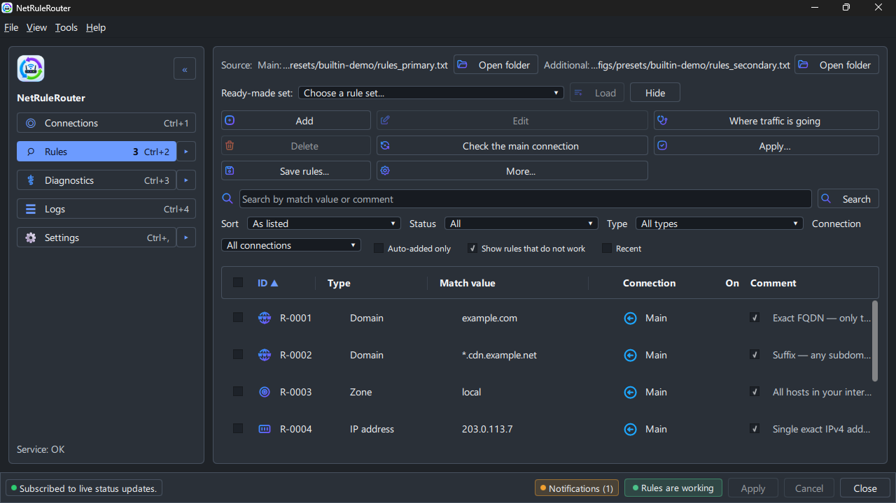

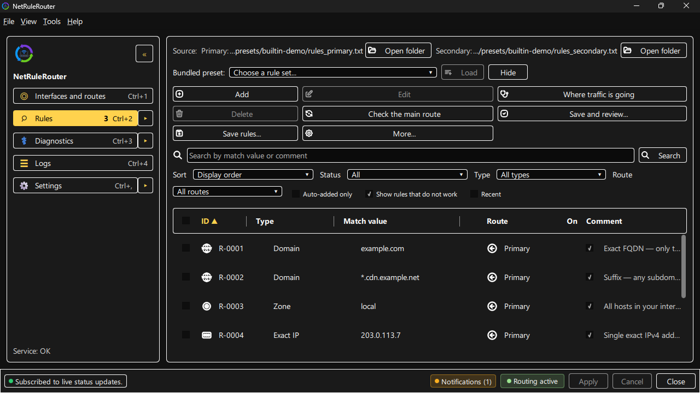

Settings → *Logs and diagnostics* decides how much the service records and how
long it keeps it — the default keeps enough for a bug report without filling
your disk.

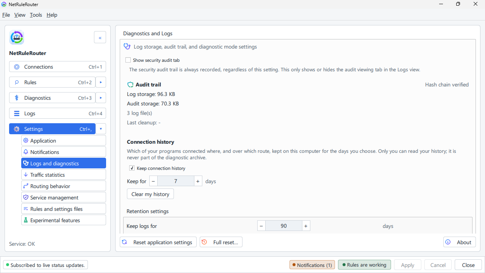

Settings → *Traffic statistics* answers the question a second connection always
raises: how much actually went through it, and how much went the usual way.

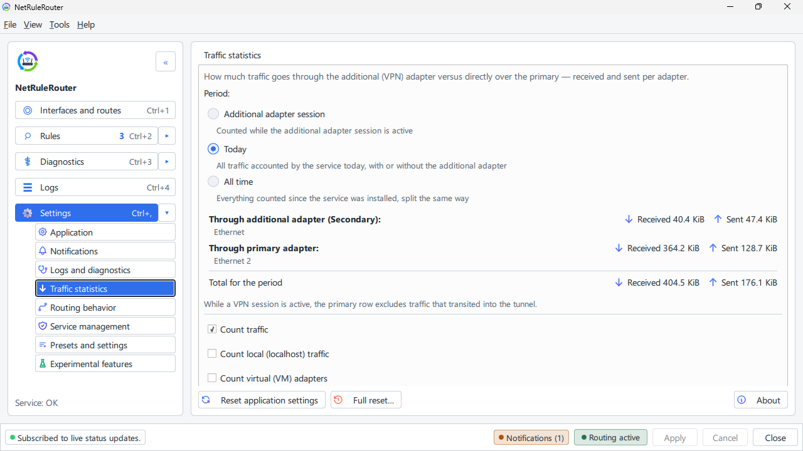

Most of the day you will not have the window open at all. The tray icon says
whether your rules are being applied, and its menu holds the actions you need
most — including turning the rules off for a moment.

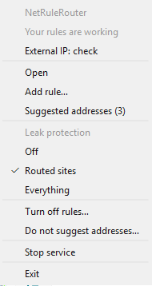

## Check that it works

1. Add a rule for some site to the additional route.
2. Apply the changes.
3. Open that site and verify it sees the additional connection's IP
   address (for example, using an IP detection service).
4. In the "Diagnostics" section you can ask the app *why* a particular
   host went to a particular route — it will show the rule that fired.

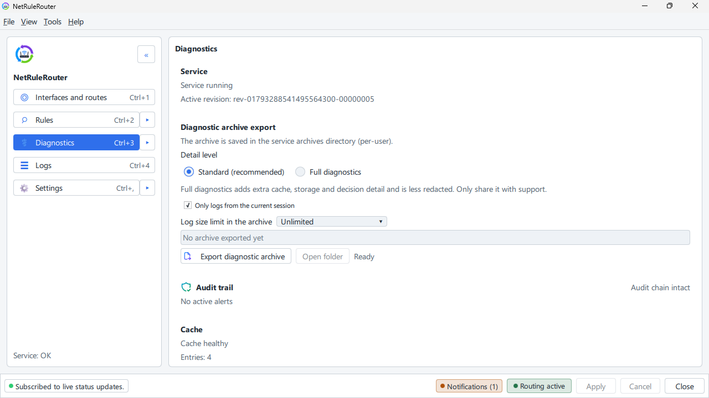

## If something is not working

1. Check that the service is running: **Settings → Service management** —
   the status should be "Running" (from a terminal: `nrr-cli status`).

   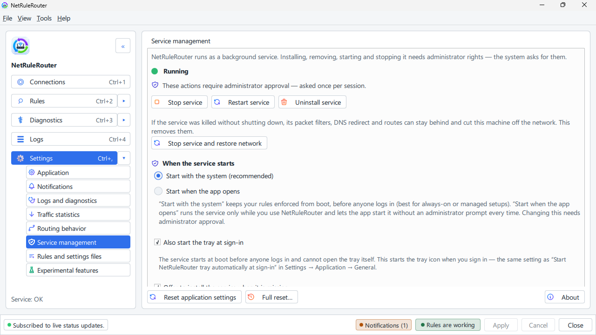

2. Look in the "Diagnostics" section — you can see applied rules and
   errors there. "Logs" lists what the service did, newest first.

   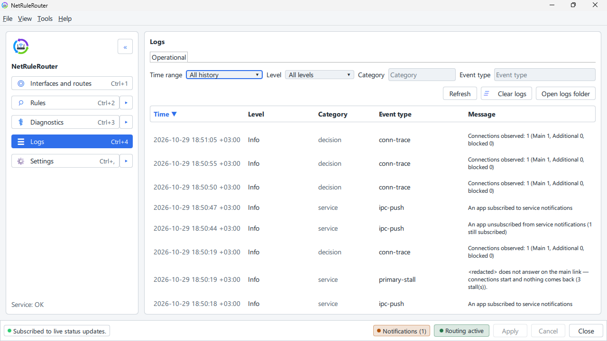

3. Ask the console for a verdict: `nrr-cli diag doctor` checks the service
   and its data from outside the app and reports what it found.
4. That did not help — collect a diagnostic archive ("Diagnostics" section
   → "Diagnostic archive export", or `nrr-cli diag export`) and create an
   [issue](https://github.com/kroxiksut/net-rule-router/issues) with the
   archive attached and a description: what you did, what you expected,
   what happened.

## Lost internet? How to reset everything

The app makes no permanent changes to your system: all routes and blocking
filters it creates are **temporary** — they do not survive a reboot. If
after experimenting with rules (especially with leak protection set to
**Everything**) you lost network access, proceed step by step:

1. **Set leak protection to Off** in the app settings
   and apply the changes.
2. **Stop the service** — Settings → Service management → Stop service.
   When the service stops, it removes its routes and protection, every
   connection returns to the main channel. A connection that was open at
   that moment may drop once, because its path changed; reconnecting fixes
   it, and new connections work right away. The service log names the
   programs that had connections open when it stopped. The same from
   a terminal as administrator:

   ```powershell
   nrr-cli stop
   ```

   Stop it with the app or `nrr-cli`: the service treats a stop from the
   Services console, `Stop-Service` or `sc.exe stop` as a failure and
   starts again a few seconds later, so the protection does not stay off
   by accident.

3. **Reboot your computer** — this guarantees a reset: the app's routes
   and filters do not persist between reboots. If the service is set to
   start with Windows and the problem recurs — after reboot stop the
   service with the command above.

To see the current routing table for diagnostics, use
`route print -4` (or `Get-NetRoute -AddressFamily IPv4`).

## Updating

Once the first release is out, the app tells you when a newer version is
available, but it never downloads or installs anything: you take the new
version from the [releases page](https://github.com/kroxiksut/net-rule-router/releases)
yourself. An update keeps your rules, settings, connection history and the
audit trail. Rule sets kept in the program folder are replaced by the new
version's, which is why your own set belongs in a folder of your own.

- **Installed with the EXE or the MSI.** Run the installer of the new version
  of the same kind: EXE over EXE, MSI over MSI. It stops the service, replaces
  the program and starts the service again. To move from one kind to the
  other, remove the first in the default mode, which keeps your data, then
  install the other.
- **Portable copy.** Close the window and choose **Exit** in the tray menu,
  unpack the new version into a folder of its own (or over the old one) and
  start `NetRuleRouter.exe` from it. The app sees that the service is an
  older build or runs from another folder and offers **Update service from
  this folder** in Settings → Service management; it asks for administrator
  approval, and routing pauses for a moment. From a terminal opened as
  administrator in the new folder, `nrr-cli reinstall` does the same.

If an update stops with an error, check that NetRuleRouter is still listed in
Settings → Apps and that the service is running (`nrr-cli status`). If either
is missing, run the installer of the new version again.

## Removal

1. Remove the service: **Settings → Service management → Remove service**
   (or from an administrator terminal: `nrr-cli uninstall`; add `--purge`
   to delete the data the service owns as well). When the service is
   removed, it clears the installed routing rules.
2. Close the app and delete the program folder.

---

Русская версия: [docs/ru/quickstart.md](../ru/quickstart.md).
