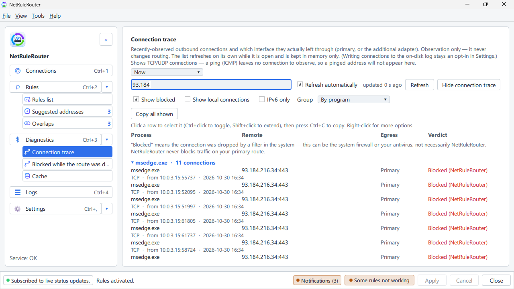

# A site does not open or is slow

**English** · [Русский](../ru/site-does-not-open.md)

This page helps when one site does not open, loads half-way or is slow. Try the
steps in order.

## Step 1: let the program check the site

1. Click **Diagnostics** in the left column and find **Check a site**.
2. Type the site, for example `example.com`, and click **Check site**.
3. Read the answer. It names the likely cause and what to do:
   - **The network is fine: the site answers over your route.** If the page
     keeps reloading or the sign-in goes round in circles, delete this site's
     cookies in your browser. The program never touches browser data.
   - **The site does not answer over its route.** Go to step 3.
   - **The route the site uses is not working.** The connection is down; see
     [Choose your main and additional connection](connections.md).
   - **Your rule denies this site.** Change or delete that rule in **Rules**.
   - **Nothing could be checked.** Open the site once in your browser, then
     check again.

## Step 2: see which way the site goes

1. In **Rules** click **Where traffic is going**. You see recent connections.
2. Find the site. The column tells you which connection it used: main or
   additional.
3. Right-click the line and choose **Why this route?** to see which rule
   decided.

## Step 3: try the other connection

1. In **Rules** click the site's rule, then **Edit**.
2. In **Connection** choose the other one.
3. Click **OK**, **Apply**, **Apply changes**. Reload the page.

No rule for the site yet? [Add one](adding-rules.md).

A browser error page ("This site can't provide a secure connection") while the
VPN is off is leak protection doing its job: [Browser error
pages](blocked-site-browser-errors.md).

To see such a held attempt, open **Diagnostics** → **Connection trace** and tick
**Show blocked**: the line reads **Blocked (NetRuleRouter)**.

## Step 4: pause everything

To learn whether the program is the cause at all: tray icon, **Turn off rules…**,
then **In 15 minutes**. If the site works now, the cause is a rule or leak
protection. If it still does not, the cause is elsewhere: the site, your
provider or the VPN. See [Pause everything, and leak protection](pause-and-protection.md).

## Slow, but it opens

The program only chooses the connection. It does not carry your traffic. If a
site is slow through the VPN and fast through the main connection, the VPN is
slow for that site. Send the site over the main connection (step 3) or try
another server in your VPN program.

## Step 5: no internet at all

Click **Settings** → **Service management** → **Restore network**. It removes
everything the program put in place. More ways, including from a terminal:
[Recovering network access](recovering-network-access.md).

## Still stuck?

Click **Diagnostics** → **Diagnostic archive export** and write to the Telegram channel
[t.me/netrulerouter](https://t.me/netrulerouter), or open an issue. The
[Quick start](quickstart.md) says what to include.

## See also

- [Browser error pages when a site is blocked](blocked-site-browser-errors.md)
- [Recovering network access](recovering-network-access.md)
- [Known limitations](known-limitations.md)
- [Living alongside other software](other-software.md)
