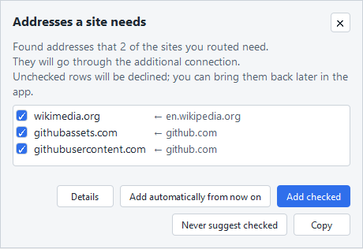
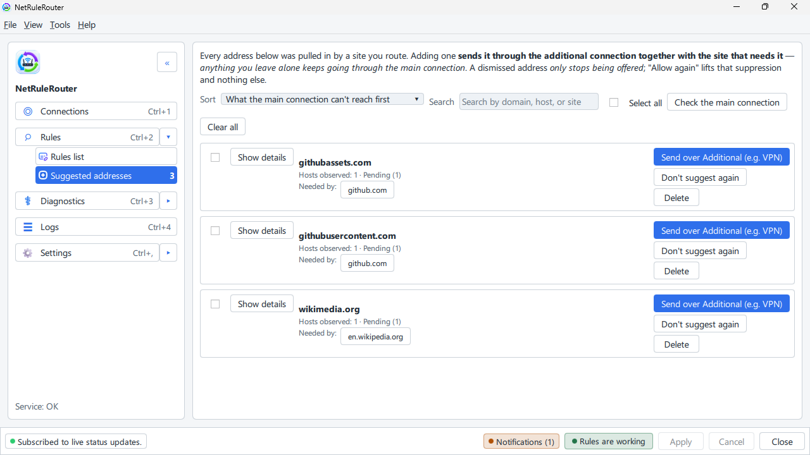

# Suggested addresses

**English** · [Русский](../ru/suggested-addresses.md)

This page explains what to do when the program offers extra addresses for a
site you already open through the VPN.

## What this is

A site is rarely one address. A page often loads its pictures, video or
sign-in from other addresses that your rules do not name. Then the page opens
half empty, or you cannot sign in. The program notices these addresses while
you browse and offers to send them the same way as the site.

Nothing is added without your say-so, unless you chose to add them
automatically (see the end of this page).

## Where you see them

- A notice near the tray icon, called **Addresses a site needs**. The addresses
  are listed and ticked.
- In the tray menu, **Suggested addresses (3)**. The number is how many wait.
  It brings the notice back if you closed it.
- In the window: **Rules** → **Suggested addresses**. The whole list.

## Accept

In the notice: untick what you do not want and click **Add checked**. The
rules work at once. Press F5 in your browser to reload the page.

In the window: on a line click the button that sends the address over the VPN.

## Decline

- **Don't suggest again** (in the notice: **Never suggest checked**). The
  address is not offered again. You can bring it back with **Allow again**
  under **Show answered**.
- **Dismiss** only closes the notice. The addresses stay in the window.

## Stop the suggestions

- For a while: tray menu, **Do not suggest addresses…**, then pick 30 minutes
  or more. **Suggest addresses again** ends the pause.
- For good: **Connections** → **Missing companion domains** → **Off**.

## If you need more

- **Add automatically from now on** (in the notice) adds suggestions for you.
  **Stop adding automatically** in the tray menu goes back to asking.
- An address the main connection already reaches is not shown in the tray; it
  stays in the window's list. **Show details** on a line says how often the
  address was seen with the site.
- In the terminal interface the **Suggested addresses** screen has `a` to add
  and `n` to stop suggesting: [the terminal interface](tui.md).

## See also

- [Open a site through the VPN](adding-rules.md)
- [A site does not open](site-does-not-open.md)
- [What routing changes — and what it does not](what-routing-changes.md)
