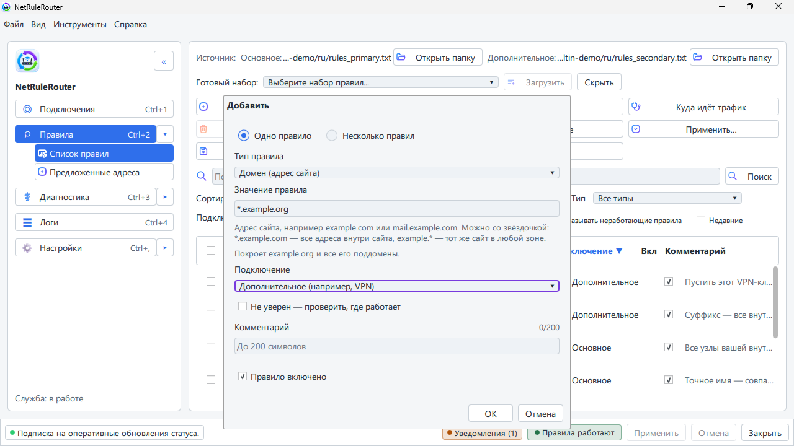
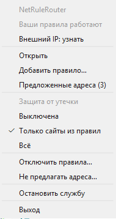

# Как открыть сайт через VPN

[English](../en/adding-rules.md) · **Русский**

Здесь показано, как сделать так, чтобы один сайт или одна программа работали
через ваш VPN, а не через обычный интернет.

## Три слова для начала

- **Правило** — это указание программе: «открывай этот сайт через такое-то
  подключение».
- **Основное подключение** — ваш обычный интернет. **Дополнительное
  подключение** — ваш VPN (или второй интернет).
- **Домен** — это адрес сайта, например `example.com`.

Сайт, для которого нет правила, открывается обычным путём — через основное
подключение.

## Открыть один сайт через VPN

Сначала включите свой VPN, как вы это всегда делаете.

1. Нажмите **Правила** в левой колонке.
2. Нажмите **Добавить**. Откроется небольшое окно.
3. В поле **Тип правила** оставьте **Домен (адрес сайта)**.
4. В поле **Значение правила** введите сайт, например `example.com`. Можно
   вставить весь адрес из браузера: программа оставит только имя сайта.
5. Прочитайте строку под полем. В ней написано, что охватит правило.
6. В списке **Подключение** выберите **Дополнительное (например, VPN)**.
7. Нажмите **ОК**. Правило появится в списке.
8. Внизу окна нажмите **Применить**. Откроется окно **Просмотр изменений** —
   в нём видно, что будет добавлено.
9. Нажмите **Применить** в этом окне.

До шага 9 правило ничего не делает. Так задумано: вы видите каждое изменение
до того, как оно начнёт работать.

Теперь откройте сайт. Если он уже был открыт в браузере, обновите страницу
клавишей F5.

**Другие адреса того же сайта.** Галочка **Вместе с поддоменами** по умолчанию
включена. Она нужна, чтобы правило охватывало `www.example.com`,
`cdn.example.com` и похожие адреса: страница подгружает картинки именно оттуда.
Оставьте её включённой.

**Много сайтов сразу.** Вверху окна переключите **Одно правило** на
**Несколько правил** и впишите по одному сайту в строку.

## Из значка в трее

Главное окно открывать не нужно.

1. Нажмите правой кнопкой на значок NetRuleRouter возле часов.
2. Выберите **Добавить правило…**.
3. Заполните такое же небольшое окно и нажмите **ОК**.

Правило начинает работать сразу, без окна проверки. Появится уведомление с
кнопкой **Отменить** — на случай, если вы передумали.

## Из уведомления

Программа замечает, что сайт не открывается, и предлагает исправление.

- **Сайт не открывается.** В уведомлении назван сайт. Нажмите **Добавить
  правило**, чтобы отправить его через VPN. **Больше так не сообщать** убирает
  уведомления об этом сайте.
- **Предложенные адреса.** Сайту, который вы направили через VPN, иногда нужны
  ещё несколько адресов, чтобы он показался целиком. См.
  [Предложенные адреса](suggested-addresses.md).

## Программа вместо сайта

Подходит для игры, торрент-клиента или любой программы, которая всегда должна
работать через VPN.

1. В разделе **Правила** нажмите **Добавить**.
2. В поле **Тип правила** выберите **Приложение**.
3. Введите имя файла программы, например `browser.exe`, или нажмите
   **Обзор...** и выберите программу.
4. В списке **Подключение** выберите **Дополнительное (например, VPN)**,
   нажмите **ОК**, затем **Применить** и ещё раз **Применить**.
5. Если программа уже была запущена, **закройте её и запустите снова**.

Не знаете, как называется программа? В разделе **Правила** нажмите **Куда идёт
трафик**. Там видны недавние соединения по программам. Нажмите на строку
правой кнопкой и выберите **Правило для этого приложения…**.

## Если нужно больше

- Правилом может быть и IP-адрес, и группа адресов, и целое окончание вроде
  `.ru` («зона»). Это выбирается в поле **Тип правила**. Правило для одного
  сайта всегда сильнее правила для целой зоны.
- **Запретить** (вариант в списке **Подключение**) значит «не открывать это
  вообще».
- Программы, которые компьютеру нужны для выхода в сеть (системные программы и
  службы), нельзя направить или запретить; окно предупредит об этом до
  сохранения.
- Если два правила спорят, побеждает более узкое:
  [Что чего главнее](what-takes-priority.md).
- Писать правила вручную в текстовом файле: [Формат правил](rules-file-format.md).
- В терминальной версии на экране **Правила** клавиша `a` добавляет правило, а
  `Ctrl+S` применяет: [терминальный интерфейс](tui.md).

## См. также

- [Как изменить, выключить или удалить правило](changing-rules.md)
- [Сайт не открывается](site-does-not-open.md)
- [Вопросы и ответы](questions.md)
