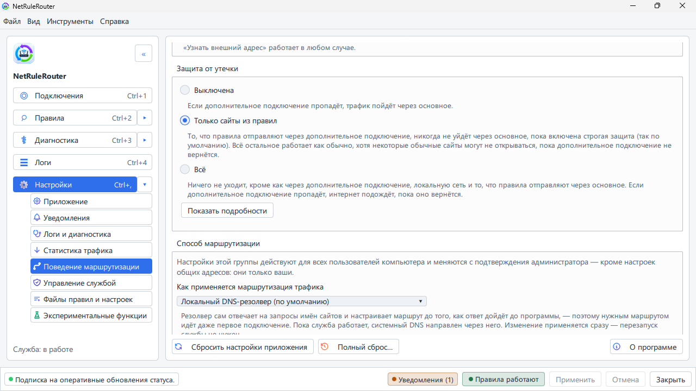

# Пауза правил и защита от утечки

[English](../en/pause-and-protection.md) · **Русский**

Здесь показано, как выключить правила программы на время и как выбрать, что
будет с вашим интернетом, когда VPN не подключён.

## Быстро поставить всё на паузу

Это нужно, чтобы понять, из-за программы ли что-то не работает.

1. Нажмите правой кнопкой на значок NetRuleRouter возле часов.
2. Выберите **Отключить правила…**.
3. Выберите, на сколько: **Через 15 минут**, **Через 1 час**, **Через 4 часа**,
   до перезапуска или **Пока не включу сам**.
4. Напишите короткую причину (она сохранится в журнале) и нажмите **Отключить
   сейчас**.

Пока правила отключены, не работают и ваши правила, и защита от утечки. Все
сайты идут обычным путём. В окне написано **Правила отключены**. Чтобы включить
раньше срока, выберите **Включить правила** в том же меню. Когда время выйдет,
правила включатся сами.

То же самое есть в окне: **Настройки** → **Поведение маршрутизации** →
**Включение и отключение правил** → **Отключить правила**.

## Защита от утечки (включена по умолчанию)

VPN может быть выключен, оборваться или запуститься позже Windows. **Защита от
утечки** решает, что тогда будет с вашим интернетом. Она включена с самого
начала в варианте **Только сайты из правил**: сайты, которые вы отправляете
через VPN, ждут, а не уходят напрямую, — поэтому сервис с региональными
ограничениями не видит ваш настоящий регион. Всё остальное работает. Выключить
её можно в настройках.

Вариантов три:

- **Выключена.** Ничего не останавливается. Сайты, которые должны идти через
  VPN, продолжают открываться, но через обычный интернет — поэтому провайдер и
  сайт видят ваш настоящий адрес.
- **Только сайты из правил** (по умолчанию). Пока VPN не работает, перестают
  открываться только сайты и программы из ваших правил. Всё остальное работает.
- **Всё.** Весь интернет ждёт, пока вернётся VPN. Ничего не уходит, кроме как
  через VPN и вашу домашнюю сеть.

Если дополнительное подключение ещё не выбрано, сайты, которые правила
отправляют туда, тоже ждут, и окно об этом говорит. Выберите подключение
([Как выбрать основное и дополнительное подключение](connections.md)) или
выключите защиту от утечки. Если правил для дополнительного подключения нет,
ничего не ждёт.

> **Это альфа-версия.** Вариант **Всё** ещё не прошёл полную проверку и может
> отрезать вас от интернета, пока вы не вернёте **Выключена**. Если так
> случилось, см. [Восстановление доступа к сети](recovering-network-access.md).

### Включить или выключить защиту

В окне:

1. Откройте NetRuleRouter и нажмите **Настройки**.
2. Нажмите **Поведение маршрутизации**.
3. В блоке **Защита от утечки** выберите **Выключена**, **Только сайты из
   правил** или **Всё**. Выбор действует сразу, применять ничего не нужно.

Чтобы снова включить защиту, выберите там же **Только сайты из правил** (или
**Всё**). Если выбрать **Всё**, пока VPN не подключён, окно сначала спросит
подтверждение: интернет остановится сразу.

В меню значка у часов переключателя защиты нет. **Отключить правила…** там
отключает на время и правила, и защиту от утечки вместе: см.
[Быстро поставить всё на паузу](#быстро-поставить-всё-на-паузу).

В терминальном интерфейсе:

1. Нажмите `0`, чтобы открыть **Настройки**.
2. Стрелками выберите **Поведение маршрутизации** и нажмите `Enter`.
3. Перейдите к **Защита от утечки** и нажмите `Enter`.
4. Стрелками выберите **Выключена**, **Только сайты из правил** или **Всё** и
   нажмите `Enter`.

### Когда сайт ждёт VPN

При варианте **Только сайты из правил** и выключенном VPN:

- приходит уведомление **Дополнительное подключение не поднято**: всё, что
  правила отправляют туда, придерживается до его возвращения, — это работает
  защита, а не ошибка;
- браузер показывает страницу ошибки для сайтов из ваших правил. Всё остальное
  открывается как обычно.

Запустите VPN. Когда он вернётся, сайты снова откроются сами; страницу, на
которой была ошибка, нужно обновить (F5). Подробнее о страницах ошибок:
[Страницы ошибок браузера](blocked-site-browser-errors.md). В терминальном
интерфейсе то же уведомление есть в ленте на экране «Статус».

## Если нужно больше

- При варианте **Только сайты из правил** могут перестать открываться и обычные
  сайты, у которых общий сервер с сайтом из правил. Чтобы их открыть, снимите
  галочку **Строго: блокировать и адреса, общие с обычными сайтами (они могут
  перестать работать)** прямо под настройкой. Тогда немного трафика сайтов из
  правил может уйти обычным путём.
- Чтобы ваша VPN-программа продолжала работать, настройте её в блоке **Ваш
  VPN-клиент**: см. [Как выбрать основное и дополнительное подключение](connections.md).
- В терминальном интерфейсе в **Настройки** → **Поведение маршрутизации** те же
  варианты: [терминальный интерфейс](tui.md).

## См. также

- [Режимы маршрутизации: что делает каждый переключатель](routing-modes.md)
- [Восстановление доступа к сети](recovering-network-access.md)
- [Что чего главнее](what-takes-priority.md)
- [Сайт не открывается](site-does-not-open.md)
