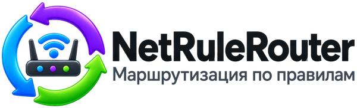

# Вопросы и ответы

[English](../en/questions.md) · **Русский**

Короткие ответы на вопросы, которые задают в первую очередь. В каждом ответе
есть ссылка на страницу со всеми шагами.

## Основное

### Что такое правило?

Правило — это указание программе: «открывай этот сайт через VPN» или «открывай
этот сайт обычным путём». Сайты без правил открываются обычным путём.
[Как открыть сайт через VPN](adding-rules.md)

### Это VPN? Нужен ли мне VPN?

Нет, NetRuleRouter — не VPN и VPN не создаёт. Он решает, какие из ваших сайтов
пойдут через подключение, которое у вас уже есть. Чтобы отправлять сайты через
VPN, нужна своя VPN-программа, установленная и с выполненным входом. Вместо VPN
можно использовать и второе подключение к интернету.
[Как выбрать основное и дополнительное подключение](connections.md)

### Программа замедляет интернет?

Программа только выбирает, через какое подключение пойдёт сайт, а сам трафик не
несёт. Сайт, который идёт через VPN, работает так быстро, как быстр ваш VPN.
Если сайт тормозит, за минуту его можно отправить другим путём.
[Сайт не открывается или тормозит](site-does-not-open.md)

### Отправляет ли она мои данные куда-нибудь?

Ничего о вас и о том, как вы пользуетесь программой: учётной записи нет, отчётов
об использовании нет. Программа узнаёт адреса сайтов из ваших правил, и
публичные DNS-серверы могут видеть эти имена. Всё, что она запрашивает в сети,
перечислено в [описании безопасности](../../SECURITY.md) в разделе «Network
activity of the product itself».

## Правила

### Как открыть сайт через VPN?

Включите VPN. Нажмите **Правила**, затем **Добавить**, впишите сайт в **Значение
правила**, в списке **Подключение** выберите **Дополнительное (например, VPN)**,
нажмите **ОК**, затем **Применить** и ещё раз **Применить**. Обновите сайт в
браузере.
[Открыть один сайт через VPN](adding-rules.md#открыть-один-сайт-через-vpn)

### Я добавил правило, а ничего не изменилось

Новое правило работает только после **Применить** и **Применить** в окне
проверки. Единственное исключение — правило, добавленное из меню значка в трее.
Страницу, которая уже была открыта, нужно обновить (F5).
[Пока вы не нажали «Применить», ничего не происходит](changing-rules.md#пока-вы-не-нажали-применить-ничего-не-происходит)

### Как отменить изменение?

До **Применить** нажмите **Отмена**. После **Применить** включите фильтр
**Недавние** в разделе **Правила** и нажмите **Вернуть** на удалённом правиле.
У правила, добавленного из трея, в уведомлении есть кнопка **Отменить**.
[Отменить изменение](changing-rules.md#отменить-изменение)

### Как сохранить свои правила в файл?

**Настройки** → **Файлы правил и настроек**. В блоке **Мои наборы правил**
выберите свою папку, затем нажмите **Сохранить текущие правила как набор...**,
введите название и нажмите **Сохранить набор**.
[Сохранить свои правила](rule-sets.md#сохранить-свои-правила)

### Как загрузить правила обратно или на другом компьютере?

Скопируйте сохранённые файлы на другой компьютер. Там нажмите **Правила** →
**Ещё...** → **Загрузить список правил...**, выберите файлы, нажмите
**Импортировать** и примените. На том же компьютере выберите набор в строке
**Мой набор правил:** и нажмите **Загрузить**.
[Перенести правила на другой компьютер](rule-sets.md#перенести-правила-на-другой-компьютер)

### Как загрузить готовые правила для моей страны?

Нажмите **Правила**. В строке **Готовый набор:** выберите свою страну и нажмите
**Загрузить**. Прочитайте окно **Просмотр изменений** и нажмите **Применить**.
Ваши правила будут заменены, поэтому сначала сохраните их.
[Загрузить готовый набор](rule-sets.md#загрузить-готовый-набор-для-своей-страны)

## Подключения и защита

### Как включить или выключить защиту?

Она включена с самого начала в варианте **Только сайты из правил**: если VPN
выключен, оборвался или запустился позже Windows, сайты, которые вы отправляете
через него, ждут, а не уходят напрямую, — поэтому сервис с региональными
ограничениями не видит ваш настоящий регион. Чтобы изменить: **Настройки** →
**Поведение маршрутизации** → **Защита от утечки**. **Выключена** ничего не
меняет. **Только сайты из правил** останавливает только сайты из ваших правил,
пока VPN не работает. **Всё** останавливает весь интернет, пока не вернётся VPN.
Выбор действует сразу.
[Включить или выключить защиту](pause-and-protection.md#включить-или-выключить-защиту)

### Я по ошибке сделал VPN основным. Как поменять местами?

Нажмите **Подключения**. На карточке VPN нажмите **Больше не основное**. Затем
нажмите **Основное** на карточке обычного интернета и **Дополнительное
(например, VPN)** на карточке VPN. Применять ничего не нужно.
[Поменять местами или выбрать другой VPN](connections.md#поменять-местами-или-выбрать-другой-vpn)

### Как выбрать другой VPN?

Включите новый VPN, нажмите **Подключения**, на старой карточке нажмите **Больше
не дополнительное**, а на новой — **Дополнительное (например, VPN)**.
[Поменять местами или выбрать другой VPN](connections.md#поменять-местами-или-выбрать-другой-vpn)

### Я поставил другую VPN-программу, или мой VPN перестал находиться

Старого подключения больше нет, и правилам некуда идти. Выберите новое
подключение, как описано выше, и в **Настройки** → **Поведение маршрутизации** →
**Ваш VPN-клиент** нажмите **Настроить мой VPN**.
[Ваш VPN сменился](connections.md#ваш-vpn-сменился)

### VPN подключился, но сайты из правил всё равно не открываются через него

Некоторые VPN-программы создают несколько одинаковых подключений и пользуются
любым из них. Если при первой настройке VPN был выключен, мастер просит его
включить, чтобы увидеть, каким подключением он пользуется. Позже NetRuleRouter
сам следует за VPN на то подключение, которым он пользуется. Если программа
просит выбрать, укажите то, что отмечено как подключённое, или откройте
**Подключения** и нажмите **Дополнительное (например, VPN)** на его карточке.
[Ваш VPN сменился](connections.md#ваш-vpn-сменился)

## Если что-то не так

### Сайт не открывается

Нажмите **Диагностика**, введите сайт в **Проверить сайт** и нажмите **Проверить
сайт**. В ответе будет сказано, что делать. Если правило направляет сайт через
VPN, а он не отвечает, отправьте его другим путём: **Правила** → правило →
**Редактировать** → **Подключение**.
[Сайт не открывается или тормозит](site-does-not-open.md)

### Сайт не открывается, пока VPN выключен, — это нормально?

Да, если сайт есть в ваших правилах для VPN. Защита от утечки включена по
умолчанию и придерживает такие сайты, пока VPN не вернётся, чтобы они не ушли
напрямую; приходит уведомление **Дополнительное подключение не поднято**.
Запустите VPN и обновите страницу. Сайты вне ваших правил для VPN продолжают
открываться. Если вы хотите, чтобы они открывались через обычный интернет,
выключите защиту.
[Когда сайт ждёт VPN](pause-and-protection.md#когда-сайт-ждёт-vpn) ·
[Включить или выключить защиту](pause-and-protection.md#включить-или-выключить-защиту)

### Браузер показывает страницу ошибки, когда VPN выключен

Это защита от утечки делает своё дело: сайту, который вы направили через VPN, не
разрешено выходить без него. Он снова откроется, когда вернётся VPN. Чтобы
изменить это, см. настройку защиты выше.
[Страницы ошибок браузера](blocked-site-browser-errors.md)

### Как быстро поставить всё на паузу?

Нажмите правой кнопкой на значок в трее, выберите **Отключить правила…**,
выберите срок, напишите причину и нажмите **Отключить сейчас**. Чтобы закончить
паузу раньше, выберите **Включить правила** в том же меню.
[Быстро поставить всё на паузу](pause-and-protection.md#быстро-поставить-всё-на-паузу)

### Пропал интернет

**Настройки** → **Управление службой** → **Восстановить сеть**.
[Восстановление доступа к сети](recovering-network-access.md)

## Сама программа

### Как обновить программу?

Программа не проверяет обновления. Новые версии появляются на
[странице выпусков](https://github.com/kroxiksut/net-rule-router/releases) и в
Telegram-канале. Установите новую версию поверх старой; правила и настройки
сохранятся.
[Быстрый старт: Обновление](quickstart.md#обновление)

### Как удалить программу?

«Параметры» Windows → «Приложения» → NetRuleRouter → «Удалить», затем выберите,
сохранять ли настройки.
[Начать заново, сбросить или удалить программу](start-over-or-remove.md#удалить-программу)

### Где спросить помощи?

В Telegram-канале [t.me/netrulerouter](https://t.me/netrulerouter) на русском
или английском либо по почте: fmalkov91@gmail.com. Об ошибках можно сообщить на
[странице проекта](https://github.com/kroxiksut/net-rule-router) (Issues). Тот
же канал есть в меню программы: **Канал в Telegram (помощь и новости)**.
