# Быстрый старт (пре-альфа)

[English](../en/quickstart.md) · **Русский**

NetRuleRouter управляет тем, **какой трафик через какое подключение идёт** —
по домену, IP-адресу или приложению. Он работает с подключениями, которые у
вас *уже есть* (основной интернет + VPN, два провайдера, Wi-Fi + Ethernet),
и не является VPN-клиентом, прокси или средством анонимизации.

> **Это пре-альфа.** Защита от утечки, прежде всего вариант **«Всё»**, ещё
> **не прошла полную проверку и может работать
> некорректно** — вплоть до полной потери доступа в сеть, пока защиту не
> вернут в положение **«Выключена»**. Она доступна в настройках, но её
> включение — на ваш страх и риск.

## Требования

- Windows 10 или 11, 64-bit
- Права администратора — один раз, для установки фоновой службы
- Два сетевых подключения, между которыми будет делиться трафик
  (например, основной интернет и VPN). Можно работать и с одним —
  см. [«Если дополнительного подключения нет»](#если-дополнительного-подключения-нет)

## Установка

1. Получите архив. Готовых архивов пока нет: `scripts/package-windows.ps1`
   собирает такой, и он запускается на машине без Qt и Rust (см.
   [Сборка переносимой версии](packaging-windows.md)).
2. Распакуйте в любую папку — например, на Рабочий стол или в корень
   диска `C:` или `D:`.
3. Запустите `NetRuleRouter.exe`. При первом запуске программа покажет
   [пользовательское соглашение](../legal/eula.ru.md) — прочитайте и
   примите его, чтобы продолжить.

   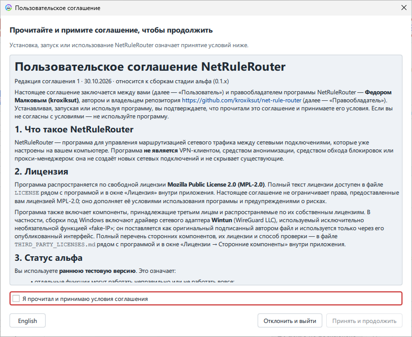

4. Установите фоновую службу. Окно приветствия предлагает это сразу —
   **«Установить и запустить службу»**; подтвердите запрос прав
   администратора (UAC). Те же действия есть в **Настройки → «Управление
   службой»**: там служба запускается, останавливается и удаляется.

Без службы приложение работает в ограниченном режиме: правила можно
редактировать, но маршрутизация не применяется.

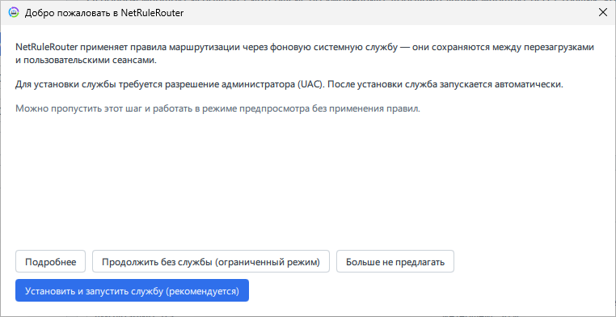

## Первая настройка

1. **Выберите стартовый набор правил.** Сразу после окна про службу
   открывается мастер первого запуска с четырьмя вариантами: страновой
   пресет, встроенный демо-набор, ваши собственные два `.txt`-файла или
   пустой старт. Выбранное попадает в правила на просмотр — до применения.
   Там же мастер предлагает запускать значок в трее при входе в систему
   (по умолчанию включено): после перезагрузки состояние видно, не открывая
   окна.

   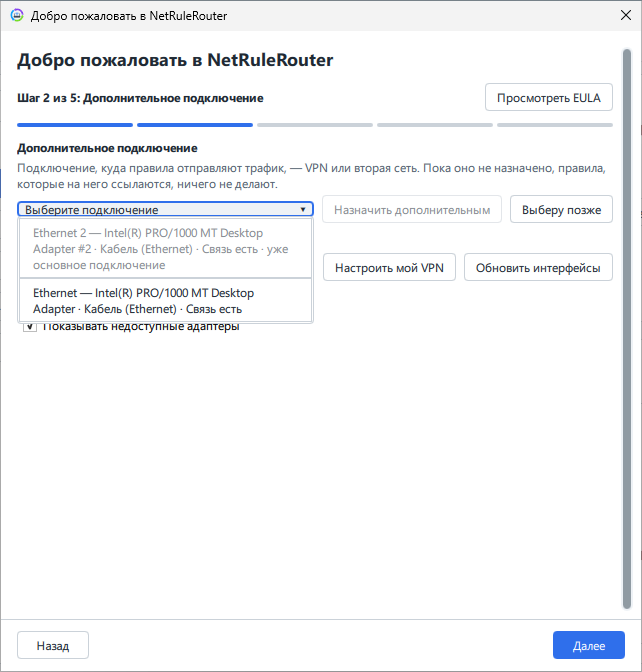

   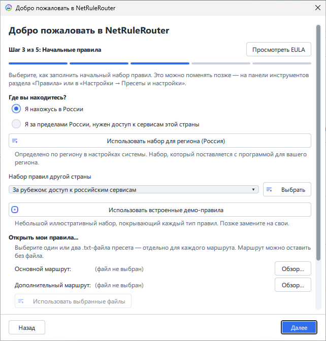

2. **Выберите два маршрута.** На экране *«Интерфейсы и маршруты»* укажите,
   какой сетевой адаптер считается *основным* (primary), а какой —
   *дополнительным* (например, VPN). Обоим можно дать свои
   названия — они будут видны в правилах.

   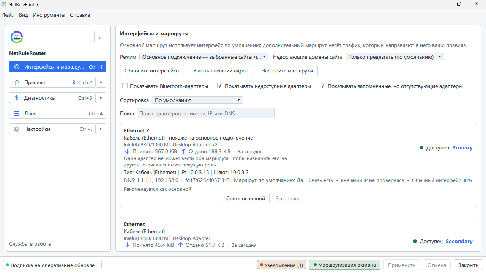

3. **Выберите маршрут по умолчанию и защиту от утечки.** *Маршрут по
   умолчанию* решает, куда идёт трафик, не подпавший ни под одно правило:

   - **«Основное подключение — выбранные сайты через дополнительное»**;
   - **«Дополнительное подключение — исключения через основное»**.

   *Защита от утечки* решает, что ещё может уйти через основное подключение
   вместо дополнительного:

   - **«Выключена»** (по умолчанию) — если дополнительное подключение
     пропадёт, трафик пойдёт через основное.
   - **«Только сайты из правил»** — то, что правила отправляют через
     дополнительное подключение, никогда не уйдёт через основное, пока
     включена строгая блокировка общих адресов (так по умолчанию). Всё
     остальное работает как обычно, кроме сайтов, у которых общий адрес с
     направляемыми. Предлагается при маршруте по умолчанию
     через основное подключение.
   - **«Всё»** — ничего не уходит, кроме как через дополнительное
     подключение, локальную сеть и то, что правила отправляют через
     основное. Если дополнительное подключение пропадёт, интернет подождёт,
     пока оно вернётся.

   Корпоративный VPN рядом с вашим при любом варианте сохраняет свои сети.

   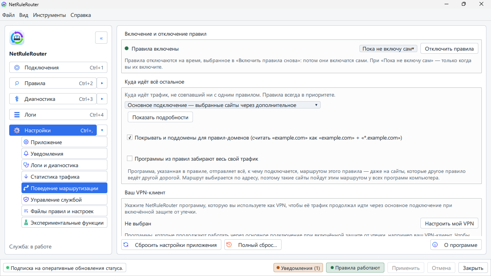

4. **Сохраните набор как свой.** Настройки → *«Пресеты и настройки»* →
   *«Мои наборы правил»*: укажите свою папку, нажмите *«Сохранить текущие
   правила как набор»* и дайте ему имя. Наборы, оставшиеся в папке
   приложения, заменяются при следующем обновлении; набор в вашей папке
   его переживёт, а держать таких наборов можно несколько — «дом»,
   «работа» — и переключаться между ними.

   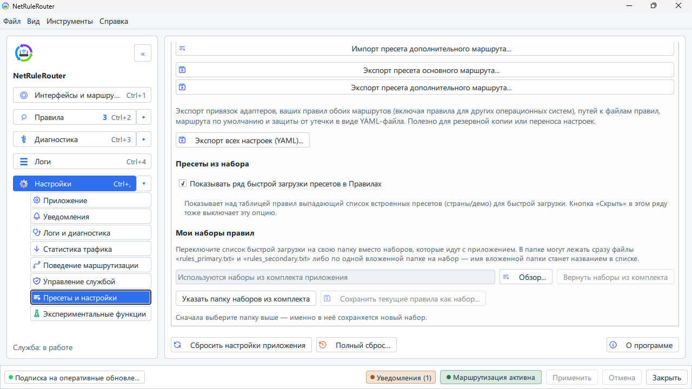

5. **Добавьте свои сайты и примените** — см. следующий раздел.

## Правила: как это работает

Правило говорит: «такой-то трафик → через такой-то маршрут». Трафик можно
описать семью способами, здесь они идут от самого сильного правила к самому
слабому:

| Тип | Пример | Что попадает |
|-----|--------|--------------|
| Точный домен | `api.example.com` | только этот хост |
| Домен с поддоменами | `*.example.com` | сам домен и все поддомены |
| Сайт в любой зоне | `example.*` | `example.com`, `example.net`, `example.co.uk`… с поддоменами |
| Точный IP | `203.0.113.7`, `2001:db8::7` | только этот адрес |
| Сеть или диапазон | `10.0.0.0/8`, `192.0.2.10-192.0.2.40` | каждый адрес в них |
| Доменная зона | `.ru` | все домены зоны |
| Приложение | `chrome.exe`, `C:\Apps\Tool\*` | эта программа, где бы она ни была установлена, или все программы этой папки |

Побеждает более узкое правило: собственное имя сайта сильнее его адреса, адрес
сильнее сети вокруг него, сеть сильнее зоны. Зона из нескольких меток
(`corp.example.com`) считается своими поддоменами и сильнее `*.example.com`.
Правило с явной зоной (`*.example.by`) сильнее `example.*` для этой зоны. Правило задаёт либо адрес, либо приложение: правило,
которое ограничивает адрес одним приложением, пока не может быть исполнено,
поэтому служба его отклоняет.


### Добавьте свои сайты — разовый шаг

Служба маршрутизирует ровно то, что написано в правилах, и ничего сверх
того. Сайты, которые раньше открывались у вас через VPN, продолжат ходить
по основному каналу, пока их нет в правилах дополнительного
маршрута: в пресете лежит чей-то чужой список, а не ваш.

Поэтому сразу после первой настройки пройдитесь по сайтам, которыми вы
реально пользуетесь через VPN, и добавьте их сами — любым из двух способов:

- в разделе **«Правила»** приложения: выберите дополнительный маршрут и
  добавьте домен (`example.com` и `*.example.com` — для его поддоменов);
- либо прямо в файле `rules_secondary.txt` в вашей папке наборов, по одной
  записи на строку, и затем загрузите набор в приложении.


После этого нажмите **«Применить»**: правила вступают в силу только после
применения. Это делается один раз — дальше список живёт вместе с вашим
набором правил и переживает переустановку.

«Применить» не преподносит сюрпризов: программа сначала показывает, что
именно получит служба — каждое добавленное, изменённое и удалённое правило —
и ждёт вашего подтверждения.

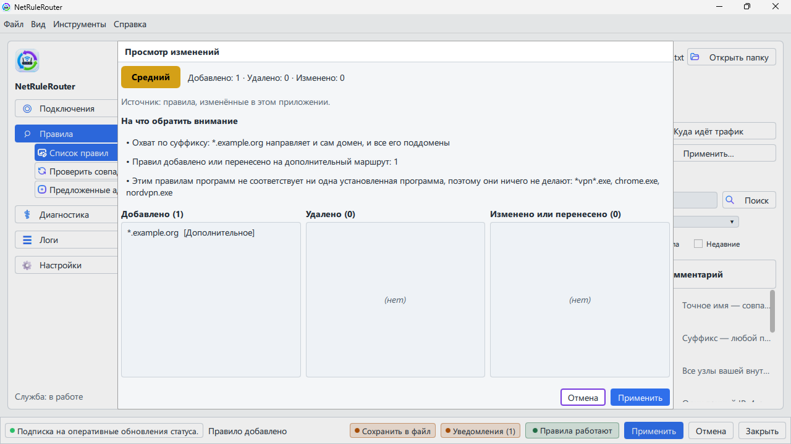

### Запрет, много правил сразу и недавние изменения

- **Запрет.** При добавлении правила выберите маршрут *«Запретить»* или
  поставьте `!` перед значением в файле правил (`!telemetry.example.net`):
  этот сайт, адрес, сеть или программу не пускают ни через одно подключение.
  Фильтр *«Запрещённые»* в списке правил показывает их все.
- **Несколько правил сразу.** Переключите окно добавления на *«Несколько
  правил»* и наберите или вставьте по одному правилу на строку, как в файле
  правил. Каждая строка проверяется и показывается со своим типом до того,
  как что-то добавится; невзятые строки остаются в поле, чтобы вы их
  поправили.
- **Недавние.** Фильтр *«Недавние»* в списке правил показывает, что вы
  добавили или изменили за последний час, сегодня или за последние 7 дней,
  новые сверху, со временем и с тем, как было раньше. Удалённые правила
  перечислены ниже, и *«Вернуть»* возвращает правило как было; примените
  изменения, чтобы оно снова вступило в силу.

В терминальном интерфейсе есть все три; см. [его экран
«Правила»](tui.md#ещё-на-экране-правила).

### Программы по имени, файлу или папке

Правило для приложения называет программу по имени (`chrome.exe`), по файлу
(`C:\Apps\Tool\tool.exe`) или по папке, где она лежит: *«Выбрать папку...»* в
окне добавления, с галкой *«Вместе с подпапками»* для программы, которая
держит помощников и новые версии в подпапках; под полем окно показывает,
сколько программ попадает под правило. Правило папки покрывает и программу,
которая появится там после обновления, и скрипты из этой папки, когда их
запускают Python, PowerShell, Java и им подобные. Правила по файлу и папке
работают на Windows и Linux. Все формы записи — в [формате
правил](rules-file-format.md#windows--linux--macos-секции-приложений).

Чтобы найти папку, откройте **«Трассировка соединений»** и сгруппируйте её по
папке: у группы папки есть правило сразу на всю папку.

### Программы, нужные системе, защищены

Запрет или правило для дополнительного маршрута не может задеть программу или
папку, без которой компьютер теряет сеть: системную папку, `svchost.exe`,
сетевые службы, общую папку многих программ вроде `Program Files`. Окно
добавления говорит об этом до сохранения, а такое правило, уже записанное в
файле правил, показывается неприменённым, с причиной. Если вы действительно
этого хотите, допишите `+override` после значения в файле правил: правило
применится, когда вы подтвердите его в списке правил (*«Подтвердить…»*), на
выбранный срок, а подтверждение правила, которое задевает не только ваши
программы, попросит права администратора. См. [Применить правило вопреки
защите](rules-file-format.md#116-применить-правило-вопреки-защите-override).

### Правилу для приложения нужен перезапуск программы

Правило для приложения называет программу, за которой следить: адреса, к
которым она обращается, узнаются по ходу её работы, и маршрут действует со
следующего соединения. Поэтому программа, **уже запущенная** в момент, когда вы
добавили правило, первые попытки соединения провалит — установщики и апдейтеры
на этом часто сдаются и сообщают, что связи нет.

Порядок такой: добавьте правило, нажмите **Применить**, затем перезапустите
программу. Если вы знаете сайт, которым программа пользуется, обычное доменное
правило (`*.example.com`) сработает лучше: оно действует с момента, когда имя
запрашивается, и узнавать ничего не нужно.

### Предложения, которыми вас не отвлекают

Пока вы работаете, приложение замечает другие узлы, которые нужны сайтам из
ваших правил, и предлагает их добавить. Узел, который и так отвечает по
основному подключению, в трее **не** всплывает: он работает и без
дополнительного маршрута, и отвлекать вас на него — шум.

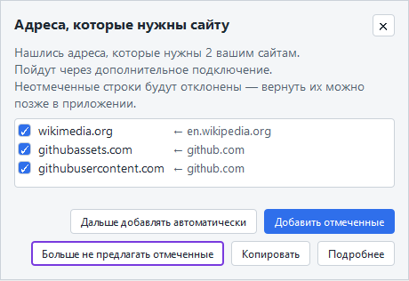

В списке предложений он остаётся, с пометкой «доступен по основному
подключению». Отвечать — не то же самое, что обслуживать: некоторые сайты
отвечают на адрес основного подключения отказом. Поэтому решение остаётся за
вами: откройте список и добавьте узел, если сайт у вас всё-таки не работает.

Когда вы принимаете предложение, приложение обновляет ваши открытые соединения
с этим сайтом, чтобы страница подхватила новый маршрут; другие программы и
другие пользователи компьютера не затрагиваются. Если обновить страницу не
удалось, приложение попросит перезагрузить её (F5).

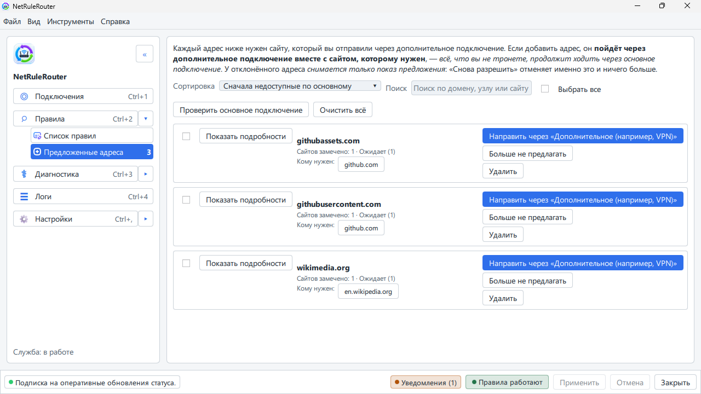

### Перекрывающиеся правила

Когда правила двух маршрутов покрывают одни и те же сайты — зона `ru` на
одном маршруте и `mail.example.ru` на другом, или `*.example.com` и
`*.api.example.com`, — побеждает более узкое правило: точное имя сильнее
маски, маска сильнее зоны, более длинное имя сильнее короткого.

**Правила → Перекрытия** показывает каждую такую пару и маршрут, по которому
идут её сайты. Нажмите **Всё верно**, чтобы подтвердить пару, или направьте
эти сайты через другой маршрут. Подтверждённая пара уходит из списка, галка
**Показать решённые** возвращает её. Число рядом с пунктом — сколько пар ещё не
подтверждено; пока показывать нечего, пункт скрыт. Изменение здесь — обычная
правка списка правил, она вступает в силу после **Применить**.

Над парами блок **Конфликты в применённых правилах** показывает правила,
которые служба исполняет не так, как они записаны: заблокированный адрес,
который заодно останавливает маршрутизируемый вами сайт; блокировку, которая не
может закрыть сайт, потому что он делит адрес с сайтом, направленным более
узким правилом; правило, которое не исполняется вовсе. Список отражает
применённые сейчас правила и обновляется после **Применить**.

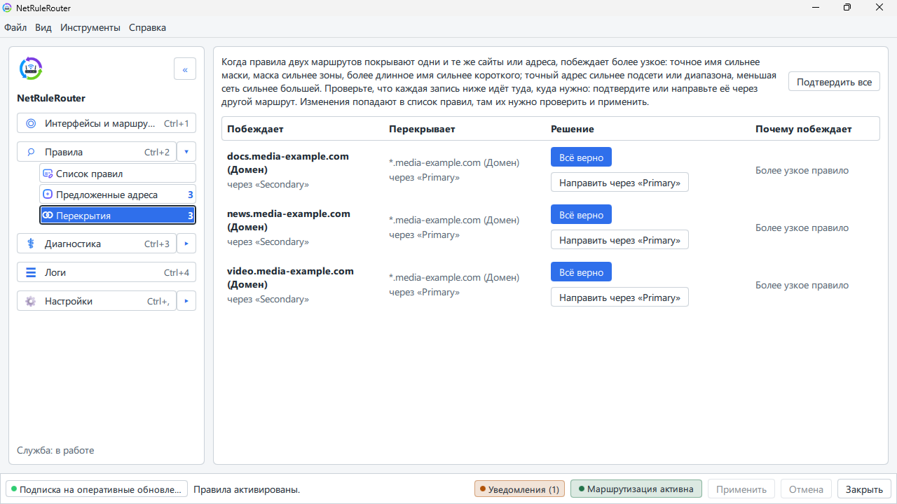

### Рабочие компьютеры по короткому имени

На работе компьютеры часто открывают по короткому имени, например `wiki` или
`timesheet`. При подключённом рабочем VPN такие имена продолжают работать:
VPN, который сообщает домен своей сети, подхватывается сам. Если ваш не
сообщает, укажите домен в Настройки → *Маршрутизация* → **Короткие имена**.

Голое короткое имя в предложениях не появляется: правило для одного `wiki`
захватило бы гораздо больше, чем одну машину. Если приложению известно полное
имя, например `wiki.corp.example`, предлагается оно.

### Если дополнительного подключения нет

VPN или второго канала может и не быть — тогда дополнительный
маршрут при настройке просто **не назначайте**. Правила, направляющие трафик
в дополнительный маршрут, в этом случае игнорируются, и весь трафик идёт как
обычно, через основной канал. Это ожидаемое поведение, а не ошибка: правила
остаются на месте и заработают, как только вы назначите дополнительный
маршрут (например, установите VPN).

Если же вы хотите, чтобы трафик из таких правил **не уходил в основной
канал, а блокировался**, выберите для защиты от утечки вариант **«Только
сайты из правил»** — но учтите предупреждение в начале этого документа: в
пре-альфе защита от утечки включается на ваш страх и риск.

Если VPN у вас всё-таки есть, укажите программе, какая это программа: её
клиент продолжит работать по основному каналу при включённой защите от утечки,
а не окажется отрезанным вместе со всем остальным.

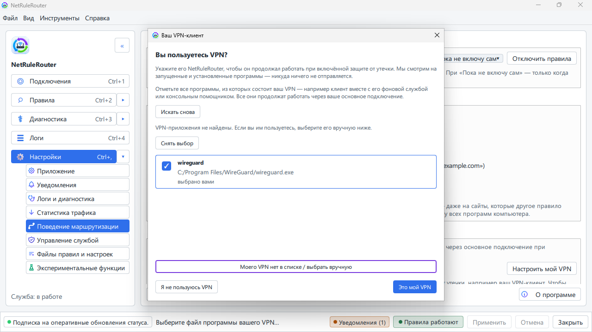

Второй VPN, которому разрешено подключаться только из одной сети, — например,
рабочий VPN, доступный только из-за рубежа, — настраивается чуть ниже, в блоке
**«Другие VPN (корпоративные)»**: он находит шлюз этого VPN и добавляет
правило, чтобы VPN всегда подключался через выбранный маршрут. Подробнее —
[VPN, который должен подключаться через другой
канал](vpn-detection.md#vpn-который-должен-подключаться-через-другой-канал-vpn-поверх-vpn).

### Готовые пресеты

В папке `presets/` лежат готовые наборы правил — в том числе разбивки
«домашний трафик / зарубежный» для ряда стран. Загрузить набор можно двумя
способами: рядом быстрой загрузки над таблицей правил (включается и
выключается в Настройки → *«Пресеты и настройки»* → *«Пресеты из набора»*)
или через Настройки → *«Пресеты и настройки»* → *«Импорт пресета основного /
дополнительного маршрута»*. В обоих случаях приложение сначала покажет, что
изменится, и только потом применит.

Импортируйте набор и адаптируйте под себя: пресеты — это стартовая точка,
а не истина в последней инстанции.

## Настройки и оформление

В разделе Настройки → *«Приложение»* собраны поведение программы (значок в
трее при входе в систему, сворачивание в трей), тема, специальные возможности
и язык интерфейса — русский или английский. В Настройки → *«Уведомления»*
решается, о чём может сообщать трей и какие уведомления скрыты и на сколько.

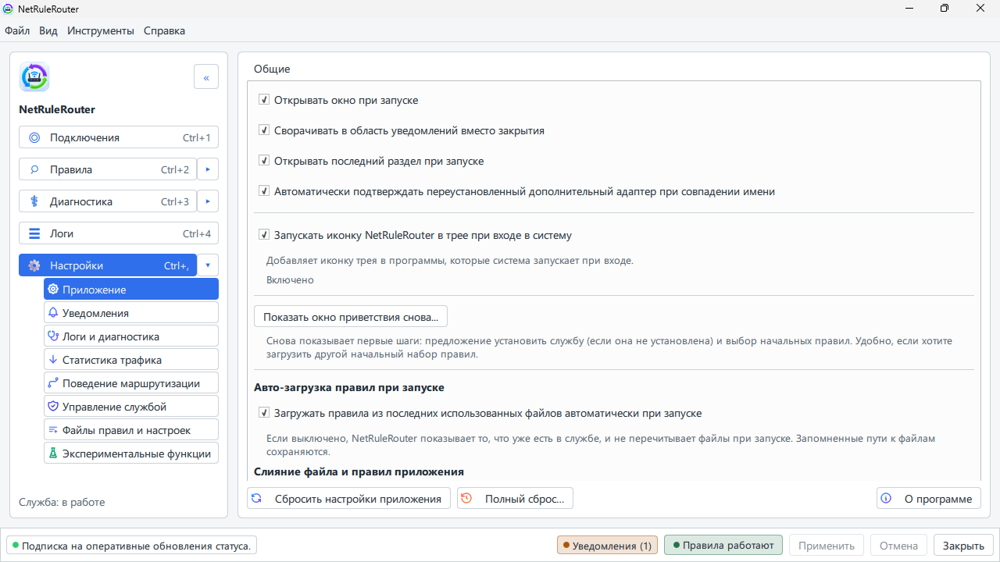

Тема следует системной или задаётся явно — светлая или тёмная; для
слабовидящих есть отдельная тема высокой контрастности. Размер текста, шрифт и
работа только с клавиатуры описаны в разделе [Доступность](accessibility.md).

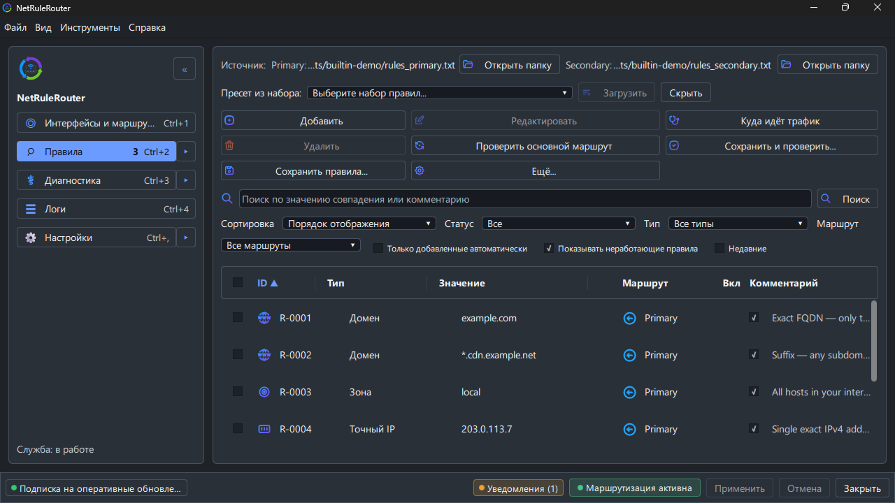

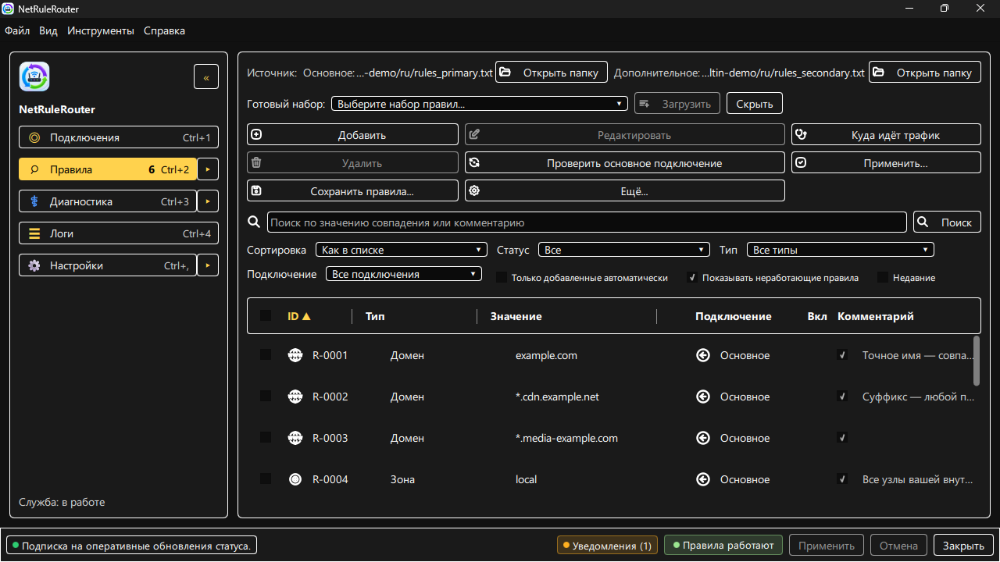

Настройки → *«Логи и диагностика»* определяют, сколько служба записывает и как
долго хранит: по умолчанию этого хватает на отчёт об ошибке и не забивает диск.

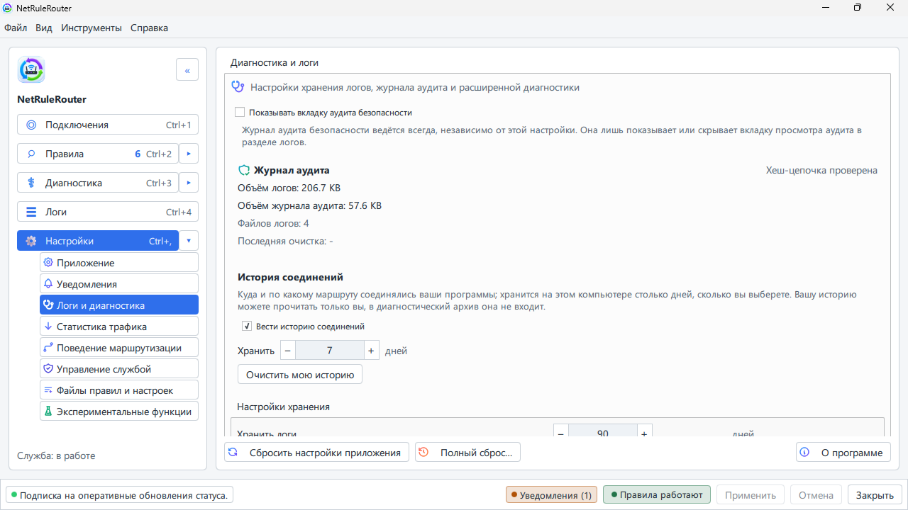

Настройки → *«Статистика трафика»* отвечают на вопрос, который всегда возникает
со вторым подключением: сколько в действительности ушло через него, а сколько —
обычным путём.

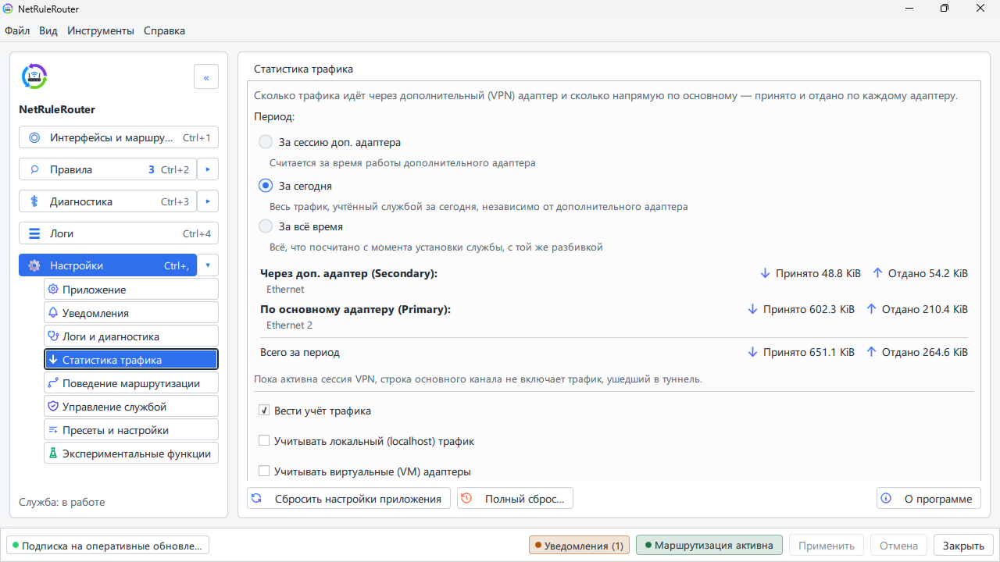

Большую часть времени окно у вас открыто не будет. Значок в трее говорит,
применяются ли ваши правила, а его меню держит самые нужные действия — включая
возможность на время выключить правила.


## Проверить, что работает

1. Добавьте правило для какого-нибудь сайта на дополнительный маршрут.
2. Примените изменения.
3. Откройте этот сайт и убедитесь, что он видит IP-адрес дополнительного
   подключения (например, через сервис определения IP).
4. В разделе «Диагностика» можно спросить у программы, *почему* конкретный
   хост ушёл в конкретный маршрут — она покажет сработавшее правило.

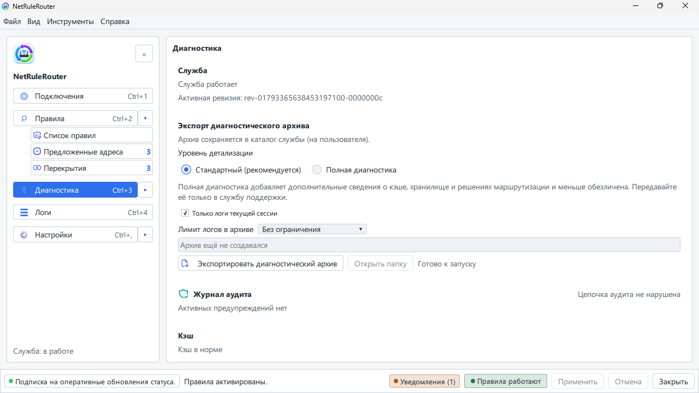

## Если что-то не работает

1. Проверьте, что служба запущена: **Настройки → «Управление службой»** —
   статус должен быть «Работает» (из терминала: `nrr-cli status`).

   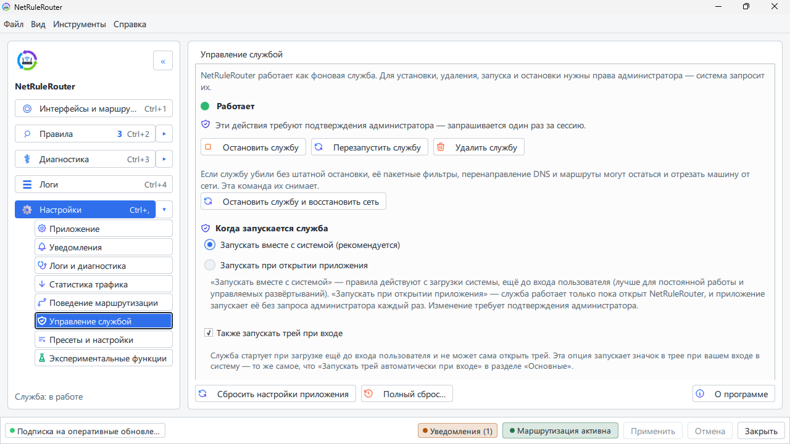

2. Загляните в раздел «Диагностика» — там видно применённые правила и ошибки.
   В разделе «Логи» записано, что делала служба, свежее сверху.

   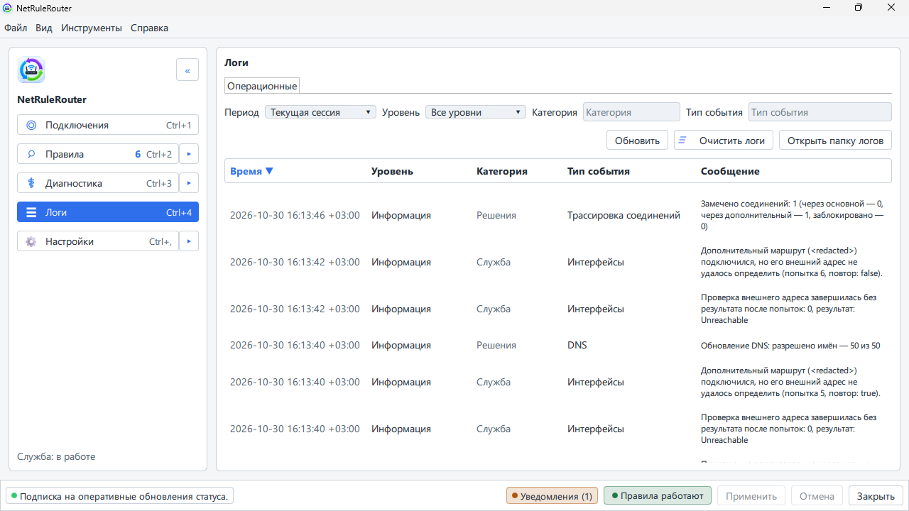

3. Спросите вердикт у консоли: `nrr-cli diag doctor` проверяет службу и её
   данные снаружи приложения и сообщает, что нашёл.
4. Не помогло — соберите диагностический архив: раздел «Диагностика» →
   «Экспорт диагностического архива» (или `nrr-cli diag export`) — и создайте
   [issue](https://github.com/kroxiksut/net-rule-router/issues) с приложенным
   архивом и описанием: что делали, что ожидали, что произошло.

## Пропал интернет? Как всё сбросить

Программа не вносит необратимых изменений в систему: все маршруты и
блокирующие фильтры, которые она создаёт, **временные** — они не переживают
перезагрузку. Если после экспериментов с правилами (особенно с защитой от утечки
в варианте «Всё») пропал доступ в сеть, действуйте по нарастающей:

1. **Переведите защиту от утечки в «Выключена»** в настройках
   приложения и примените изменения.
2. **Остановите службу** — Настройки → «Управление службой» → «Остановить
   службу». При остановке служба снимает свои маршруты и защиту, каждое
   соединение возвращается на основной канал. Соединение, открытое в этот
   момент, может один раз оборваться, потому что у него сменился путь;
   переподключение это исправляет, новые соединения работают сразу. В логе
   службы названы программы, у которых в момент остановки были открытые
   соединения. То же из терминала от имени администратора:

   ```powershell
   nrr-cli stop
   ```

   Останавливайте службу из приложения или через `nrr-cli`: остановку из
   консоли «Службы», `Stop-Service` или `sc.exe stop` служба считает сбоем
   и через несколько секунд запускается снова, чтобы защита не осталась
   выключенной случайно.

3. **Перезагрузите компьютер** — это гарантированный сброс: маршруты и
   фильтры программы не сохраняются между перезагрузками. Если служба
   настроена запускаться вместе с Windows и проблема воспроизводится —
   после перезагрузки остановите службу командой выше.

Посмотреть текущую таблицу маршрутов для диагностики можно командой
`route print -4` (или `Get-NetRoute -AddressFamily IPv4`).

## Обновление

После первого выпуска программа сообщает, что вышла новая версия, но сама
ничего не скачивает и не устанавливает: новую версию вы берёте со [страницы
выпусков](https://github.com/kroxiksut/net-rule-router/releases) сами.
Обновление сохраняет ваши правила, настройки, историю соединений и журнал
аудита. Наборы правил в папке программы заменяются наборами новой версии —
поэтому свой набор держите в своей папке.

- **Установлено через EXE или MSI.** Запустите установщик новой версии того же
  вида: EXE поверх EXE, MSI поверх MSI. Он остановит службу, заменит
  программу и снова запустит службу. Чтобы перейти с одного вида на другой,
  удалите первый в режиме по умолчанию — он сохраняет ваши данные — и
  установите второй.
- **Переносная копия.** Закройте окно и выберите **«Выход»** в меню трея,
  распакуйте новую версию в отдельную папку (или поверх старой) и запустите
  из неё `NetRuleRouter.exe`. Программа увидит, что служба старше или
  запускается из другой папки, и предложит **«Обновить службу из этой
  папки»** в Настройки → «Управление службой»; это попросит подтверждения
  администратора, и маршрутизация ненадолго прервётся. Из терминала,
  открытого от имени администратора в новой папке, то же делает
  `nrr-cli reinstall`.

Если обновление остановилось с ошибкой, проверьте, что NetRuleRouter
по-прежнему есть в Параметры → «Приложения» и что служба работает
(`nrr-cli status`). Если чего-то нет, запустите установщик новой версии ещё
раз.

## Удаление

1. Удалите службу: **Настройки → «Управление службой» → «Удалить службу»**
   (или из терминала администратора: `nrr-cli uninstall`; добавьте `--purge`,
   чтобы удалить и данные, которыми владеет служба). При удалении служба
   снимает установленные правила маршрутизации.
2. Закройте приложение и удалите папку программы.

---

Английская версия: [docs/en/quickstart.md](../en/quickstart.md).
