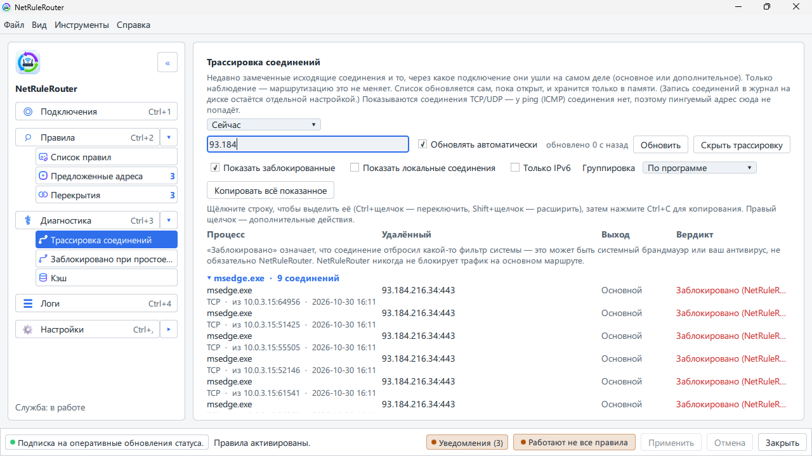

# Сайт не открывается или тормозит

[English](../en/site-does-not-open.md) · **Русский**

Эта страница поможет, если один сайт не открывается, грузится наполовину или
медленно. Пробуйте шаги по порядку.

## Шаг 1: пусть программа проверит сайт

1. Нажмите **Диагностика** в левой колонке и найдите **Проверить сайт**.
2. Введите сайт, например `example.com`, и нажмите **Проверить сайт**.
3. Прочитайте ответ. В нём названа вероятная причина и что делать:
   - **Сеть в порядке: сайт отвечает через ваш маршрут**. Если страница всё
     время перезагружается или вход ходит по кругу, удалите cookie этого сайта
     в браузере. Данных браузера программа не касается.
   - **Сайт не отвечает через свой маршрут**. Переходите к шагу 3.
   - **Маршрут, через который идёт сайт, не работает**. Подключение не работает; см.
     [Как выбрать основное и дополнительное подключение](connections.md).
   - **Ваше правило запрещает этот сайт.** Измените или удалите правило в
     разделе **Правила**.
   - **Проверить ничего не удалось**. Откройте сайт один раз в браузере и проверьте
     снова.

## Шаг 2: посмотрите, каким путём идёт сайт

1. В разделе **Правила** нажмите **Куда идёт трафик**. Откроются недавние
   соединения.
2. Найдите сайт. В колонке видно, через какое подключение он шёл: основное или
   дополнительное.
3. Нажмите на строку правой кнопкой и выберите **Почему такой маршрут?** —
   увидите, какое правило решило.

## Шаг 3: попробуйте другое подключение

1. В разделе **Правила** нажмите на правило сайта, затем **Редактировать**.
2. В списке **Подключение** выберите другое.
3. Нажмите **ОК**, **Применить**, **Применить**. Обновите страницу.

Правила для сайта ещё нет? [Добавьте его](adding-rules.md).

Страница ошибки в браузере («Сайт не может обеспечить безопасное соединение»),
пока VPN выключен, — это защита от утечки делает своё дело: [Страницы ошибок
браузера](blocked-site-browser-errors.md).

Чтобы увидеть такую задержанную попытку, откройте **Диагностика** →
**Трассировка соединений** и отметьте **Показать заблокированные**: строка
будет с пометкой **Заблокировано (NetRuleRouter)**.

## Шаг 4: поставьте всё на паузу

Чтобы понять, виновата ли вообще программа: значок в трее, **Отключить
правила…**, затем **Через 15 минут**. Если сайт теперь работает, причина —
правило или защита от утечки. Если по-прежнему нет, причина в другом: в сайте,
у провайдера или в самом VPN. См.
[Пауза правил и защита от утечки](pause-and-protection.md).

## Сайт открывается, но медленно

Программа только выбирает подключение. Ваш трафик она не несёт. Если сайт
медленный через VPN и быстрый через основное подключение, значит, VPN медленно
работает с этим сайтом. Отправьте сайт через основное подключение (шаг 3) или
попробуйте другой сервер в вашей VPN-программе.

## Шаг 5: интернета нет совсем

Нажмите **Настройки** → **Управление службой** → **Восстановить сеть**. Это
уберёт всё, что программа настроила. Другие способы, в том числе из терминала:
[Восстановление доступа к сети](recovering-network-access.md).

## Всё ещё не получается?

Нажмите **Диагностика** → **Экспорт диагностического архива** и напишите в
Telegram-канал [t.me/netrulerouter](https://t.me/netrulerouter) или заведите
обращение (issue). В [Быстром старте](quickstart.md) написано, что приложить.

## См. также

- [Страницы ошибок браузера при блокировке сайта](blocked-site-browser-errors.md)
- [Восстановление доступа к сети](recovering-network-access.md)
- [Известные ограничения](known-limitations.md)
- [Соседство с другим ПО](other-software.md)
